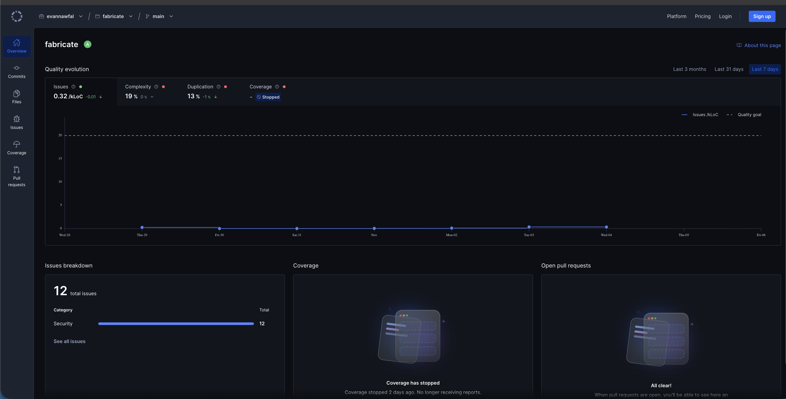
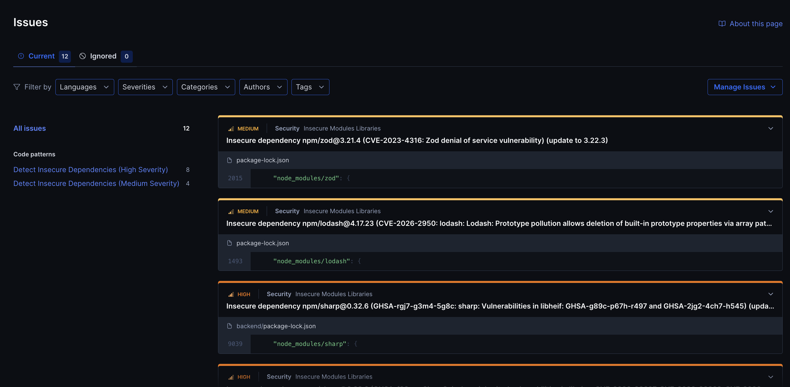

# Code Review

## 1. Change History

| **Change Date**   | **Modified Sections** | **Rationale** |
| ----------------- | --------------------- | ------------- |
| Nov 4, 2026 | 2 | Complete section 2 for CP2 |

---

## 2. Automated Code Review Results

### 2.1. Commit Hash Where Codacy Ran

`194c9c796fe364dd33b599a3ce8849778b67a989`

### 2.2. Unfixed Issues per Codacy Category

### 2.3. Unfixed Issues per Codacy Code Pattern

### 2.4. Justifications for Unfixed Issues

All 12 unfixed issues are Trivy reports of known vulnerabilities in three packages that [`@imgly/background-removal-node`](https://github.com/evannawfal/fabricate/blob/194c9c796fe364dd33b599a3ce8849778b67a989/backend/package.json#L24) 1.4.5 depends on: sharp 0.32.6, lodash 4.17.23 and zod 3.21.4. We use it to remove the background from a clothing item's front photo before building the item's 3D model ([`processGarment.ts`](https://github.com/evannawfal/fabricate/blob/194c9c796fe364dd33b599a3ce8849778b67a989/backend/src/garment/imgToGlb/processGarment.ts#L5)). Version 1.4.5 is its latest release, and it pins these versions (`sharp ~0.32.4`, `lodash ~4.17.21`, `zod ~3.21.4`), so they can only be upgraded by forcing newer versions underneath it. We kept the pinned versions because newer sharp releases don't support one team member's older development machine, and every team member needs to run the back-end locally.

Each advisory is reported twice: once in `backend/package-lock.json`, and once in the `package-lock.json` at the repository root, which lists the same package. The server only installs from `backend/` (CI, the Dockerfile and the deploy script all run `npm ci` there), so the root copies never run on the server.

- **Code Pattern: [Detect Insecure Dependencies (High Severity)](https://app.codacy.com/gh/evannawfal/fabricate/issues)**

  1. **sharp 0.32.6: libvips vulnerabilities (GHSA-f88m-g3jw-g9cj)**

     - **Location in Git:** [`backend/package-lock.json#L9039`](https://github.com/evannawfal/fabricate/blob/194c9c796fe364dd33b599a3ce8849778b67a989/backend/package-lock.json#L9039)
     - **Justification:** sharp only decodes photos that were already accepted at upload: JPEG, PNG or WebP files of at most 5 MB ([`clothing.ts`](https://github.com/evannawfal/fabricate/blob/194c9c796fe364dd33b599a3ce8849778b67a989/backend/src/controllers/clothing.ts#L16)), which Claude must also be able to read as that type, or the upload is rejected with 400 and nothing is stored ([`classifier.ts`](https://github.com/evannawfal/fabricate/blob/194c9c796fe364dd33b599a3ce8849778b67a989/backend/src/services/classifier.ts#L182)). The advisory's workaround is to block sharp's GIF, TIFF and VIPS decoders, and those formats never reach sharp.

  2. **sharp 0.32.6: libvips vulnerabilities (GHSA-f88m-g3jw-g9cj)**

     - **Location in Git:** [`package-lock.json#L999`](https://github.com/evannawfal/fabricate/blob/194c9c796fe364dd33b599a3ce8849778b67a989/package-lock.json#L999)
     - **Justification:** Same advisory as issue 1, in the root lock file, which the server never installs.

  3. **sharp 0.32.6: librsvg vulnerability (GHSA-wq5f-xc86-pv6w)**

     - **Location in Git:** [`backend/package-lock.json#L9039`](https://github.com/evannawfal/fabricate/blob/194c9c796fe364dd33b599a3ce8849778b67a989/backend/package-lock.json#L9039)
     - **Justification:** The vulnerability is in sharp's SVG decoder. SVG files can't be uploaded or stored (see issue 1), so they never reach sharp.

  4. **sharp 0.32.6: librsvg vulnerability (GHSA-wq5f-xc86-pv6w)**

     - **Location in Git:** [`package-lock.json#L999`](https://github.com/evannawfal/fabricate/blob/194c9c796fe364dd33b599a3ce8849778b67a989/package-lock.json#L999)
     - **Justification:** Same advisory as issue 3, in the root lock file, which the server never installs.

  5. **sharp 0.32.6: libheif vulnerabilities (GHSA-rgj7-g3m4-5g8c)**

     - **Location in Git:** [`backend/package-lock.json#L9039`](https://github.com/evannawfal/fabricate/blob/194c9c796fe364dd33b599a3ce8849778b67a989/backend/package-lock.json#L9039)
     - **Justification:** The vulnerabilities are in sharp's HEIF and AVIF decoder. Those formats can't be uploaded or stored (see issue 1), so they never reach sharp.

  6. **sharp 0.32.6: libheif vulnerabilities (GHSA-rgj7-g3m4-5g8c)**

     - **Location in Git:** [`package-lock.json#L999`](https://github.com/evannawfal/fabricate/blob/194c9c796fe364dd33b599a3ce8849778b67a989/package-lock.json#L999)
     - **Justification:** Same advisory as issue 5, in the root lock file, which the server never installs.

  7. **lodash 4.17.23: code injection through `_.template` (CVE-2026-4800)**

     - **Location in Git:** [`backend/package-lock.json#L7377`](https://github.com/evannawfal/fabricate/blob/194c9c796fe364dd33b599a3ce8849778b67a989/backend/package-lock.json#L7377)
     - **Justification:** Only `_.template` called with untrusted `imports` key names is affected. `@imgly/background-removal-node` only uses lodash's `memoize`, and our own code doesn't use lodash.

  8. **lodash 4.17.23: code injection through `_.template` (CVE-2026-4800)**

     - **Location in Git:** [`package-lock.json#L1493`](https://github.com/evannawfal/fabricate/blob/194c9c796fe364dd33b599a3ce8849778b67a989/package-lock.json#L1493)
     - **Justification:** Same advisory as issue 7, in the root lock file, which the server never installs.

- **Code Pattern: [Detect Insecure Dependencies (Medium Severity)](https://app.codacy.com/gh/evannawfal/fabricate/issues)**

  1. **lodash 4.17.23: prototype pollution through `_.unset` and `_.omit` (CVE-2026-2950)**

     - **Location in Git:** [`backend/package-lock.json#L7377`](https://github.com/evannawfal/fabricate/blob/194c9c796fe364dd33b599a3ce8849778b67a989/backend/package-lock.json#L7377)
     - **Justification:** Only `_.unset`, `_.omit` and `_.pullAt` called with untrusted paths are affected. `@imgly/background-removal-node` only uses lodash's `memoize`, and our own code doesn't use lodash.

  2. **lodash 4.17.23: prototype pollution through `_.unset` and `_.omit` (CVE-2026-2950)**

     - **Location in Git:** [`package-lock.json#L1493`](https://github.com/evannawfal/fabricate/blob/194c9c796fe364dd33b599a3ce8849778b67a989/package-lock.json#L1493)
     - **Justification:** Same advisory as issue 1 of this pattern, in the root lock file, which the server never installs.

  3. **zod 3.21.4: slow regular expression in email validation (CVE-2023-4316)**

     - **Location in Git:** [`backend/package-lock.json#L1489`](https://github.com/evannawfal/fabricate/blob/194c9c796fe364dd33b599a3ce8849778b67a989/backend/package-lock.json#L1489)
     - **Justification:** Only `z.string().email()` is affected. `@imgly/background-removal-node` uses zod only to check its own options, which our code sets ([`processGarment.ts`](https://github.com/evannawfal/fabricate/blob/194c9c796fe364dd33b599a3ce8849778b67a989/backend/src/garment/imgToGlb/processGarment.ts#L29)), and it never validates an email. Our own code doesn't use zod.

  4. **zod 3.21.4: slow regular expression in email validation (CVE-2023-4316)**

     - **Location in Git:** [`package-lock.json#L2015`](https://github.com/evannawfal/fabricate/blob/194c9c796fe364dd33b599a3ce8849778b67a989/package-lock.json#L2015)
     - **Justification:** Same advisory as issue 3 of this pattern, in the root lock file, which the server never installs.

---

## 3. Manual Code Review Results

### 3.1. Review You Performed

- **Peer group reviewed:** [WRITE_HERE]
- **Commit SHA reviewed:** `[Insert Commit SHA here]`
- **Date the artifacts were exchanged:** [WRITE_HERE]
- **Review report submitted:** [`<CP#>_<YourPeerGroupName>_Review.pdf`](#)

| **Section**          | **Item**                                                                                                                                             | **Score** |
| -------------------- | ---------------------------------------------------------------------------------------------------------------------------------------------------- | --------- |
| Manual code review   | Code is maintainable (well-documented, uses self-explanatory variable names, does not have complicated and long methods, magic numbers, etc.), efficient, handles error cases well | x/10      |
| Manual test review   | Tests are complete (all APIs exposed to the front-end are tested, three main features are tested), errors and edge cases are thoroughly tested, correct assertions are used | x/10      |
| Manual test review   | Test code is maintainable and well-structured                                                                                                          | x/10      |
| Manual test review   | Test implementation matches the requirements and design                                                                                                | x/10      |
| Manual test review   | Non-functional requirements are tested well                                                                                                            | x/10      |
| Manual test review   | Tests achieve high coverage and cases of < 100% coverage are well-justified                                                                            | x/10      |
| Manual test review   | All back-end tests can be run automatically                                                                                                            | x/10      |
| Automated code review| Codacy runs with the required setup                                                                                                                    | x/10      |
| Automated code review| All remaining Codacy issues are well-justified                                                                                                          | x/10      |

**Major fault reported**

- **Description:** ...
- **Steps to reproduce:** ...
- **Screenshots:** _(Placeholder for screenshots of the reported fault)_
- **Severity:** ...

### 3.2. Review You Received

- **Reviewing group:** [WRITE_HERE]
- **Commit SHA that was reviewed:** `[Insert Commit SHA here]`
- **Review report received:** [`<CP#>_<YourGroupName>_Review.pdf`](#)

| **Section**          | **Item**                                                                                                                                             | **Score** |
| -------------------- | ---------------------------------------------------------------------------------------------------------------------------------------------------- | --------- |
| Manual code review   | Code is maintainable, efficient, handles error cases well                                                                                               | x/10      |
| Manual test review   | Tests are complete, errors and edge cases are thoroughly tested, correct assertions are used                                                            | x/10      |
| Manual test review   | Test code is maintainable and well-structured                                                                                                          | x/10      |
| Manual test review   | Test implementation matches the requirements and design                                                                                                | x/10      |
| Manual test review   | Non-functional requirements are tested well                                                                                                            | x/10      |
| Manual test review   | Tests achieve high coverage and cases of < 100% coverage are well-justified                                                                            | x/10      |
| Manual test review   | All back-end tests can be run automatically                                                                                                            | x/10      |
| Automated code review| Codacy runs with the required setup                                                                                                                    | x/10      |
| Automated code review| All remaining Codacy issues are well-justified                                                                                                          | x/10      |

**Major fault reported against your project**

- **Description:** ...
- **Severity:** ...

### 3.3. Actions Taken in Response to the Review

| **Finding** | **Action Taken** | **Commit / Location in Git** |
| ----------- | ---------------- | ---------------------------- |
| ...         | ...              | [`src/...`](#)               |
| ...         | ...              | ...                          |

- **Findings not acted on.** For each finding you decided not to address, give the reason:
  1. **Finding:** ...
     - **Justification:** ...
