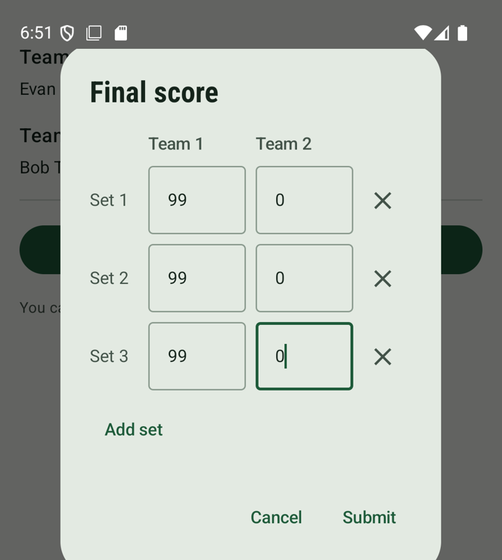
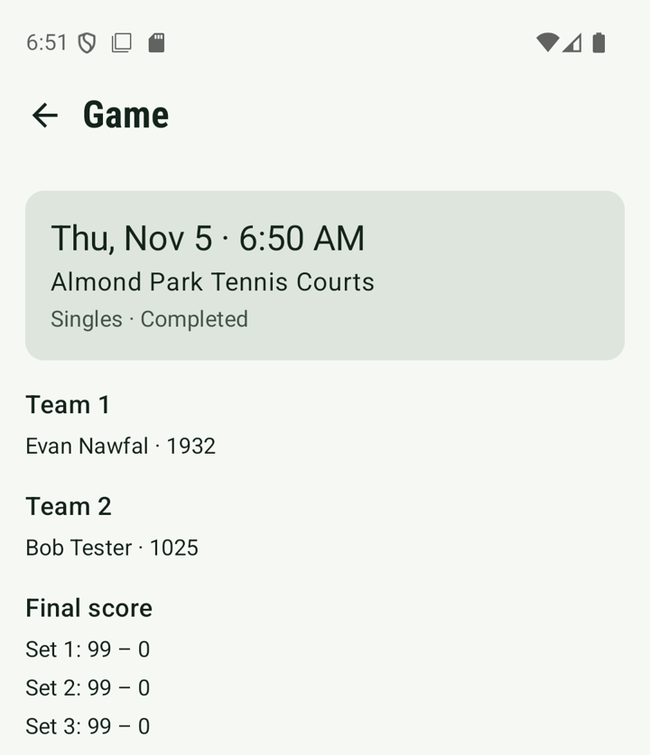
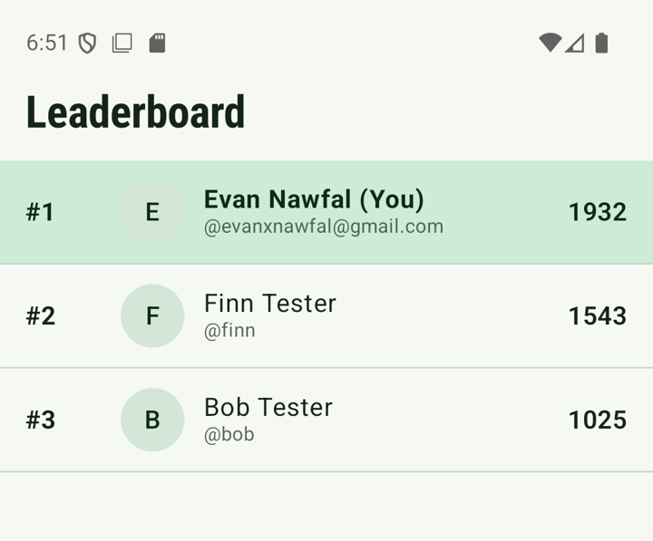
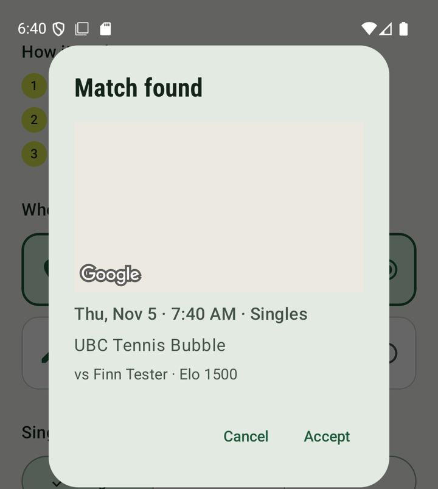
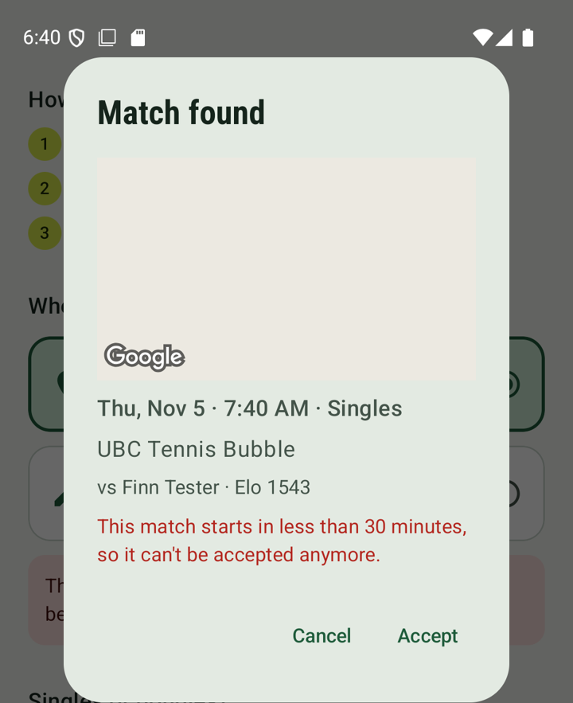
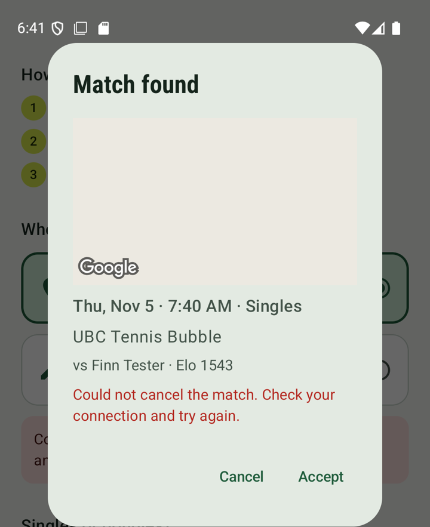
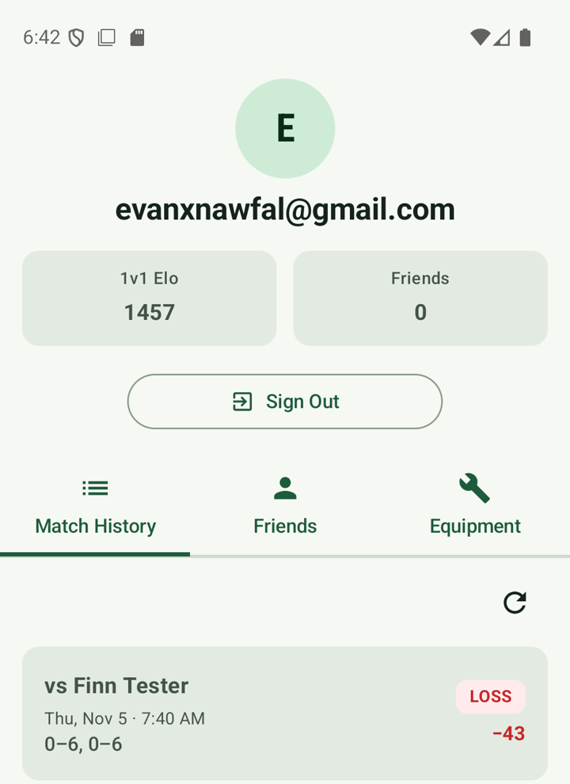

# Code Review

## 1. Change History

| **Change Date**   | **Modified Sections** | **Rationale** |
| ----------------- | --------------------- | ------------- |
| Nov 4, 2026 | 2 | Complete section 2 for CP2 |
| Nov 9, 2026 | 3.1 | Record the review we performed of Donut's project for CP3 |
| Nov 18, 2026 | 3.2, 3.3 | Record TimeTravel's review of our project for CP3, and the actions we took or planned in response |
| Nov 19, 2026 | 2 | Updated section 2 to Codacy's latest analysis of `main` (`7a3a6f9`): the same 12 Trivy issues, with their new lock file lines, and 4 new detekt LongMethod issues, which a separate pull request fixes. The category and pattern counts are copied from Codacy as tables. |
| Nov 19, 2026 | 2, 3.3 | Section 2 uses Codacy's latest analysis of `main` (`59a67c0`): the 4 LongMethod issues were fixed in #173, leaving the same 12 Trivy issues on the same lines. Section 3.3 records the review findings we have since acted on, and the planned work we decided against. |

---

## 2. Automated Code Review Results

### 2.1. Commit Hash Where Codacy Ran

[`59a67c02d60963763b223cdd0defdeb940c19b97`](https://github.com/evannawfal/fabricate/commit/59a67c02d60963763b223cdd0defdeb940c19b97), the latest commit on `main` that Codacy analysed (Nov 19, 2026).

### 2.2. Unfixed Issues per Codacy Category

Copied from the "Issues breakdown" table on Codacy's Overview page:

| **Category** | **Issues** |
| ------------ | ---------- |
| Security | 12 |
| Best Practice, Code Complexity, Code Style, Comprehensibility, Compatibility, Documentation, Error Prone, Performance, Unused Code | 0 |
| **Total** | **12** |

### 2.3. Unfixed Issues per Codacy Code Pattern

Copied from Codacy's Issues page:

| **Code Pattern** | **Tool** | **Issues** |
| ---------------- | -------- | ---------- |
| Detect Insecure Dependencies (High Severity) | Trivy | 8 |
| Detect Insecure Dependencies (Medium Severity) | Trivy | 4 |

The 4 detekt LongMethod issues from the previous analysis (`HomeDestination` in `AppNavHost.kt`, `ProfileScreen`, `MainScreen` and `AvatarScreen`) were fixed in [#173](https://github.com/evannawfal/fabricate/pull/173), which splits each into smaller Composables. The 12 Trivy issues are justified below.

### 2.4. Justifications for Unfixed Issues

All 12 unfixed issues are Trivy reports of known vulnerabilities in three packages that [`@imgly/background-removal-node`](https://github.com/evannawfal/fabricate/blob/59a67c02d60963763b223cdd0defdeb940c19b97/backend/package.json#L25) 1.4.5 depends on: sharp 0.32.6, lodash 4.17.23 and zod 3.21.4. We use it to remove the background from a clothing item's front photo before building the item's 3D model ([`processGarment.ts`](https://github.com/evannawfal/fabricate/blob/59a67c02d60963763b223cdd0defdeb940c19b97/backend/src/garment/imgToGlb/processGarment.ts#L3)). Version 1.4.5 is its latest release, and it pins these versions (`sharp ~0.32.4`, `lodash ~4.17.21`, `zod ~3.21.4`), so they can only be upgraded by forcing newer versions underneath it. We kept the pinned versions because newer sharp releases don't support one team member's older development machine, and every team member needs to run the back-end locally.

Each advisory is reported twice: once in `backend/package-lock.json`, and once in the `package-lock.json` at the repository root, which lists the same package. The server only installs from `backend/` (CI, the Dockerfile and the deploy script all run `npm ci` there), so the root copies never run on the server.

- **Code Pattern: [Detect Insecure Dependencies (High Severity)](https://app.codacy.com/gh/evannawfal/fabricate/issues)**

  1. **sharp 0.32.6: libvips vulnerabilities (GHSA-f88m-g3jw-g9cj)**

     - **Location in Git:** [`backend/package-lock.json#L9746`](https://github.com/evannawfal/fabricate/blob/59a67c02d60963763b223cdd0defdeb940c19b97/backend/package-lock.json#L9746)
     - **Justification:** sharp only decodes photos that were already accepted at upload: JPEG, PNG or WebP files of at most 5 MB ([`routes/clothing.ts`](https://github.com/evannawfal/fabricate/blob/59a67c02d60963763b223cdd0defdeb940c19b97/backend/src/routes/clothing.ts#L19), [`classifier.ts`](https://github.com/evannawfal/fabricate/blob/59a67c02d60963763b223cdd0defdeb940c19b97/backend/src/services/classifier.ts#L98)), which Claude must also be able to read as that type, or the upload is rejected with 400 and nothing is stored ([`classifier.ts`](https://github.com/evannawfal/fabricate/blob/59a67c02d60963763b223cdd0defdeb940c19b97/backend/src/services/classifier.ts#L182)). The advisory's workaround is to block sharp's GIF, TIFF and VIPS decoders, and those formats never reach sharp.

  2. **sharp 0.32.6: libvips vulnerabilities (GHSA-f88m-g3jw-g9cj)**

     - **Location in Git:** [`package-lock.json#L999`](https://github.com/evannawfal/fabricate/blob/59a67c02d60963763b223cdd0defdeb940c19b97/package-lock.json#L999)
     - **Justification:** Same advisory as issue 1, in the root lock file, which the server never installs.

  3. **sharp 0.32.6: librsvg vulnerability (GHSA-wq5f-xc86-pv6w)**

     - **Location in Git:** [`backend/package-lock.json#L9746`](https://github.com/evannawfal/fabricate/blob/59a67c02d60963763b223cdd0defdeb940c19b97/backend/package-lock.json#L9746)
     - **Justification:** The vulnerability is in sharp's SVG decoder. SVG files can't be uploaded or stored (see issue 1), so they never reach sharp.

  4. **sharp 0.32.6: librsvg vulnerability (GHSA-wq5f-xc86-pv6w)**

     - **Location in Git:** [`package-lock.json#L999`](https://github.com/evannawfal/fabricate/blob/59a67c02d60963763b223cdd0defdeb940c19b97/package-lock.json#L999)
     - **Justification:** Same advisory as issue 3, in the root lock file, which the server never installs.

  5. **sharp 0.32.6: libheif vulnerabilities (GHSA-rgj7-g3m4-5g8c)**

     - **Location in Git:** [`backend/package-lock.json#L9746`](https://github.com/evannawfal/fabricate/blob/59a67c02d60963763b223cdd0defdeb940c19b97/backend/package-lock.json#L9746)
     - **Justification:** The vulnerabilities are in sharp's HEIF and AVIF decoder. Those formats can't be uploaded or stored (see issue 1), so they never reach sharp.

  6. **sharp 0.32.6: libheif vulnerabilities (GHSA-rgj7-g3m4-5g8c)**

     - **Location in Git:** [`package-lock.json#L999`](https://github.com/evannawfal/fabricate/blob/59a67c02d60963763b223cdd0defdeb940c19b97/package-lock.json#L999)
     - **Justification:** Same advisory as issue 5, in the root lock file, which the server never installs.

  7. **lodash 4.17.23: code injection through `_.template` (CVE-2026-4800)**

     - **Location in Git:** [`backend/package-lock.json#L7980`](https://github.com/evannawfal/fabricate/blob/59a67c02d60963763b223cdd0defdeb940c19b97/backend/package-lock.json#L7980)
     - **Justification:** Only `_.template` called with untrusted `imports` key names is affected. `@imgly/background-removal-node` only uses lodash's `memoize`, and our own code doesn't use lodash.

  8. **lodash 4.17.23: code injection through `_.template` (CVE-2026-4800)**

     - **Location in Git:** [`package-lock.json#L1493`](https://github.com/evannawfal/fabricate/blob/59a67c02d60963763b223cdd0defdeb940c19b97/package-lock.json#L1493)
     - **Justification:** Same advisory as issue 7, in the root lock file, which the server never installs.

- **Code Pattern: [Detect Insecure Dependencies (Medium Severity)](https://app.codacy.com/gh/evannawfal/fabricate/issues)**

  1. **lodash 4.17.23: prototype pollution through `_.unset` and `_.omit` (CVE-2026-2950)**

     - **Location in Git:** [`backend/package-lock.json#L7980`](https://github.com/evannawfal/fabricate/blob/59a67c02d60963763b223cdd0defdeb940c19b97/backend/package-lock.json#L7980)
     - **Justification:** Only `_.unset`, `_.omit` and `_.pullAt` called with untrusted paths are affected. `@imgly/background-removal-node` only uses lodash's `memoize`, and our own code doesn't use lodash.

  2. **lodash 4.17.23: prototype pollution through `_.unset` and `_.omit` (CVE-2026-2950)**

     - **Location in Git:** [`package-lock.json#L1493`](https://github.com/evannawfal/fabricate/blob/59a67c02d60963763b223cdd0defdeb940c19b97/package-lock.json#L1493)
     - **Justification:** Same advisory as issue 1 of this pattern, in the root lock file, which the server never installs.

  3. **zod 3.21.4: slow regular expression in email validation (CVE-2023-4316)**

     - **Location in Git:** [`backend/package-lock.json#L2075`](https://github.com/evannawfal/fabricate/blob/59a67c02d60963763b223cdd0defdeb940c19b97/backend/package-lock.json#L2075)
     - **Justification:** Only `z.string().email()` is affected. `@imgly/background-removal-node` uses zod only to check its own options, which our code sets ([`processGarment.ts`](https://github.com/evannawfal/fabricate/blob/59a67c02d60963763b223cdd0defdeb940c19b97/backend/src/garment/imgToGlb/processGarment.ts#L35)), and it never validates an email. Our own code doesn't use zod.

  4. **zod 3.21.4: slow regular expression in email validation (CVE-2023-4316)**

     - **Location in Git:** [`package-lock.json#L2015`](https://github.com/evannawfal/fabricate/blob/59a67c02d60963763b223cdd0defdeb940c19b97/package-lock.json#L2015)
     - **Justification:** Same advisory as issue 3 of this pattern, in the root lock file, which the server never installs.

---

## 3. Manual Code Review Results

### 3.1. Review You Performed

- **Peer group reviewed:** Donut ([`donut-cpen321/donut`](https://github.com/donut-cpen321/donut))
- **Commit SHA reviewed:** [`0ab1a7c34a4bd2c580b44b444c305310fdd5bb88`](https://github.com/donut-cpen321/donut/commit/0ab1a7c34a4bd2c580b44b444c305310fdd5bb88)
- **Date the artifacts were exchanged:** Nov 9, 2026
- **Review report submitted:** [`CP3_Donut_Review.pdf`](reviews/CP3_Donut_Review.pdf)

| **Section**          | **Item**                                                                                                                                             | **Score** |
| -------------------- | ---------------------------------------------------------------------------------------------------------------------------------------------------- | --------- |
| Manual code review   | Code is maintainable (well-documented, uses self-explanatory variable names, does not have complicated and long methods, magic numbers, etc.), efficient, handles error cases well | 8/10      |
| Manual test review   | Tests are complete (all APIs exposed to the front-end are tested, three main features are tested), errors and edge cases are thoroughly tested, correct assertions are used | 9/10      |
| Manual test review   | Test code is maintainable and well-structured                                                                                                          | 8/10      |
| Manual test review   | Test implementation matches the requirements and design                                                                                                | 8/10      |
| Manual test review   | Non-functional requirements are tested well                                                                                                            | 3/10      |
| Manual test review   | Tests achieve high coverage and cases of < 100% coverage are well-justified                                                                            | 7/10      |
| Manual test review   | All back-end tests can be run automatically                                                                                                            | 10/10     |
| Automated code review| Codacy runs with the required setup                                                                                                                    | 10/10     |
| Automated code review| All remaining Codacy issues are well-justified                                                                                                          | 10/10     |

**Major fault reported**

- **Description:** One player can set any opponent's ELO rating, through three gaps in how game scores are handled:
  1. **No limit on margin of victory.** The rating update adds 1.5 points per game of margin, summed over all sets, with no cap ([`elo.ts#L102-L105`](https://github.com/donut-cpen321/donut/blob/0ab1a7c34a4bd2c580b44b444c305310fdd5bb88/backend/src/ranking/elo.ts#L102-L105)). The win/loss term is at most 50, so the margin dominates.
  2. **No tennis score validation.** Any non-negative number of games per set and any number of sets are accepted ([`games.schemas.ts#L12`](https://github.com/donut-cpen321/donut/blob/0ab1a7c34a4bd2c580b44b444c305310fdd5bb88/backend/src/games/games.schemas.ts#L12)), and the app allows up to 99 per set.
  3. **One unconfirmed report is final, at any time.** `checkCanEditGame` ([`games.service.ts#L369`](https://github.com/donut-cpen321/donut/blob/0ab1a7c34a4bd2c580b44b444c305310fdd5bb88/backend/src/games/games.service.ts#L369)) only rejects completed or cancelled games, so a score is accepted for a matched game that nobody accepted, before it starts. Afterwards the game can't be accepted, cancelled or re-reported (409), so the change is permanent.
- **Steps to reproduce:** In Donut's own app, built from commit `0ab1a7c` with no code changes. `local.properties` only points it at a local server running the same commit, so no real user's rating was changed. One tester plays as Evan in the app; Bob and Finn are test players acting through the API, exactly as the app would call it.
  - **A. An impossible score is accepted and moves both ratings by 475:**
    1. Evan (1457) schedules a singles game, and Bob (1500) joins team 2, so the game is booked.
    2. After the start time, Evan taps **Report final score**, enters 99–0, 99–0, 99–0 and submits. The app and the server accept it.
    3. Evan's rating goes to 1932 (+475) and Bob's to 1025 (−475). Evan is now first on the leaderboard.
  - **B. A player loses rating on a match they never accepted, and can't undo it:**
    1. Evan and Finn (both 1500) queue for singles. At 6:40, matchmaking proposes a game at 7:40, and nobody has accepted it.
    2. Finn immediately reports 6–0, 6–0 (`POST /games/score`). The server returns 200 and the game is completed.
    3. In the app, Evan's **Accept** fails with the wrong reason ("starts in less than 30 minutes", at 6:40 for a 7:40 game), and **Cancel** fails too.
    4. At 6:42, Evan's match history shows a loss, −43 (1500 → 1457), for a 7:40 match that was never accepted or played.
- **Screenshots:**
  - **A.** Left to right: the score form accepts 99–0 sets (step 2); the game is completed with ratings of 1932 and 1025 (step 3); the leaderboard (step 3).

      

  - **B.** Left to right: at 6:40 a match is proposed for 7:40 (step 1); Accept is refused (step 3); Cancel is refused (step 3); at 6:42 the match history shows a loss of −43 (step 4).

       

- **Severity:** High. It breaks the ELO ranking and the leaderboard, two core features, and matchmaking uses the bad ratings to pick opponents.

### 3.2. Review You Received

- **Reviewing group:** TimeTravel (Noah Ndambuki, Abhi Verma, Nikhil Sinclair, Ansh Gandhi)
- **Commit SHA that was reviewed:** [`806591443242123301b911c90ae8b78649186610`](https://github.com/evannawfal/fabricate/commit/806591443242123301b911c90ae8b78649186610)
- **Date the artifacts were exchanged:** Nov 4, 2026
- **Review report received:** [`CP3_Fabricate_Review.pdf`](reviews/CP3_Fabricate_Review.pdf)

| **Section**          | **Item**                                                                                                                                             | **Score** |
| -------------------- | ---------------------------------------------------------------------------------------------------------------------------------------------------- | --------- |
| Manual code review   | Code is maintainable, efficient, handles error cases well                                                                                               | 7/10      |
| Manual test review   | Tests are complete, errors and edge cases are thoroughly tested, correct assertions are used                                                            | 8/10      |
| Manual test review   | Test code is maintainable and well-structured                                                                                                          | 8/10      |
| Manual test review   | Test implementation matches the requirements and design                                                                                                | 6/10      |
| Manual test review   | Non-functional requirements are tested well                                                                                                            | 5/10      |
| Manual test review   | Tests achieve high coverage and cases of < 100% coverage are well-justified                                                                            | 8/10      |
| Manual test review   | All back-end tests can be run automatically                                                                                                            | 9/10      |
| Automated code review| Codacy runs with the required setup                                                                                                                    | 9/10      |
| Automated code review| All remaining Codacy issues are well-justified                                                                                                          | 6/10      |

**Major fault reported against your project**

- **Description:** Friends and rooms need no consent, and removing a friend keeps their room access. `POST /friends` adds any registered email as a friend with no accept step and returns that user's name ([`friends.ts#L21-L39`](https://github.com/evannawfal/fabricate/blob/806591443242123301b911c90ae8b78649186610/backend/src/controllers/friends.ts#L21-L39)). That friend can then be added to a room, which they can't leave. After either user removes the other with `DELETE /friends`, both can still read the room, post in it and get signed links to each other's clothing photos, because room access only checks membership ([`rooms.ts#L50-L57`](https://github.com/evannawfal/fabricate/blob/806591443242123301b911c90ae8b78649186610/backend/src/sockets/rooms.ts#L50-L57)).
- **Severity:** High. Anyone who knows a user's email can learn their name, pull them into a room they can't leave, and keep access to their photos after being removed.

### 3.3. Actions Taken in Response to the Review

| **Finding** | **Action Taken** | **Commit / Location in Git** |
| ----------- | ---------------- | ---------------------------- |
| 2.4: The 10-second upload requirement has no test. | Added a test that runs in the app against the deployed back-end and its real classifier, timing 5 uploads each of photos of about 0.5, 2 and 5 MB. The slowest took 4.5 seconds. | [`ClothingUploadTimeTest.kt`](https://github.com/evannawfal/fabricate/pull/152) |
| 5.2.3: The try-on slider overlaps the Height slider. | Split the avatar screen's controls into Clothes and Measurements tabs, so the try-on controls and the measurement sliders are no longer on the same screen. | [`e155f10`](https://github.com/evannawfal/fabricate/commit/e155f10) |
| Major fault: friends need no consent: `POST /friends` adds anyone by email. | Friends are now added with friend requests. The other user accepts or declines a request, the sender can cancel it, and `POST /friends` was removed. | [#171](https://github.com/evannawfal/fabricate/pull/171) (back-end), [#170](https://github.com/evannawfal/fabricate/pull/170) (app) |
| 2.3: The design lists interfaces that don't exist yet, leaves out the garment model routes, and gives avatar units in cm. | Requirements_and_Design.md 4.1 documents posts and likes as built, the garment model routes, `POST /avatar` in metres, and the `ClothingItem` model instead of `getItemsForUser`. Ratings, outfit renders and Firebase Cloud Messaging were removed from the design, since we decided not to build them. | [#157](https://github.com/evannawfal/fabricate/pull/157) |
| 5.1: Use case 2 has no failure for location access being denied, and the wash bin has no UI. | Use case 2 documents failure 4c with the message the app shows. The wash bin is built: clothes can be moved into and out of it, and generated outfits leave them out. | [#157](https://github.com/evannawfal/fabricate/pull/157), [#166](https://github.com/evannawfal/fabricate/pull/166) |
| 5.1 and 5.3: The Rooms list doesn't refresh, and a member who misses a live update has no way to catch up. | Pull down on the Rooms list, or on a room, to reload it. A room reloads its outfit, the host's closet and the chat, and reconnects (use case 3, failure 4b). | [`ec7fc46`](https://github.com/evannawfal/fabricate/commit/ec7fc46) |
| 5.2: Seven bottom-bar items, including Sign out. | The bottom bar has 4 tabs (Closet, Outfits, Social and Avatar). Shop, Rooms and Profile are in the top bar, and Sign out is in the Profile menu. | [`6baea91`](https://github.com/evannawfal/fabricate/commit/6baea91) |
| 3.1: Section 2 cited an old commit. | Section 2 cites Codacy's latest analysis of `main`. | Section 2 above |

- **Findings not acted on.** We prioritized finishing and testing the remaining use cases for CP3. These findings are planned for M3 unless the justification says otherwise:
  1. **Finding:** Major fault, second part: removing a friend keeps their access to the rooms they share, and a member can't leave a room.
     - **Justification:** Rooms are now deleted 2 days after they are created ([#162](https://github.com/evannawfal/fabricate/pull/162)), which limits how long that access lasts. Planned for M3: a friendship check on every room request and socket connection.
  2. **Finding:** 1.2: Building garment and avatar models blocks the server.
     - **Justification:** Planned for M3: move model building to a `worker_threads` worker, with a room latency test that runs while a model is being built.
  3. **Finding:** 1.3: The classifier's 30-second timeout with 2 retries lets an upload take about 90 seconds.
     - **Justification:** The timeout and retries only matter when the Anthropic API is slow or failing. In normal operation, uploads take 3 to 4.5 seconds (see the upload time test above). Planned for M3: lower the timeout so a failing upload ends with an error within 10 seconds.
  4. **Finding:** 1.4: A dress counts as a top and a bottom in closet gaps, but outfits and Shop need a top and a bottom.
     - **Justification:** Planned for M3: accept a dress in place of a top and a bottom when generating outfits.
  5. **Finding:** 1.5: Sessions expire after 30 minutes with no refresh, and the room socket keeps its first token.
     - **Justification:** Planned for M3: refresh tokens, and reconnecting the room socket with the current token.
  6. **Finding:** 1.6: Release builds use the debug keystore committed to the repository.
     - **Justification:** This is deliberate ([#42](https://github.com/evannawfal/fabricate/issues/42)). Google Sign-In only accepts apps signed with a key registered in our Google Cloud project, and the course staff must be able to build a working app from a fresh clone, so the key has to be in the repository. A production release would use a private key kept out of the repository.
  7. **Finding:** 1.7: Three HTTP clients with different error types, and only two handle 401.
     - **Justification:** Planned for M3: merge them into one client that handles 401 the same way everywhere.
  8. **Finding:** 2.1: The test for deleting another user's item can't fail, and `PATCH` with `isClean: true`, an expired token and combined filters are untested.
     - **Justification:** Planned for M3, together with the remaining coverage work ([#89](https://github.com/evannawfal/fabricate/issues/89)).
  9. **Finding:** 2.2: Some `describe` groups mix interfaces.
     - **Justification:** Planned for M3, with the test changes in finding 8.
  10. **Finding:** 2.4: The room latency test runs on localhost with no load, and the closet analysis test times its own query instead of the controller's.
      - **Justification:** Planned for M3, with the worker change in finding 2.
  11. **Finding:** 2.5: `exportAvatar.ts` is excluded from coverage although it's used, and the classifier and storage constructors could be covered with a dummy key.
      - **Justification:** Planned for M3, as part of [#89](https://github.com/evannawfal/fabricate/issues/89).
  12. **Finding:** 2.6: The first local test run can fail when MongoMemoryServer times out on start.
      - **Justification:** The reviewers' rerun passed. Planned for M3: raise the start timeout.
  13. **Finding:** 3.1 and 3.2: The sharp justification has no source, and six issues come from the root `package.json` and lock file.
      - **Justification:** Planned for M3: removing the unused root `package.json` and lock file, and raising the nested versions with npm `overrides`.
  14. **Finding:** 5.1: The avatar carries over between accounts, and the Outfits list doesn't refresh.
      - **Justification:** Planned for M3.
  15. **Finding:** 5.2: The template app name, icon and theme, and the keyboard pushing the room screen's top bar off screen.
      - **Justification:** Planned for M3, when we polish the app's look.
  16. **Finding:** 5.3: Show the avatar wearing the generated outfit, add chat timestamps, and warn when the closet lacks weather-suitable items.
      - **Justification:** Showing outfits on the avatar is planned ([#58](https://github.com/evannawfal/fabricate/issues/58)). The other two are good ideas but outside our use cases, so we'll consider them after M3's required work.
