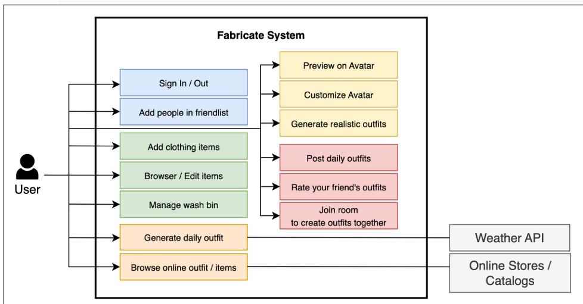
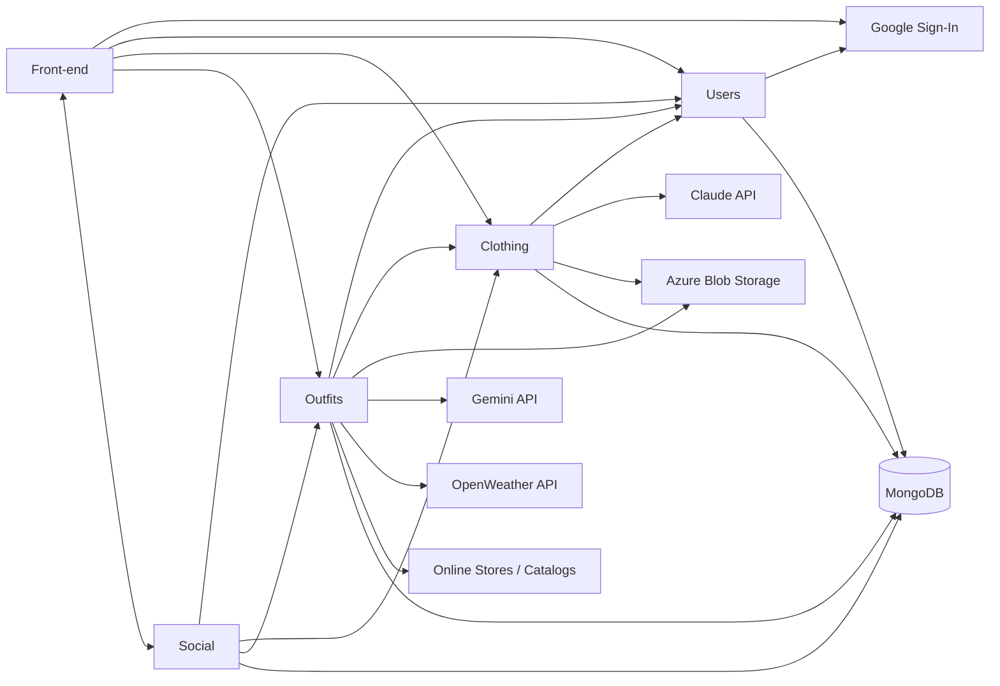
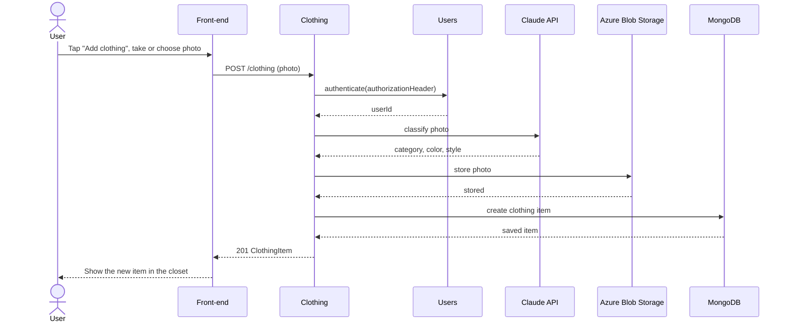
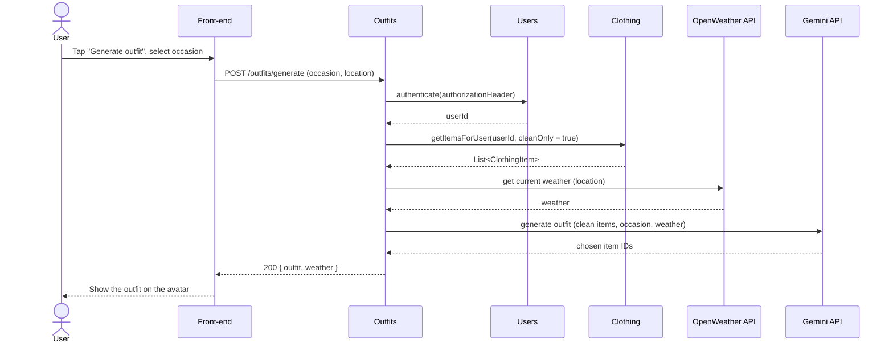
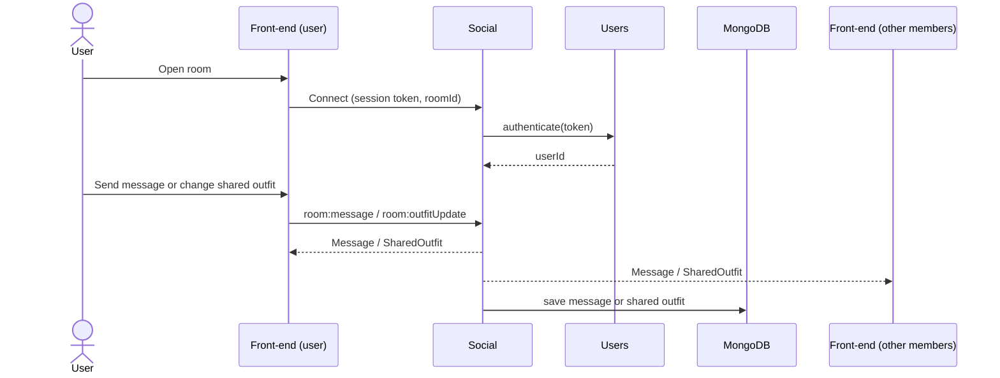
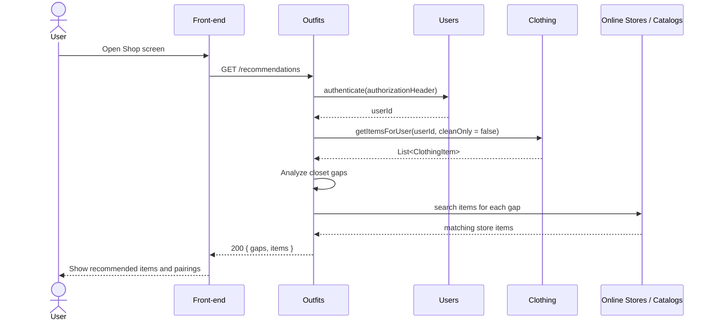
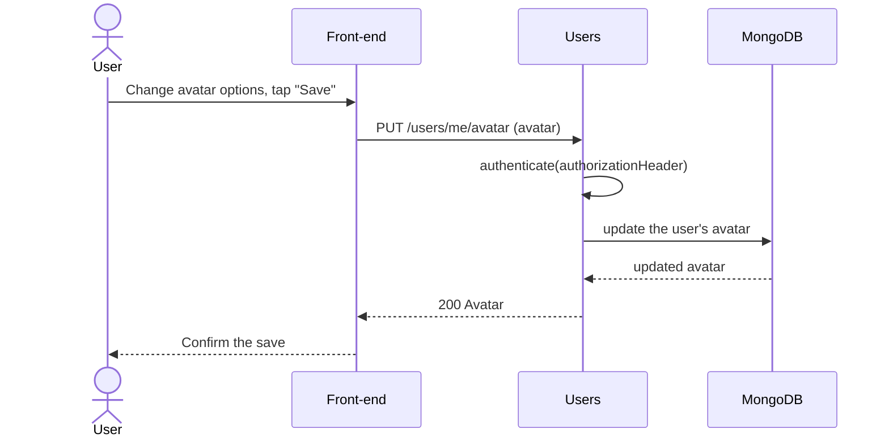

# Requirements and Design

## 1. Change History

| **Change Date** | **Modified Sections** | **Rationale** |
| --------------- | --------------------- | ------------- |
| 2026-10-19 | All sections | First version for CP1, based on the features and use case diagram agreed on in M2 and on the back-end implemented so far (authentication, Clothing and Outfits components). |

---

## 2. Project Description

Fabricate is a digital wardrobe and outfit generation app. Users photograph their clothes, and the app automatically classifies each item (category, color and style) and adds it to a digital closet. From there, users can have AI generate a daily outfit from their clean clothes and the current weather, preview outfits on a personalized avatar, and browse items from online stores that would fill gaps in their closet.

Fabricate is aimed at fashion enthusiasts who want more out of their wardrobe, people looking for guided daily inspiration, and busy users who want to spend less time getting ready. It is also social: users add friends, post and rate each other's daily outfits, and join rooms to build outfits together in real time.

---

## 3. Requirements Specification

### **3.1. List of Features**

1. **Account and Friends**: Users sign in and out with their Google account; a new user is registered automatically on their first sign-in. Users add other people to their friend list.
2. **Manage Closet**: Users add clothing items by taking a photo or choosing one from their gallery. The photo is classified by an external AI service and the item is added to the closet, where it can be browsed, edited and removed. Users keep track of which clothes are dirty with a wash bin.
3. **Daily Outfits and Shopping**: Users have AI generate a daily outfit from their clean clothes, based on the current weather. Users also browse items from online stores, which the app recommends by analyzing the gaps in their closet.
4. **Avatar**: Users customize a personal avatar by choosing their body size, skin tone and hair style, preview outfits on it, and generate a realistic image of the avatar wearing an outfit.
5. **Social Styling**: Users post their daily outfits, rate their friends' outfits, and join rooms with friends to create outfits together, where chat messages and outfit changes appear live for everyone in the room.

### **3.2. Use Case Diagram**

### **3.3. Actors Description**

1. **User**: A person who signs in with their Google account to digitize, organize and style their wardrobe, and to share and build outfits with friends.
2. **Weather API (OpenWeather)**: An external API that provides the current weather at the user's location, used when generating the daily outfit.
3. **Online Stores / Catalogs**: External product catalogs that provide the clothing items the user can browse and that the app recommends.

### **3.4. Use Case Description**

- Use cases for feature 1: **Account and Friends**
1. **Sign In / Out**: The user signs in with their Google account, or signs out. If they have never used Fabricate, a new account is created on their first sign-in.
2. **Add People in Friend List**: The user finds another user by email and adds them to their friend list.

- Use cases for feature 2: **Manage Closet**
3. **Add Clothing Items**: The user takes or chooses a photo of a clothing item, which is classified and added to their closet.
4. **Browse / Edit Items**: The user browses their closet, filtered by category, and edits an item's name, category, color, style or tags, or removes it from the closet. Saved outfits that used a removed item still show it.
5. **Manage Wash Bin**: The user moves worn clothes to the wash bin and back to the closet once they are clean. Clothes in the wash bin are left out of generated outfits.

- Use cases for feature 3: **Daily Outfits and Shopping**
6. **Generate Daily Outfit**: The app generates an outfit from the user's clean clothes for an occasion they choose, taking the current weather into account.
7. **Browse Online Outfits / Items**: The user browses items from online stores, recommended by analyzing the gaps in their closet, and sees which of their clothes each item pairs with.

- Use cases for feature 4: **Avatar**
8. **Customize Avatar**: The user sets their avatar's body size, skin tone and hair style and saves it to their profile.
9. **Preview on Avatar**: The user sees an outfit displayed on their avatar before deciding to wear or save it.
10. **Generate Realistic Outfits**: The app generates a realistic image of the user's avatar wearing a chosen outfit.

- Use cases for feature 5: **Social Styling**
11. **Post Daily Outfits**: The user posts the outfit they are wearing today so their friends can see it.
12. **Rate Your Friend's Outfits**: The user rates the outfits their friends posted, from 1 to 5 stars.
13. **Join Room to Create Outfits Together**: The user joins a room with friends, where they chat and build an outfit together, and every message and outfit change appears live on all members' devices.

### **3.5. Formal Use Case Specifications (5 Most Major Use Cases)**

#### Use Case 1: Add Clothing Items

**Description**: The user adds a clothing item to their closet by taking or choosing a photo, which is classified automatically by an external AI service.

**Primary actor(s)**: User

**Main success scenario**:

1. The user opens the Closet tab and taps "Add clothing".
2. The app asks whether to take a photo with the camera or choose one from the gallery.
3. The user takes or chooses a photo of a clothing item.
4. The app uploads the photo and shows a loading indicator while the item is classified.
5. The app shows the new item at the top of the closet with its photo and name; its details show the category, colour and style the app detected.

**Failure scenario(s)**:

- 3a. The user closes the camera or gallery without choosing a photo.
  - 3a1. The app returns to the Closet screen and the closet is unchanged.
- 4a. The photo does not show a clothing item.
  - 4a1. The app shows the message "This photo doesn't show a clothing item. Try another photo." and the closet is unchanged.
- 4b. The photo can't be uploaded or classified (no network, or the server is unavailable).
  - 4b1. The app shows the message "Couldn't add the item. Please try again." with a "Try again" button.
  - 4b2. The user taps "Try again" and the app repeats step 4.

#### Use Case 2: Generate Daily Outfit

**Description**: The user picks an occasion and the app generates an outfit from their clean clothes, taking the current weather into account.

**Primary actor(s)**: User, Weather API

**Main success scenario**:

1. The user taps "Generate outfit" on the Outfits screen.
2. The app shows a list of occasions (casual, work, formal and workout).
3. The user selects an occasion.
4. The app shows a loading indicator while the outfit is generated from the user's clean clothes, the occasion and the current weather.
5. The app displays the generated outfit on the user's avatar, with the weather it was based on.
6. The user saves the outfit, or taps "Regenerate" to get a different one.

**Failure scenario(s)**:

- 1a. The user's clean clothes do not include at least one shirt and one pair of pants.
  - 1a1. The app displays a message listing the missing items and prompts the user to add clothes or empty their wash bin.
- 4a. The outfit generation service is unavailable or does not respond in time.
  - 4a1. The app displays an error message prompting the user to try again later.
- 4b. The current weather cannot be retrieved.
  - 4b1. The app generates the outfit without the weather and tells the user that the weather was not considered.

#### Use Case 3: Join Room to Create Outfits Together

**Description**: The user joins a room with friends, where members chat and build a shared outfit together, and every message and outfit change appears live on all members' devices.

**Primary actor(s)**: User

**Main success scenario**:

1. The user opens the Rooms screen and selects a room, or creates one and invites friends from their friend list.
2. The app shows the room's chat and the shared outfit board.
3. The user sends a chat message, or adds or removes an item from their closet on the shared outfit board.
4. The message or outfit change appears on every room member's screen.
5. The user taps "Save outfit" to save the shared outfit to their own outfits.

**Failure scenario(s)**:

- 1a. The user has no friends in their friend list to invite.
  - 1a1. The app explains that friends must be added first and links to the friend list.
- 3a. The connection to the server is lost.
  - 3a1. The app shows a "Reconnecting" banner and disables sending until the connection is restored.
- 4a. Another member leaves the room.
  - 4a1. The app shows a notice that the member left, and the room continues for the remaining members.

#### Use Case 4: Browse Online Outfits / Items

**Description**: The app analyzes the user's closet for gaps and shows items from online stores that would fill them, along with the user's clothes that each item pairs with.

**Primary actor(s)**: User, Online Stores / Catalogs

**Main success scenario**:

1. The user opens the Shop screen.
2. The app shows a loading indicator while the closet is analyzed.
3. The app displays recommended items from online stores, each with a photo, price and reason (e.g. "No outerwear in your closet").
4. The user taps an item.
5. The app shows the items in the user's closet that the recommendation pairs with, and a link to the item in the store.

**Failure scenario(s)**:

- 2a. The closet does not include at least one shirt and one pair of pants.
  - 2a1. The app displays a message prompting the user to add those items first.
- 3a. The online catalogs return no matching items.
  - 3a1. The app shows the closet gaps it found and a message that no matching items are available right now.
- 3b. The analysis or the catalog search fails because of a server or network problem.
  - 3b1. The app displays an error message prompting the user to try again.

#### Use Case 5: Customize Avatar

**Description**: The user customizes their avatar's appearance and saves it to their profile, so outfits can be previewed on it.

**Primary actor(s)**: User

**Main success scenario**:

1. The user opens the Avatar screen.
2. The app shows the user's current avatar and options for body size, skin tone and hair style.
3. The user changes one or more options, and the avatar preview updates.
4. The user taps "Save".
5. The app saves the avatar to the user's profile and confirms the save.

**Failure scenario(s)**:

- 1a. The user has never customized their avatar.
  - 1a1. The app shows a default avatar for the user to start from.
- 5a. The save fails because of a network problem.
  - 5a1. The app displays an error message, keeps the user's changes on screen and lets them retry.

### **3.6. Screen Mock-ups**

Not included for CP1.

### **3.7. Non-Functional Requirements**

1. **Room update latency**
   - **Description**: Chat messages and outfit changes in a room appear on the other members' devices within 1 second, for 95% of updates under normal network conditions.
   - **Justification**: Rooms are only useful if they feel live. 1 second is the limit for a user's flow of thought to stay uninterrupted (Nielsen, "Response Times: The 3 Important Limits", Nielsen Norman Group), so longer delays make the collaboration feel broken.
2. **Clothing upload time**
   - **Description**: An uploaded clothing photo is classified and the new item appears in the closet within 10 seconds, for photos up to the 5 MB upload limit.
   - **Justification**: Adding clothes is the first thing every user does and depends on an external AI service. 10 seconds is the limit for keeping a user's attention on a task (same source); past it, users tend to give up or switch tasks.
3. **Closet analysis time**
   - **Description**: The closet gap analysis for recommendations completes on the back-end within 2 seconds for closets of up to 500 items.
   - **Justification**: Recommendations update as the closet changes, so the analysis runs often. 500 items is well above a typical wardrobe, so the limit leaves room to grow, and 2 seconds keeps the Shop screen responsive.

---

## 4. Designs Specification

### **4.1. Main Components**

1. **Users**
   - **Purpose**: Signs users in with Google, stores their profiles, avatars and friend lists, and authenticates the requests sent to every other component. Keeping authentication in one component means every component checks users the same way.
   - **Interfaces**:
     1. `POST /auth/google`, body `{ idToken: String }`, returns `{ user: User, token: String }`
        - **Purpose**: Verifies a Google ID token with Google, finds or creates the user by their Google ID, and returns the user with a session token signed by the back-end.
     2. `PUT /users/me/avatar`, body `{ avatar: Avatar }`, returns `Avatar`
        - **Purpose**: Saves the user's avatar settings to their profile.
     3. `GET /friends`, returns `List<User>`, and `POST /friends`, body `{ email: String }`, returns `201 User`
        - **Purpose**: Returns the user's friend list, or adds another user to it by email.
     4. `String authenticate(String authorizationHeader)`
        - **Purpose**: Checks the session token sent in the `Authorization` header and returns the user's ID; rejects the request with 401 if the token is missing or invalid. Used by every other component.
     5. `List<String> getFriendIds(String userId)`
        - **Purpose**: Returns the IDs of a user's friends, so Social can check who can see and rate posts or join rooms.

2. **Clothing**
   - **Purpose**: Stores and manages the user's clothing items and wash bin. It sends new photos to the clothing classifier and keeps the photos in file storage. It is separate from Outfits so that the other components read closet data through one interface.
   - **Interfaces**:
     1. `POST /clothing`, multipart form with a `photo` file (JPEG, PNG or WebP, at most 5 MB), returns `201 ClothingItem`
        - **Purpose**: Classifies the photo, stores it, and saves the new item with the detected category, color and style. Returns 422 if the photo does not show clothing and 503 if classification or storage is unavailable.
     2. `GET /clothing`, query `category?: String`, `clean?: Boolean`, returns `{ items: List<ClothingItem> }`
        - **Purpose**: Returns the user's items that are still in the closet, newest first, optionally filtered by category or clean status (`clean=false` lists the wash bin).
     3. `GET /clothing/{id}`, returns `ClothingItem`
        - **Purpose**: Returns one of the user's items, including items that were removed from the closet.
     4. `PATCH /clothing/{id}`, body with any of `{ name, category, color, style, tags, isClean }`, returns `ClothingItem`
        - **Purpose**: Updates an item's details, or moves it into or out of the wash bin.
     5. `DELETE /clothing/{id}`, returns `204`
        - **Purpose**: Archives an item: it leaves the closet, but saved outfits still show it.
     6. `List<ClothingItem> getItemsForUser(String userId, Boolean cleanOnly)`
        - **Purpose**: Returns a user's items in the closet, optionally only the clean ones, for Outfits and Social.

3. **Outfits**
   - **Purpose**: Saves and generates outfits, renders realistic outfit images, and runs the closet gap analysis for shopping recommendations. These are in the same component because they all reason about how closet items combine.
   - **Interfaces**:
     1. `POST /outfits`, body `{ name: String, itemIds: List<String> }`, returns `201 Outfit`
        - **Purpose**: Saves an outfit.
     2. `GET /outfits`, returns `List<Outfit>`, and `GET /outfits/{id}`, returns `Outfit`
        - **Purpose**: Returns the user's saved outfits, or one of them.
     3. `PATCH /outfits/{id}`, body `{ name?, itemIds? }`, returns `Outfit`, and `DELETE /outfits/{id}`, returns `204`
        - **Purpose**: Edits or deletes a saved outfit.
     4. `POST /outfits/generate`, body `{ occasion: String, latitude: Double, longitude: Double }`, returns `{ outfit: Outfit, weather: Weather? }`
        - **Purpose**: Generates an outfit from the user's clean clothes for the occasion and the current weather.
     5. `POST /outfits/{id}/render`, returns `{ imageUrl: String }`
        - **Purpose**: Generates a realistic image of the user's avatar wearing the outfit.
     6. `GET /recommendations`, returns `{ gaps: List<String>, items: List<StoreItem> }`
        - **Purpose**: Analyzes the user's closet for gaps and returns matching items from online catalogs, each with the closet items it pairs with.
     7. `Outfit getOutfit(String outfitId)` and `Outfit saveOutfit(String userId, String name, List<String> itemIds)`
        - **Purpose**: Read and save outfits for other users' posts and rooms. Used by Social.

4. **Social**
   - **Purpose**: Manages outfit posts, ratings and rooms, and delivers chat messages and shared outfit changes to room members in real time.
   - **Interfaces**:
     1. `POST /posts`, body `{ outfitId: String }`, returns `201 Post`
        - **Purpose**: Posts the user's daily outfit for their friends.
     2. `GET /posts`, returns `List<Post>`
        - **Purpose**: Returns the outfits the user's friends posted, newest first, with their average ratings.
     3. `POST /posts/{id}/ratings`, body `{ stars: Int }` (1 to 5), returns `Rating`
        - **Purpose**: Rates a friend's posted outfit; rating again replaces the user's previous rating.
     4. `POST /rooms`, body `{ name: String, friendIds: List<String> }`, returns `Room`, and `GET /rooms`, returns `List<Room>`
        - **Purpose**: Creates a room with friends, or returns the rooms the user belongs to.
     5. Socket.IO event `room:message`, payload `{ roomId: String, text: String }`, sent to the members as `Message`
        - **Purpose**: Sends a chat message to every member of the room.
     6. Socket.IO event `room:outfitUpdate`, payload `{ roomId: String, itemIds: List<String> }`, sent to the members as `SharedOutfit`
        - **Purpose**: Updates the room's shared outfit for every member.
     7. `POST /rooms/{id}/save`, returns `Outfit`
        - **Purpose**: Saves the room's shared outfit to the user's outfits.

### **4.2. Databases**

1. **MongoDB**
   - **Purpose**: Stores users (Google ID, email, name, avatar and friend list), clothing items, outfits, posts, ratings, rooms and chat messages. A document database fits because clothing items and outfits have flexible attributes such as tags, and MongoDB is one of the two databases the course allows.

### **4.3. External Modules**

1. **Google Sign-In**
   - **Purpose**: Signs the user in on their device and issues a Google ID token, which the Users component verifies with Google.
2. **Claude API**
   - **Purpose**: Classifies clothing photos: detects an item's category, color and style, or reports that the photo is not clothing.
3. **Gemini API**
   - **Purpose**: Generates daily outfits with Gemini 4 (`gemini-4-argon`), Google's latest and most capable model, by picking items from the user's clean clothes for the occasion and weather. Renders realistic outfit images with the Nano Banana 2.1 image model (`gemini-nano-banana-2.1`).
4. **OpenWeather API**
   - **Purpose**: Provides the current weather at the user's location for daily outfit generation. Chosen because it is widely used and its free plan (1,000,000 calls a month) is far more than the project needs.
5. **Online Stores / Catalogs**
   - **Purpose**: Provide product listings (photo, price, category and store link) that the Outfits component searches for items that fill the user's closet gaps.
6. **Azure Blob Storage**
   - **Purpose**: Stores clothing photos and generated outfit images, and gives the app time-limited links to download them.

### **4.4. Frameworks and Libraries**

1. **Jetpack Compose**
   - **Purpose**: Builds the Android user interface.
   - **Reason**: Required by the course; its state-driven model suits screens with loading and error states.
2. **Navigation Compose**
   - **Purpose**: Moves between screens and manages the back stack.
   - **Reason**: The standard navigation library for Compose apps.
3. **OkHttp**
   - **Purpose**: Sends HTTP requests from the app to the back-end.
   - **Reason**: A widely used, reliable HTTP client for Android.
4. **AndroidX Credential Manager and Google ID library**
   - **Purpose**: Shows the Google account picker and returns a Google ID token.
   - **Reason**: Google's current recommended way to implement Sign in with Google; the older Google Sign-In client is deprecated.
5. **Coil**
   - **Purpose**: Loads and caches clothing photos and outfit images from their download links.
   - **Reason**: A lightweight image loader built for Compose.
6. **Socket.IO (server and Android client)**
   - **Purpose**: Delivers live chat messages and outfit changes in rooms.
   - **Reason**: Keeps a persistent connection with built-in rooms and automatic reconnection, so the app does not have to poll.
7. **Express.js**
   - **Purpose**: Defines the back-end's HTTP routes and middleware.
   - **Reason**: The most widely used web framework for Node.js, with simple middleware for authentication and error handling.
8. **Mongoose**
   - **Purpose**: Defines the MongoDB schemas and runs queries from TypeScript.
   - **Reason**: Adds schema validation and typed models on top of MongoDB.
9. **google-auth-library**
   - **Purpose**: Verifies Google ID tokens on the back-end.
   - **Reason**: Google's official Node.js library; it fetches and caches Google's public keys.
10. **Jest and mongodb-memory-server**
    - **Purpose**: Run the back-end tests and report coverage; the tests use an in-memory MongoDB server.
    - **Reason**: Jest is required by the course; an in-memory database lets the tests run without a real database or credentials.

### **4.5. Dependencies Diagram**

### **4.6. Use Case Sequence Diagram (5 Most Major Use Cases)**

1. [**Add Clothing Items**](#use-case-1-add-clothing-items)

2. [**Generate Daily Outfit**](#use-case-2-generate-daily-outfit)

3. [**Join Room to Create Outfits Together**](#use-case-3-join-room-to-create-outfits-together)

4. [**Browse Online Outfits / Items**](#use-case-4-browse-online-outfits--items)

5. [**Customize Avatar**](#use-case-5-customize-avatar)

### **4.7. Design of Non-Functional Requirements**

1. [**Room update latency**](#nfr1)
   - **Implementation**: Social keeps a persistent Socket.IO connection with each member's device and pushes each update to the room as soon as it arrives, so devices never wait on polling. The update is sent to members before the database write, so storage time does not add to delivery time.
2. [**Clothing upload time**](#nfr2)
   - **Implementation**: Photos are limited to 5 MB and checked for type and size before anything else, so invalid uploads fail immediately. The back-end checks that storage is configured before calling the classifier, and the classifier call has a timeout, so a slow or rate-limited service returns a clear 503 error instead of leaving the user waiting.
3. [**Closet analysis time**](#nfr3)
   - **Implementation**: The gap analysis loads the user's items in one database query (indexed by user ID) and runs entirely in memory, counting items per category, color and style and checking pairings without further database or network calls. The catalog search runs only after the analysis, once per gap found.
