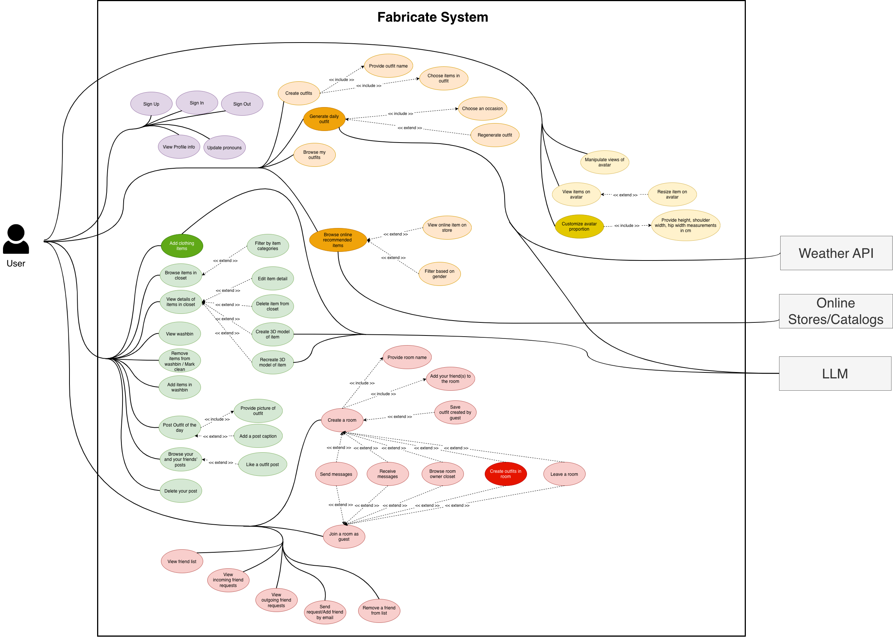
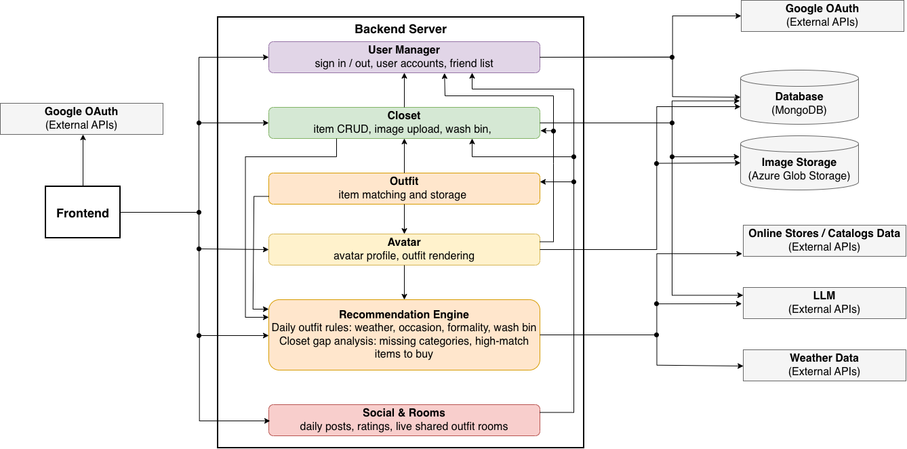
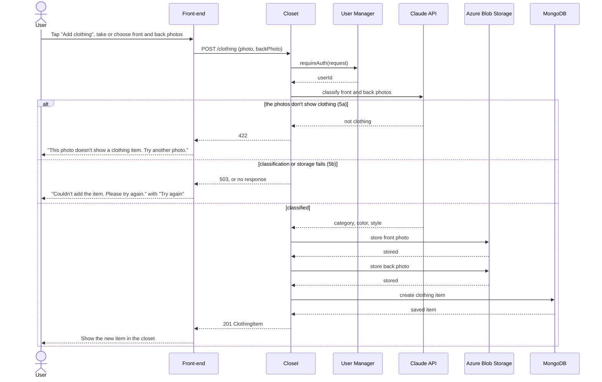
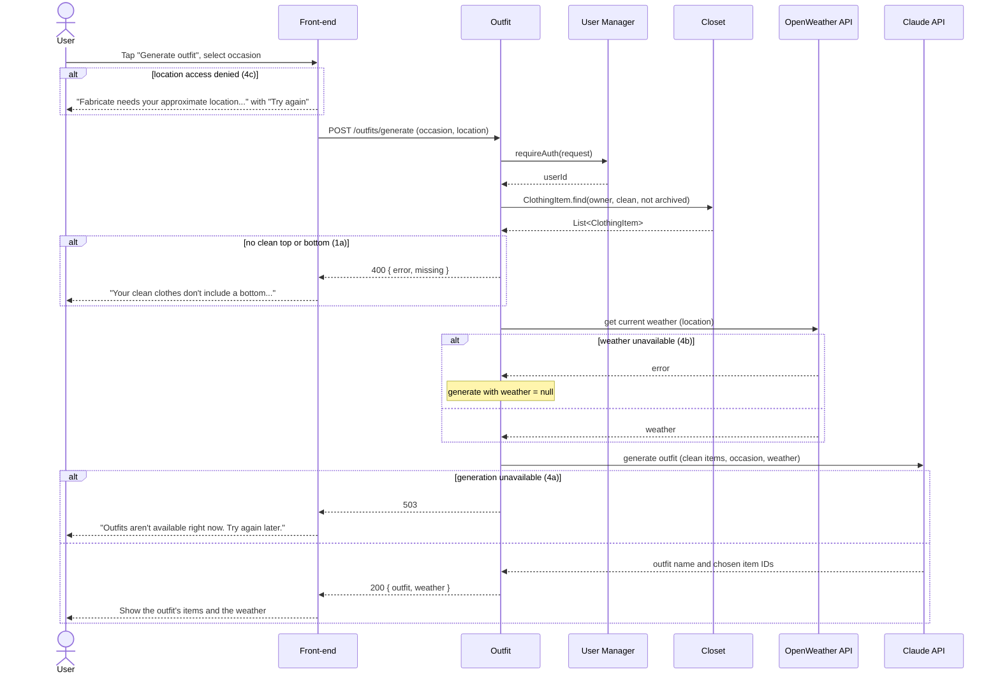
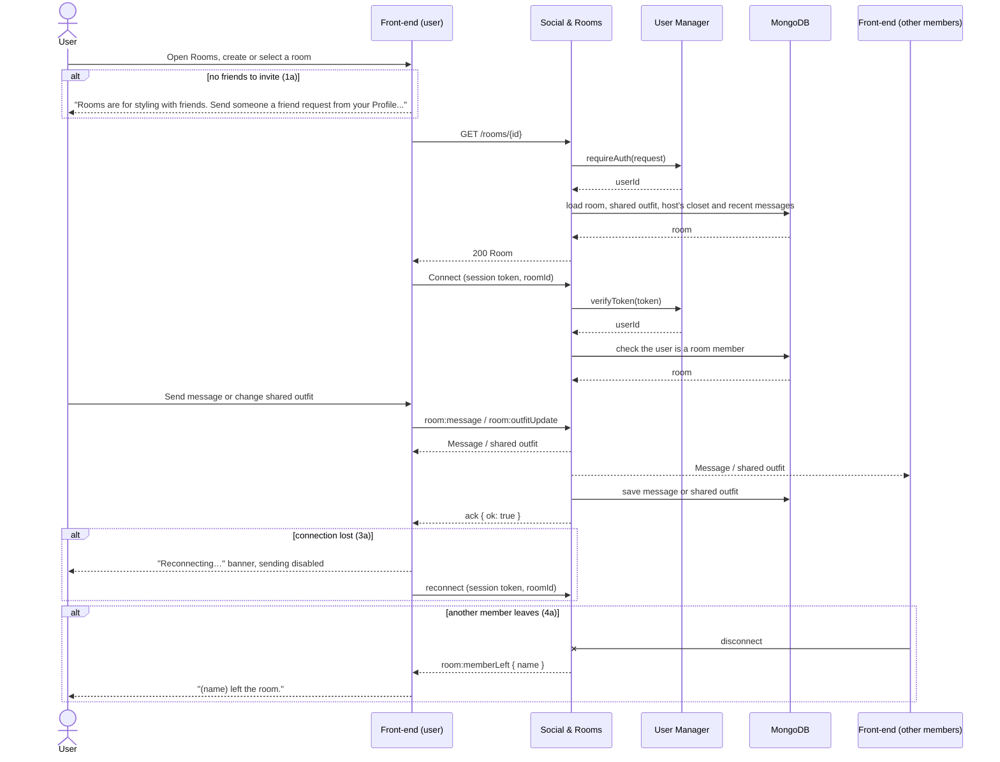
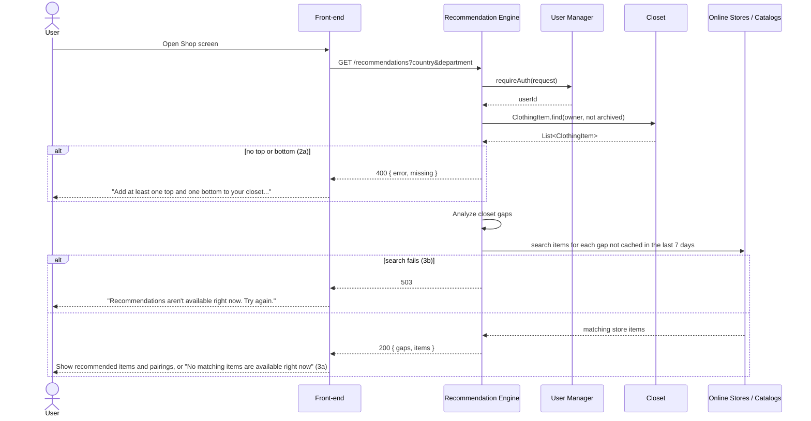
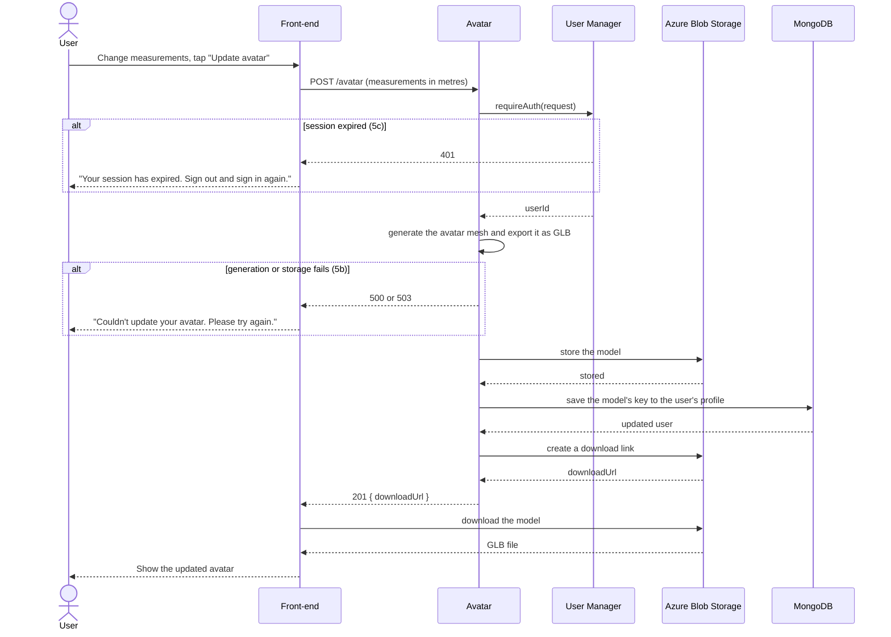

# Requirements and Design

## 1. Change History

| **Change Date** | **Modified Sections** | **Rationale** |
| --------------- | --------------------- | ------------- |
| 2026-10-19 | All sections | First version for CP1, based on the features and use case diagram agreed on in M2 and on the back-end implemented so far (authentication, Clothing and Outfits components). |
| 2026-10-30 | 3.1, 3.2, 3.4, 3.5 (use case names) | Reorganized the features to match the app we are building: Manage Closet, Customize Avatar, Create Outfit, Recommend Clothes to Buy, and Friends and Social. CP1 TA feedback: the use cases were at very different levels of abstraction, major and minor use cases were not separated, and the closet and outfit use cases were not separated. The use case diagram was redrawn so every use case is one user action, and 3.4 now lists the same use cases with the same names, marking the five with formal specifications as major and the rest as minor. |
| 2026-10-30 | 4.1, 4.2, 4.3, 4.4, 4.5 | Split the back-end into the six components of the redrawn design diagram: User Manager, Closet, Outfit, Avatar, Recommendation Engine, and Social & Rooms. CP1 TA feedback: Closet and Outfit are now separate components with their own interfaces in the text and in every diagram. Interfaces updated to match the code: `POST /auth/google` returns `{ accessToken }`, the avatar is generated with `POST /avatar` (replacing `PUT /users/me/avatar`), outfits use `items` and `occasion`, and rooms use `GET /rooms/{id}` and a Socket.IO connection per room with `room:message`, `room:outfitUpdate` and `room:memberLeft`. Daily outfits are generated with the Claude API instead of Gemini. Added `GET`/`PATCH /users/me`, `DELETE /friends/{id}`, Firebase Cloud Messaging, the avatar generation method, Three.js and SceneView. |
| 2026-10-30 | 4.6, 4.7 | Sequence diagrams and NFR designs use the new component names, and the room sequence diagram shows the membership check and the broadcast before the database write. |
| 2026-11-01 | 4.1, 4.2, 4.3, 4.6 | Chose Serper for the online store search and documented it. `GET /recommendations` gains `country` and `department`, because results depend on the user's country and searches without a department came back mostly women's. Search results are cached in MongoDB to stay within the search credits. |
| 2026-11-01 | 4.1 | `GET /recommendations`: each `StoreItem` also has the `reason` of the gap it fills and the closet items it `pairsWith`, which the Shop screen shows in use case 4 steps 3 and 5. Documented its 400 and 503 responses. |
| 2026-11-04 | 3.4, 3.5, 4.1, 4.6 | Each clothing item now has a front and a back photo. Use case 1 asks for both, and backing out of the camera or gallery asks for the photo again before cancelling. `POST /clothing` takes a `backPhoto` file, and the use case 1 sequence diagram stores both photos. |
| 2026-11-18 | 3.1, 3.4 | 3.4 now lists the same use cases as the use case diagram (CP2 TA feedback): Sign Up, Sign In and Sign Out are separate, and Leave a room and Add viewed item to wishlist were added. The avatar use cases now say how they differ: one item, a whole outfit as a 3D model, or a realistic image. Browse past outfits says that deleting an outfit unsaves it. |
| 2026-11-18 | 3.5 | Failure scenarios give the exact messages the app shows (CP2 TA feedback). Use case 2 shows the outfit's items, not the outfit on the avatar, which is still to be built, and has a new failure for location access being denied (peer review 5.1.2). Use case 5 matches the avatar screen: measurement sliders and "Update avatar", with failures for avatar generation and an expired session; skin tone and hair style are still to be built. |
| 2026-11-18 | 4.1, 4.3, 4.4, 4.6, 4.7 | Interfaces match the code (CP2 TA feedback and peer review 2.3). Outfit generation moved from Recommendation Engine to Outfit, where its code is. Closet documents the garment model routes `POST /clothing/{id}/generate` and `GET /clothing/{id}/model`, and other components read clothing items through the `ClothingItem` model rather than a `getItemsForUser` function. `POST /avatar` takes measurements in metres. Interfaces and modules that aren't built yet (posts, ratings, outfit renders, Gemini and Firebase Cloud Messaging) are marked as planned. Added why we chose the Claude API, and the background removal library. Sequence diagrams show the failure scenarios. The upload time design describes the classifier's actual timeout and retries. |
| 2026-11-18 | 3.4, 3.5, 4.1 | Rooms are for styling the host's closet: the user who creates a room is its host, every member builds the outfit from the host's clothes, and only the host can save it. Rooms and their messages are deleted 2 days after the room is created, and the room list shows when each room expires. Room responses gain `hostId` and `expiresAt`, and `GET /rooms/{id}` also returns the host's closet. |
| 2026-11-19 | 3.5, 4.1 | The closet gap analysis was reworked because it suggested nearly the same item for every closet (usually a black business jacket). `GET /recommendations` now finds up to 3 varied gaps: empty categories, an unbalanced number of tops and bottoms, occasions the closet can't dress for, a colour for an all-neutral closet, and the pieces that would make the most new outfits, which also finds useful additions for a closet with no obvious gaps. It searches for specific colours (e.g. white, navy, beige) instead of black for every neutral, and recognises far more of the colour and style words the classifier writes. Shoes and outerwear are only suggested when the closet has none, or none for an occasion. Use case 4 step 3: the Shop screen lists the store items under the gap each one fills. |
| 2026-11-19 | 3.4, 3.5, 4.1 | Friends are now added with friend requests. Before, anyone who knew a user's email could add them as a friend without their consent, and friends can see each other's daily posts and add each other to rooms. Use case 16 now sends a request that the other user accepts or declines, and use case 3 (Create Outfits in a Room) points users without friends to the Profile screen. `POST /friends` was replaced by `POST /friends/requests`, `GET /friends/requests`, `POST /friends/requests/{id}/accept` and `DELETE /friends/requests/{id}`. |
| 2026-11-19 | 3.1, 3.4, 3.5, 4.1, 4.2, 4.3 | Matched the app as built (PR #157 review). Posts are liked instead of rated, and Social & Rooms lists the posts endpoints as built. Sign Up, Sign In and Sign Out moved to a new Account feature. Leave a room now says that a room stays in the list until it expires. The avatar asks for height, shoulder width and hip width in text fields. Removed what we won't build: the wishlist, realistic outfit images (with `POST /outfits/{id}/render` and the Gemini API) and push notifications (Firebase Cloud Messaging). |
| 2026-11-26 | 4.1 | `POST /outfits` and `PATCH /outfits/{id}` limit how many items of each category an outfit can have (400), and reject an outfit with the same items as another of the user's outfits, even under a different name (409). Before, an outfit could have any number of tops and bottoms, and the same outfit could be saved twice (issues #192 and #195). The outfit editor stops picks at each limit and says why, warns about a duplicate before saving, and lists an outfit's own items first when editing it. |
| 2026-11-26 | 4.1 | `POST /outfits/generate` returns outfits the avatar can wear: exactly one top and one bottom, no dress, and at most one outerwear piece, one pair of shoes and three accessories. Before, it could pick two tops, which the avatar can't show (issue #196). |
| 2026-11-26 | 3.4, 4.1 | Like counts on the feed update live: the app reloads the feed with `GET /posts` every 5 seconds while it is open and in the foreground. Before, they only changed after a manual refresh (issue #187). We chose polling over a Socket.IO event because the sockets are only opened for rooms. |

---

## 2. Project Description

Fabricate is a digital wardrobe and outfit generation app. Users photograph their clothes, and the app automatically classifies each item (category, color and style) and adds it to a digital closet. From there, users can have AI generate a daily outfit from their clean clothes and the current weather, try clothes on a personalized 3D avatar, and browse items from online stores that would fill gaps in their closet.

Fabricate is aimed at fashion enthusiasts who want more out of their wardrobe, people looking for guided daily inspiration, and busy users who want to spend less time getting ready. It is also social: users add friends, post and like each other's daily outfits, and join rooms to build outfits together in real time.

---

## 3. Requirements Specification

### **3.1. List of Features**

1. **Manage Closet**: Users add clothing items by taking a photo or choosing one from their gallery. The photo is classified by an external AI service and the item is added to the closet, where it can be browsed, edited and removed. Users keep track of which clothes are dirty with a wash bin.
2. **Customize Avatar**: Users customize the proportions of a personal avatar from their body measurements, and try clothing items on it.
3. **Create Outfit**: Users have AI generate a daily outfit from their clean clothes based on the occasion and the current weather, save outfits, and browse the outfits they saved.
4. **Recommend Clothes to Buy**: The app analyzes the gaps in the user's closet and recommends items from online stores that fill them, with the user's clothes that each item pairs with.
5. **Friends and Social**: Users add and remove friends with friend requests, post a photo of their outfit of the day, like their friends' posts, and create and join rooms with friends to build outfits together from the host's closet, where chat messages and outfit changes appear live for every member.
6. **Account**: Users sign up and sign in with their Google account, and sign out.

### **3.2. Use Case Diagram**

### **3.3. Actors Description**

1. **User**: A person who signs in with their Google account to digitize, organize and style their wardrobe, and to share and build outfits with friends.
2. **Weather API (OpenWeather)**: An external API that provides the current weather at the user's location, used when generating the daily outfit.
3. **Online Stores / Catalogs**: External product catalogs that provide the clothing items the user can browse and that the app recommends.
4. **LLM**: External LLM service for AI-based use cases. 

### **3.4. Use Case Description**

Each use case below has the same name as in the use case diagram. **Major** use cases are the five with formal specifications in 3.5; the other use cases are **minor**. Use cases that appear in the diagram only as an `<<include>>` or `<<extend>>` step are described inside their parent use case.

- Use cases for feature 1: **Manage Closet**
1. **Add clothing items** (major): The user takes or uploads a photo of the front and of the back of a clothing item. The app classifies the item with the LLM and adds it to their closet.
2. **Browse items in closet** (minor): The user browses their closet, optionally filtering by item category.
3. **View details of items in closet** (minor): The user opens an item to see its details. From there they can edit its details, delete it, or create or recreate its 3D model.
4. **Edit item detail** (minor): The user changes an item's name, category, color or style.
5. **Delete item from closet** (minor): The user removes an item from their closet. Saved outfits that used it still show it.
6. **Create 3D model of item** (minor): The user asks the app to build a 3D model of a closet item from its photos, so it can be shown on their avatar.
7. **Recreate 3D model of item** (minor): The user asks the app to rebuild an item's 3D model when the first result is unsatisfactory.
8. **View washbin** (minor): The user views the clothes currently in the wash bin.
9. **Add items in washbin** (minor): The user moves worn clothes to the wash bin, which leaves them out of generated outfits.
10. **Remove items from washbin / Mark clean** (minor): The user marks clothes as clean, which moves them from the wash bin back to the closet.

- Use cases for feature 2: **Customize Avatar**
11. **Customize avatar proportion** (major): The user enters their height, shoulder width and hip width in centimeters, and the app builds their 3D avatar from these measurements.
12. **View items on avatar** (minor): The user tries clothing items from their closet on their 3D avatar, one of each kind at a time (a top, a bottom and outerwear).
13. **Resize item on avatar** (minor): While viewing an item on their avatar, the user adjusts its size to fit the avatar.
14. **Manipulate views of avatar** (minor): The user rotates, zooms and moves the camera around their avatar to see it from different angles.

- Use cases for feature 3: **Create Outfit**
15. **Generate outfits from closet** (major): The user chooses an occasion, and the app generates an outfit from their clean clothes, taking the current weather (from the Weather API) into account. If the user does not like the result, they can regenerate the outfit.
16. **Create outfits** (minor): The user builds an outfit by hand. They give it a name and choose the items from their closet to include.
17. **Browse my outfits** (minor): The user browses the outfits they have created or saved.

- Use cases for feature 4: **Recommend Clothes to Buy**
18. **Browse online recommended items** (major): The user browses items from online stores (Online Stores/Catalogs), recommended by analyzing the gaps in their closet. They can filter the items by gender and open any item on the store's website.

- Use cases for feature 5: **Friends and Social**
19. **View friend list** (minor): The user views the list of their current friends.
20. **View incoming friend requests** (minor): The user views the friend requests other users have sent them, and can accept or decline each one.
21. **View outgoing friend requests** (minor): The user views the friend requests they have sent that are still pending.
22. **Send request/Add friend by email** (minor): The user sends another user a friend request by email. Two users become friends once one accepts the other's request, so nobody can add someone without their consent.
23. **Remove a friend from list** (minor): The user removes someone from their friend list.
24. **Post outfit of the day** (minor): The user posts a photo of the outfit they are wearing today so their friends can see it, and can optionally add a caption. The post disappears at the user's next midnight.
25. **Browse your and your friends' posts** (minor): The user browses their own and their friends' outfit-of-the-day posts, and can like a post or take the like back. Each post shows how many likes it has.
26. **Delete your post** (minor): The user deletes one of their own outfit-of-the-day posts before it expires.
27. **Create a room** (minor): The user names a new room and adds friends from their friend list to it. The user who creates the room is its host. The host can save an outfit that a guest created in the room.
28. **Join a room as guest** (minor): The user opens a room they were added to and sees its chat and shared outfit board. From inside the room, they can send and receive messages, browse the room owner's closet, create an outfit in the room, or leave the room.
29. **Send messages** (minor): A room member sends a chat message that appears live for all members of the room.
30. **Receive messages** (minor): A room member sees chat messages from other members as they arrive.
31. **Browse room owner closet** (minor): A room member browses the closet of the room's host (the member who created it) to pick items for outfits.
32. **Create outfits in room** (major): The user builds an outfit from the host's closet together with the room's members, where every chat message and outfit change appears live on all members' devices.
33. **Leave a room** (minor): The user closes a room, and the other members see that they left. The room stays in every member's room list until it expires, 2 days after it was created, when it and its chat are deleted.

- Use cases for feature 6: **Account**
34. **Sign Up** (minor): A person who has never used Fabricate signs up with their Google account, and an account is created for them.
35. **Sign In** (minor): The user signs in with their Google account.
36. **Sign Out** (minor): The user signs out, after confirming.
37. **View Profile info** (minor): The user views their profile information, such as their name and pronouns.
38. **Update pronouns** (minor): The user changes the pronouns shown on their profile.

### **3.5. Formal Use Case Specifications (5 Most Major Use Cases)**

#### Use Case 1: Add Clothing Items

**Description**: The user adds a clothing item to their closet by taking or choosing a photo of its front and of its back, which are classified automatically by an external AI service.

**Primary actor(s)**: User

**Main success scenario**:

1. The user opens the Closet tab and taps "Add clothing".
2. The app asks whether to take a photo of the front of the item with the camera or choose one from the gallery.
3. The user takes or chooses a photo of the front of a clothing item.
4. The app asks the same for the back of the item, and the user takes or chooses a photo of the back.
5. The app uploads both photos and shows a loading indicator while the item is classified.
6. The app shows the new item at the top of the closet with its photo and name; its details show its front and back photos and the category, colour and style the app detected.

**Failure scenario(s)**:

- 3a. In step 3 or 4, the user closes the camera or gallery without choosing a photo.
  - 3a1. The app asks again where the photo should come from.
  - 3a2. The user closes that too. The app returns to the Closet screen and the closet is unchanged.
- 5a. The photos do not show a clothing item.
  - 5a1. The app shows the message "This photo doesn't show a clothing item. Try another photo." and the closet is unchanged.
- 5b. The photos can't be uploaded or classified (no network, or the server is unavailable).
  - 5b1. The app shows the message "Couldn't add the item. Please try again." with a "Try again" button.
  - 5b2. The user taps "Try again" and the app repeats step 5.

#### Use Case 2: Generate Daily Outfit

**Description**: The user picks an occasion and the app generates an outfit from their clean clothes, taking the current weather into account.

**Primary actor(s)**: User, Weather API

**Main success scenario**:

1. The user taps "Generate outfit" on the Outfits screen.
2. The app shows a list of occasions (casual, work, formal and workout).
3. The user selects an occasion.
4. The app shows a loading indicator while the outfit is generated from the user's clean clothes, the occasion and the current weather.
5. The app displays the generated outfit's items, with the weather it was based on (for example "Based on the weather: 12°C, light rain").
6. The user saves the outfit, or taps "Regenerate" to get a different one.

**Failure scenario(s)**:

- 1a. The user's clean clothes do not include at least one top and one bottom.
  - 1a1. The app shows "Couldn't generate an outfit" with a message naming what is missing, for example "Your clean clothes don't include a bottom. Add one to your closet or empty your wash bin."
- 4a. The outfit generation service is unavailable or does not respond in time.
  - 4a1. The app shows "Couldn't generate an outfit" with the message "Outfits aren't available right now. Try again later." and a "Try again" button.
- 4b. The current weather cannot be retrieved.
  - 4b1. The app generates the outfit without the weather and shows "The weather wasn't considered for this outfit."
- 4c. The user doesn't allow the app to use their location.
  - 4c1. The app shows "Couldn't generate an outfit" with the message "Fabricate needs your approximate location to dress you for the weather. Allow location access and try again, or turn it on in your device's settings." and a "Try again" button.

#### Use Case 3: Create Outfits in a Room

**Description**: The user joins a room with friends, where members chat and build an outfit together from the closet of the room's host, the member who created it. Every message and outfit change appears live on all members' devices, and the room is deleted 2 days after it is created.

**Primary actor(s)**: User

**Main success scenario**:

1. The user opens the Rooms screen, which shows when each room expires, and selects a room, or creates one and invites friends from their friend list. Creating a room makes the user its host.
2. The app shows the room's chat and the shared outfit board.
3. The user sends a chat message, or adds an item from the host's closet to the shared outfit board or removes an item from it.
4. The message or outfit change appears on every room member's screen.
5. If the user is the host, they tap "Save outfit" to save the shared outfit to their outfits. Other members don't see the button.

**Failure scenario(s)**:

- 1a. The user has no friends in their friend list to invite.
  - 1a1. The app explains that rooms are for friends, who are added by sending them a friend request from the Profile screen.
- 3a. The connection to the server is lost.
  - 3a1. The app shows a "Reconnecting…" banner and disables sending until the connection is restored.
- 4a. Another member leaves the room.
  - 4a1. The app shows the notice "(member's name) left the room." in the chat, and the room continues for the remaining members.
- 4b. The user missed a live update, for example while their connection was down.
  - 4b1. The user pulls down on the room to reload its outfit, closet and chat and reconnect.

#### Use Case 4: Browse Online Recommended Items

**Description**: The app analyzes the user's closet for gaps and shows items from online stores that would fill them, along with the user's clothes that each item pairs with.

**Primary actor(s)**: User, Online Stores / Catalogs

**Main success scenario**:

1. The user opens the Shop screen.
2. The app shows a loading indicator while the closet is analyzed.
3. The app displays recommended items from online stores, each with a photo and price, listed under the closet gap it fills (e.g. "No outerwear in your closet" or "Nothing to wear for a workout: you have no workout shoes").
4. The user taps an item.
5. The app shows the items in the user's closet that the recommendation pairs with, and a link to the item in the store.

**Failure scenario(s)**:

- 2a. The closet does not include at least one top and one bottom.
  - 2a1. The app shows "No recommendations yet" with the message "Add at least one top and one bottom to your closet to get recommendations".
- 3a. The online catalogs return no matching items.
  - 3a1. The app shows the closet gaps it found and the message "No matching items are available right now".
- 3b. The analysis or the catalog search fails because of a server or network problem.
  - 3b1. The app shows "Couldn't load recommendations" with the message "Recommendations aren't available right now. Try again." and a "Try again" button.

#### Use Case 5: Customize Avatar Proportion

**Description**: The user sets their avatar's body measurements, and the app builds a 3D avatar with those proportions, so clothes can be tried on it.

**Primary actor(s)**: User

**Main success scenario**:

1. The user opens the Avatar screen.
2. The app shows the user's current avatar, with a Clothes tab and a Measurements tab.
3. The user opens the Measurements tab and types one or more of their height, shoulder width and hip width (in cm) into their fields.
4. The user taps "Update avatar".
5. The app shows "Creating your avatar…" while the avatar is generated, then shows the new avatar. The avatar is saved to the user's profile and the measurements are kept on the device.

**Failure scenario(s)**:

- 1a. The user has never created their avatar.
  - 1a1. The app shows "Set your measurements and tap Update avatar to create your avatar." with the measurement fields set to default values.
- 5a. The app can't reach the server.
  - 5a1. The app shows "Can't reach the server. Check your connection and try again.", keeps the user's measurements and lets them tap "Update avatar" again.
- 5b. The avatar can't be generated or saved.
  - 5b1. The app shows "Couldn't update your avatar. Please try again.", keeps the user's measurements and lets them tap "Update avatar" again.
- 5c. The user's session has expired.
  - 5c1. The app shows "Your session has expired. Sign out and sign in again."

### **3.6. Screen Mock-ups**

Not included for CP1.

### **3.7. Non-Functional Requirements**

1. **Room update latency**
   - **Description**: Chat messages and outfit changes in a room appear on the other members' devices within 1 second, for 95% of updates under normal network conditions.
   - **Justification**: Rooms are only useful if they feel live. 1 second is the limit for a user's flow of thought to stay uninterrupted (Nielsen, "Response Times: The 3 Important Limits", Nielsen Norman Group), so longer delays make the collaboration feel broken.
2. **Clothing upload time**
   - **Description**: An uploaded clothing photo is classified and the new item appears in the closet within 10 seconds, for photos up to the 5 MB upload limit.
   - **Justification**: Adding clothes is the first thing every user does and depends on an external AI service. 10 seconds is the limit for keeping a user's attention on a task (same source); past it, users tend to give up or switch tasks.
3. **Closet analysis time**
   - **Description**: The closet gap analysis for recommendations completes on the back-end within 2 seconds for closets of up to 500 items.
   - **Justification**: Recommendations update as the closet changes, so the analysis runs often. 500 items is well above a typical wardrobe, so the limit leaves room to grow, and 2 seconds keeps the Shop screen responsive.

---

## 4. Designs Specification

### **4.1. Main Components**

1. **User Manager**
   - **Purpose**: Signs users in with Google, stores their accounts, profiles and friend lists, and authenticates the requests sent to every other component. Keeping authentication in one component means every component checks users the same way.
   - **Interfaces**:
     1. `POST /auth/google`, body `{ idToken: String }`, returns `{ accessToken: String }`
        - **Purpose**: Verifies a Google ID token with Google, finds or creates the user by their Google ID, and returns a session token signed by the back-end.
     2. `GET /users/me`, returns `{ id, name, email, pronouns }`, and `PATCH /users/me`, body `{ pronouns: String }`, returns the same
        - **Purpose**: Returns the signed-in user's profile, or updates their pronouns (at most 30 characters).
     3. `GET /friends`, returns `{ friends: List<Friend> }`
        - **Purpose**: Returns the user's friend list. A `Friend` has `id`, `name` and `email`. Friends are only added by accepting a friend request.
     4. `POST /friends/requests`, body `{ email: String }`, returns `201 { status: "sent", request: FriendRequest }` or `200 { status: "friends", friend: Friend }`
        - **Purpose**: Sends a friend request to the user with that email. If that user had already sent the user a request, it is accepted instead and they become friends. Returns 404 if no user has the email, 400 for the user's own email, and 409 if they are already friends or the user already sent them a request.
     5. `GET /friends/requests`, returns `{ incoming: List<FriendRequest>, outgoing: List<FriendRequest> }`
        - **Purpose**: Returns the requests sent to the user and the ones they sent, newest first. A `FriendRequest` has `id`, `sentAt` and `user`, the other person as a `Friend`.
     6. `POST /friends/requests/{id}/accept`, returns `Friend`
        - **Purpose**: Accepts a request sent to the user, adding each user to the other's friend list and removing the request. Returns 403 if the user sent the request, and 404 if it isn't theirs or no longer exists.
     7. `DELETE /friends/requests/{id}`, returns `204`
        - **Purpose**: Declines a request sent to the user, or cancels one they sent. Returns 404 if it isn't theirs.
     8. `DELETE /friends/{id}`, returns `204`
        - **Purpose**: Removes a friend from both users' friend lists. Returns 404 if they are not friends.
     9. `requireAuth(request, response, next)` and `String? verifyToken(String token)`
        - **Purpose**: `requireAuth` checks the session token sent in the `Authorization` header and attaches the user's ID to the request, or rejects it with 401 if the token is missing or invalid. Every other component's routes use it; room sockets use `verifyToken` to check the token sent when they connect.
     10. `List<String> getFriendIds(String userId)`
        - **Purpose**: Returns the IDs of a user's friends, so Social & Rooms can check who can see and like posts or be invited to rooms.

2. **Closet**
   - **Purpose**: Stores and manages the user's clothing items and wash bin. It sends new photos to the clothing classifier and keeps the photos in file storage. Other components read closet data only through its interfaces.
   - **Interfaces**:
     1. `POST /clothing`, multipart form with a `photo` file (the front) and a `backPhoto` file (the back), each JPEG, PNG or WebP and at most 5 MB, returns `201 ClothingItem`
        - **Purpose**: Classifies both photos in one request, stores them, and saves the new item with the detected category, color and style. Returns 422 if the photos do not show clothing and 503 if classification or storage is unavailable. If storing a photo or saving the item fails, any photo already stored is deleted again.
     2. `GET /clothing`, query `category?: String`, `clean?: Boolean`, returns `{ items: List<ClothingItem> }`
        - **Purpose**: Returns the user's items that are still in the closet, newest first, optionally filtered by category or clean status (`clean=false` lists the wash bin).
     3. `GET /clothing/{id}`, returns `ClothingItem`
        - **Purpose**: Returns one of the user's items, including items that were removed from the closet.
     4. `PATCH /clothing/{id}`, body with any of `{ name, category, color, style, tags, isClean }`, returns `ClothingItem`
        - **Purpose**: Updates an item's details, or moves it into (`isClean: false`) or out of (`isClean: true`) the wash bin.
     5. `DELETE /clothing/{id}`, returns `204`
        - **Purpose**: Archives an item: it leaves the closet, but saved outfits still show it.
     6. `POST /clothing/{id}/generate`, returns `201 { downloadUrl: String, contentType: String, meshType: String, hasModel: Boolean }`
        - **Purpose**: Builds the item's 3D model for trying it on the avatar: the base mesh for its category (top, bottom or outerwear), coloured from the front photo with its background removed. Stores the model, saves it on the item and returns a time-limited link to download it. Generating again replaces the previous model. Returns 422 if the item's category has no base mesh yet, 404 if the item isn't in the user's closet, and 503 if storage is unavailable.
     7. `GET /clothing/{id}/model`, returns `{ downloadUrl: String, contentType: String }`
        - **Purpose**: Returns a time-limited link to the item's 3D model. Returns 404 if no model has been generated for it.
     8. `ClothingItem` model: `ClothingItem.find(filter)`
        - **Purpose**: The Mongoose model of clothing items. Outfit, Recommendation Engine and Social & Rooms read a user's items through it, for example `{ owner: userId, isArchived: false, isClean: true }` for the clean clothes in their closet.

3. **Outfit**
   - **Purpose**: Generates daily outfits from the weather, occasion and wash bin, stores the user's outfits and checks that every item in an outfit is in the user's closet. It is separate from Closet because an outfit refers to items without owning them: removing an item archives it in Closet, and the outfit still shows it.
   - **Interfaces**:
     1. `POST /outfits`, body `{ name: String, occasion?: String, items: List<String> }`, returns `201 Outfit`
        - **Purpose**: Saves an outfit made from items in the user's closet. An outfit can have at most 2 tops (for layering), 1 bottom, 1 outerwear piece, 1 dress, 1 pair of shoes and 3 accessories; more returns 400 naming the limit. If another of the user's outfits has exactly the same items, whatever its name or item order, it returns 409 naming that outfit.
     2. `GET /outfits`, returns `{ outfits: List<Outfit> }`, and `GET /outfits/{id}`, returns `Outfit`
        - **Purpose**: Returns the user's saved outfits, newest first, or one of them.
     3. `PATCH /outfits/{id}`, body with any of `{ name, occasion, items }`, returns `Outfit`, and `DELETE /outfits/{id}`, returns `204`
        - **Purpose**: Edits or deletes a saved outfit. New `items` follow the same category limits (400) and can't be the same items as another of the user's outfits (409); an outfit keeping its own items is fine.
     4. `POST /outfits/generate`, body `{ occasion: String, latitude: Double, longitude: Double }`, returns `{ outfit: { name, occasion, items }, weather: Weather? }`
        - **Purpose**: Generates an outfit from the user's clean clothes for the occasion (`casual`, `work`, `formal` or `workout`) and the current weather, without saving it; the app saves it with `POST /outfits` if the user keeps it. So it can be shown on the avatar, the outfit always has exactly one top and one bottom (never a dress), and at most one outerwear piece, one pair of shoes and three accessories. If the weather can't be retrieved, the outfit is generated without it and `weather` is `null`. Returns 400 listing the missing categories if the clean clothes don't include a top and a bottom, and 503 if generation is unavailable.
     5. `Promise<Outfit> saveOutfit(String ownerId, String name, List<String> itemIds)`
        - **Purpose**: Saves an outfit for Social & Rooms when a room's host saves its shared outfit.

4. **Avatar**
   - **Purpose**: Generates and stores the user's 3D avatar.
   - **Interfaces**:
     1. `POST /avatar`, body `{ height, shoulderWidth, chestWidth, waistWidth, hipWidth }` (numbers, in metres; the app asks for height, shoulder width and hip width in cm, and sends fixed defaults for chest and waist width), returns `201 { downloadUrl: String, contentType: String }`
        - **Purpose**: Generates the user's 3D avatar model (a GLB file) from their measurements, stores it in file storage, saves it to their profile, and returns a time-limited link to download it.
   - **Avatar generation**: The avatar is built procedurally on the back-end with Three.js. The body is defined as signed distance fields (ellipsoids, capsules and rounded boxes for each body part, joined with smooth unions) sized from the user's measurements, sampled on a 3D grid, meshed with marching tetrahedra, and exported as a GLB file that the app displays with SceneView.

5. **Recommendation Engine**
   - **Purpose**: Runs the closet gap analysis that finds items to buy, and searches online stores for items that fill the gaps.
   - **Interfaces**:
     1. `GET /recommendations?country={code}&department={department}`, returns `{ gaps: List<String>, items: List<StoreItem> }`, where a `StoreItem` has `name`, `price`, `imageUrl`, `link`, `store`, `reason` (the gap it fills) and `pairsWith: List<ClothingItem>`
        - **Purpose**: Analyzes the user's closet for gaps and returns matching items from online catalogs, each with the closet items it pairs with. `country` is a two-letter code from the device's region and defaults to `ca`. `department` is `mens` or `womens`, chosen on the Shop screen; leaving it out searches all clothing. Items in the wash bin count as part of the closet. Up to 3 gaps are found, most important first: a category the closet has none of (tops, bottoms, shoes or outerwear; accessories and dresses are never suggested), fewer tops than bottoms or more than 4 tops per bottom, an occasion (casual, work, workout or formal) the closet can't make an outfit for, a coloured top for a closet of almost only neutrals, and then the tops and bottoms that would make the most new outfits (a top, bottom and shoes whose colours and styles go together) with the clothes the user already has, with at most one of those in a neutral colour and no colour suggested twice. Each gap is searched for in a colour and style chosen to go with the user's clothes, and up to 4 store items are returned per gap. Returns 400 listing the missing categories if the closet doesn't include a top and a bottom, and 503 if the store search is unavailable.

6. **Social & Rooms**
   - **Purpose**: Manages daily outfit posts, their likes and rooms, and delivers chat messages and shared outfit changes to room members in real time.
   - **Interfaces**:
     1. `POST /posts`, multipart form with a `photo` file (JPEG, PNG or WebP) and optional `caption` and `tzOffsetMinutes`, returns `201 Post`
        - **Purpose**: Posts a photo of the user's outfit of the day for their friends. A `Post` has `id`, `authorId`, `authorName`, `imageUrl`, `caption`, `likeCount`, `likedByMe`, `createdAt` and `expiresAt`. It expires at the user's next local midnight (from `tzOffsetMinutes`, or UTC), when MongoDB deletes it. Returns 400 if the photo is missing or not a supported image.
     2. `GET /posts`, returns `{ posts: List<Post> }`
        - **Purpose**: Returns the unexpired posts of the user and their friends, newest first. The app calls it again every 5 seconds while the feed is open, so like counts stay current.
     3. `POST /posts/{id}/like` and `DELETE /posts/{id}/like`, return `Post`
        - **Purpose**: Likes a post, or takes the like back. Liking twice counts once. Returns 403 if the post's author is not the user or one of their friends, and 404 if the post doesn't exist or has expired.
     4. `DELETE /posts/{id}`, returns `204`
        - **Purpose**: Deletes one of the user's own posts and its photo. Returns 404 if the user has no such post.
     5. `POST /rooms`, body `{ name: String, friendIds: List<String> }`, returns `201 Room`, and `GET /rooms`, returns `{ rooms: List<Room> }`
        - **Purpose**: Creates a room with the user as host and their friends as members (400 if an ID is not a friend), or returns the rooms the user belongs to, most recently updated first. Each `Room` has its `hostId` and `expiresAt`, 2 days after it was created, when MongoDB deletes it and its messages.
     6. `GET /rooms/{id}`, returns `Room` with `outfitItems: List<ClothingItem>`, `closet: List<ClothingItem>` and `messages: List<Message>`
        - **Purpose**: Returns a room's shared outfit, the host's closet to build it from, and its 50 most recent messages, oldest first, when the user opens it. Returns 403 if the user is not a member.
     7. Socket.IO connection, auth `{ token: String, roomId: String }`
        - **Purpose**: The app opens one connection per room while the room screen is open. The connection is refused unless the token is valid and the user is a member of the room. When it closes, the other members receive `room:memberLeft` with `{ roomId, userId, name }`.
     8. Socket.IO event `room:message`, payload `{ text: String }`, sent to the members as `Message`
        - **Purpose**: Sends a chat message to every member of the room, then saves it. The sender's acknowledgement is `{ ok: true }` or `{ error: String }`.
     9. Socket.IO event `room:outfitUpdate`, payload `{ itemIds: List<String> }`, sent to the members as `{ roomId, updatedBy, items: List<ClothingItem> }`
        - **Purpose**: Replaces the room's shared outfit for every member, then saves it. Items must be in the host's closet; the item details are sent so every member can see them.
     10. `POST /rooms/{id}/save`, returns `201 Outfit`
        - **Purpose**: Saves the shared outfit as one of the host's outfits, named after the room. Returns 403 if the user is not the host, and 400 if the board is empty.

### **4.2. Databases**

1. **MongoDB**
   - **Purpose**: Stores users (Google ID, email, name, avatar and friend list), friend requests, clothing items, outfits, posts and their likes, rooms, chat messages and cached store search results. A document database fits because clothing items and outfits have flexible attributes such as tags, and MongoDB is one of the two databases the course allows.

### **4.3. External Modules**

1. **Google OAuth (Google Sign-In)**
   - **Purpose**: Signs the user in on their device and issues a Google ID token, which the User Manager verifies with Google.
2. **LLM: Claude API**
   - **Purpose**: Used with Claude Sonnet 5.5 (`claude-sonnet-5-5`) for two tasks: classifying clothing photos (detecting an item's category, color and style, or reporting that the photo is not clothing), and generating daily outfits by picking items from the user's clean clothes for the occasion and weather.
   - **Reason**: Both tasks need a model that reads photos and returns a fixed set of fields. The alternatives were OpenAI's GPT models and Google's Gemini, which can also do both. We chose Claude because its API can require the answer to match a JSON schema, so every response has the category, color and style fields the back-end expects, and it can retry a declined request on a fallback model within the same call. Using one provider for both tasks also means one API key and one SDK on the back-end.
3. **OpenWeather API**
   - **Purpose**: Provides the current weather at the user's location for daily outfit generation. Chosen because it is widely used and its free plan (1,000,000 calls a month) is far more than the project needs.
4. **Online Stores / Catalogs (Serper)**
   - **Purpose**: Provide product listings (name, price, photo, store and link) that the Recommendation Engine searches for items that fill the user's closet gaps. The search goes through the Serper API, which returns Google Shopping results for a country, so one search covers many stores. Each result's link opens its Google Shopping page, which leads to the store.
   - **Reason**: Store APIs don't fit a class project: Amazon's requires recent sales, eBay's needs approval, Etsy's only covers handmade goods, and ASOS and Zalando have no public API. Serper's free plan has 2,500 credits with no credit card, and a search costs 2 credits. The back-end caches each search in MongoDB for 7 days, so usage depends on how many different searches there are rather than how many users open the Shop screen. If a search fails, it shows older cached results when it has them.
5. **Azure Blob Storage**
   - **Purpose**: Stores clothing photos, avatar models and post photos, and gives the app time-limited links to download them.

### **4.4. Frameworks and Libraries**

1. **Jetpack Compose**
   - **Purpose**: Builds the Android user interface.
   - **Reason**: Required by the course; its state-driven model suits screens with loading and error states.
2. **Navigation Compose**
   - **Purpose**: Moves between screens and manages the back stack.
   - **Reason**: The standard navigation library for Compose apps.
3. **OkHttp**
   - **Purpose**: Sends HTTP requests from the app to the back-end.
   - **Reason**: A widely used, reliable HTTP client for Android.
4. **AndroidX Credential Manager and Google ID library**
   - **Purpose**: Shows the Google account picker and returns a Google ID token.
   - **Reason**: Google's current recommended way to implement Sign in with Google; the older Google Sign-In client is deprecated.
5. **Coil**
   - **Purpose**: Loads and caches clothing photos and post photos from their download links.
   - **Reason**: A lightweight image loader built for Compose.
6. **Socket.IO (server and Android client)**
   - **Purpose**: Delivers live chat messages and outfit changes in rooms.
   - **Reason**: Keeps a persistent connection with built-in rooms and automatic reconnection, so the app does not have to poll.
7. **Express.js**
   - **Purpose**: Defines the back-end's HTTP routes and middleware.
   - **Reason**: The most widely used web framework for Node.js, with simple middleware for authentication and error handling.
8. **Mongoose**
   - **Purpose**: Defines the MongoDB schemas and runs queries from TypeScript.
   - **Reason**: Adds schema validation and typed models on top of MongoDB.
9. **google-auth-library**
   - **Purpose**: Verifies Google ID tokens on the back-end.
   - **Reason**: Google's official Node.js library; it fetches and caches Google's public keys.
10. **Three.js**
    - **Purpose**: Builds the avatar mesh on the back-end and exports it as a GLB file.
    - **Reason**: A widely used 3D library whose GLB exporter produces a standard file the app can display.
11. **SceneView**
    - **Purpose**: Displays the avatar's GLB model in the app.
    - **Reason**: Renders 3D models in Compose with Google's Filament engine, without writing a renderer ourselves.
12. **@imgly/background-removal-node**
    - **Purpose**: Removes the background from a clothing item's front photo before its colours are applied to the item's 3D model.
    - **Reason**: Runs on the back-end without calling an external service, so photos aren't sent to another provider.
13. **Jest and mongodb-memory-server**
    - **Purpose**: Run the back-end tests and report coverage; the tests use an in-memory MongoDB server.
    - **Reason**: Jest is required by the course; an in-memory database lets the tests run without a real database or credentials.

### **4.5. Dependencies Diagram**

### **4.6. Use Case Sequence Diagram (5 Most Major Use Cases)**

1. [**Add Clothing Items**](#use-case-1-add-clothing-items)

2. [**Generate Daily Outfit**](#use-case-2-generate-daily-outfit)

3. [**Create Outfits in a Room**](#use-case-3-create-outfits-in-a-room)

4. [**Browse Online Recommended Items**](#use-case-4-browse-online-outfit--items)

5. [**Customize Avatar Proportion**](#use-case-5-customize-avatar-proportion)

### **4.7. Design of Non-Functional Requirements**

1. [**Room update latency**](#nfr1)
   - **Implementation**: Social & Rooms keeps a persistent Socket.IO connection with each member's device and pushes each update to the room as soon as it arrives, so devices never wait on polling. The update is sent to members before the database write, so storage time does not add to delivery time.
2. [**Clothing upload time**](#nfr2)
   - **Implementation**: Photos are limited to 5 MB and checked for type and size before anything else, so invalid uploads fail immediately. The back-end checks that storage is configured before calling the classifier. Both photos are classified in one request to the Claude API with low reasoning effort, which takes about 3 seconds. The classifier call has a 30-second timeout and up to 2 retries, so when the Claude API is slow or failing, an upload can take longer than 10 seconds before the user sees an error; lowering the timeout so failures also end within 10 seconds is planned.
3. [**Closet analysis time**](#nfr3)
   - **Implementation**: The Recommendation Engine's gap analysis loads the user's items in one database query (indexed by user ID) and runs entirely in memory, counting items per category, color and style and checking pairings without further database or network calls. The catalog search runs only after the analysis, once per gap found.
