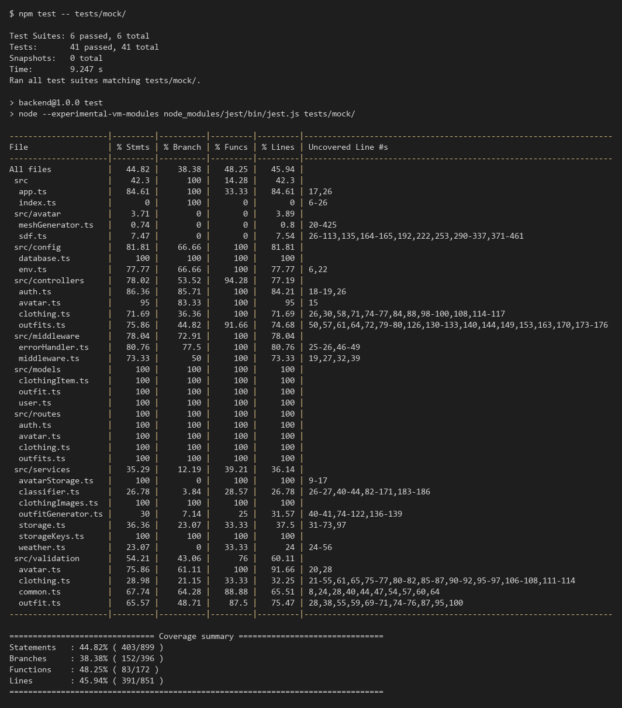
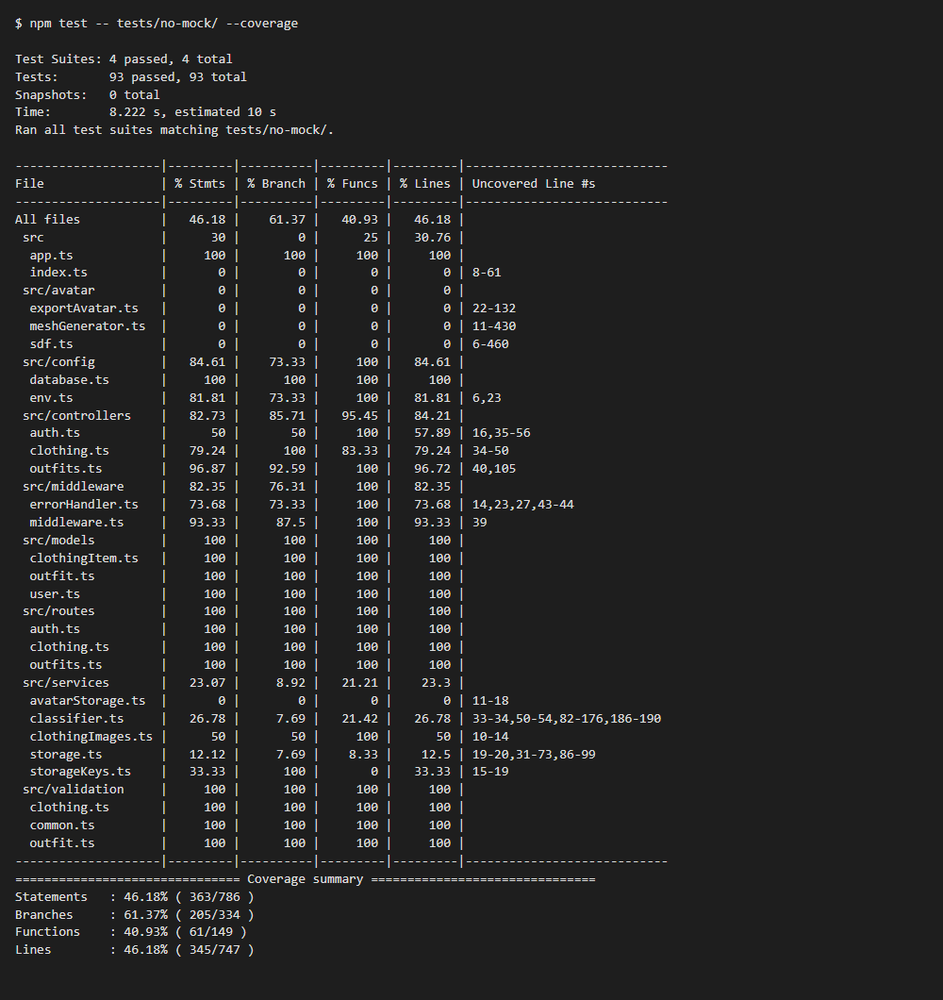
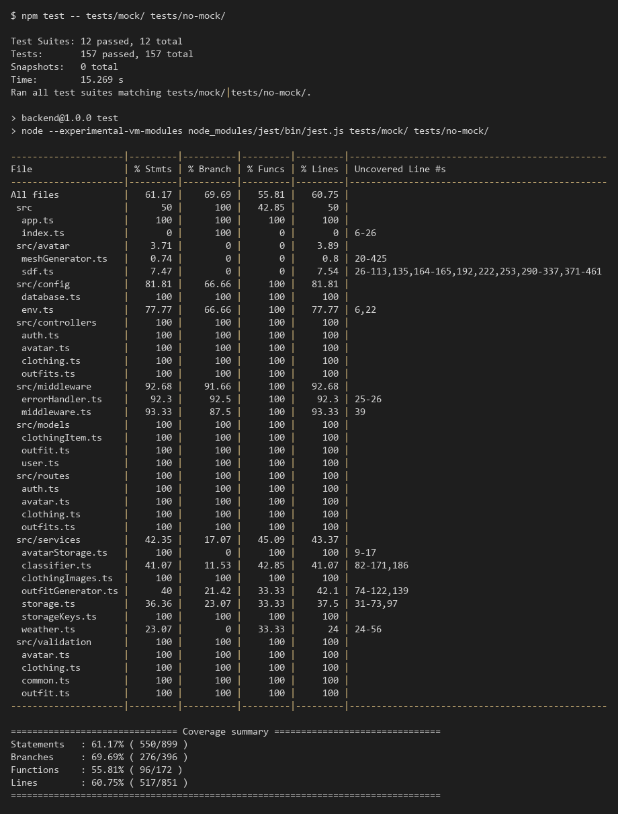

# Testing

## 1. Change History

| **Change Date** | **Modified Sections** | **Rationale** |
| --------------- | --------------------- | ------------- |
| 2026-10-18 | 2, 3, 4 | First version for CP1. Section 2 documents the back-end tests of all interfaces of the Clothing component (`/clothing`), how to run them, the GitHub Actions configuration and the coverage reports. Section 4 gives the end-to-end test design for the Upload Clothing Item use case. Section 3 is left for CP2, since the non-functional requirements are not finalized yet. |
| 2026-10-25 | 4 | Implemented the Upload Clothing Item end-to-end test (`UploadClothingTest.kt`) and added its logs. Each scenario is now a separate test so they don't depend on each other, and "the closet is unchanged" is checked against the back-end and the first card instead of by counting cards, since a large closet doesn't fit on screen. The test adds its photos to the photo library itself and removes them and any item it added afterwards. |

---

## 2. Back-end Test Specification: APIs

For CP1 the back-end tests are documented for all interfaces of the **Clothing** component: `POST /clothing`, `GET /clothing`, `GET /clothing/:id`, `PATCH /clothing/:id` and `DELETE /clothing/:id`. The other interfaces that already have tests are listed in the same table and will be documented in detail for CP2.

### 2.1. Locations of Back-end Tests and Instructions to Run Them

#### 2.1.1. Tests

| **Interface** | **Describe Group Location, No Mocks** | **Describe Group Location, With Mocks** | **Mocked Components** |
| ------------- | ------------------------------------- | --------------------------------------- | --------------------- |
| **POST /clothing** | [`backend/tests/no-mock/clothing.test.ts#L24`](https://github.com/evannawfal/fabricate/blob/10f8b8a44372602cbf048c6a18e843c9c0c1ab0b/backend/tests/no-mock/clothing.test.ts#L24) | [`backend/tests/mock/clothingUpload.test.ts#L69`](https://github.com/evannawfal/fabricate/blob/10f8b8a44372602cbf048c6a18e843c9c0c1ab0b/backend/tests/mock/clothingUpload.test.ts#L69) | Clothing classifier (Claude API), Azure Blob Storage, Clothing DB |
| **GET /clothing** | [`backend/tests/no-mock/clothing.test.ts#L120`](https://github.com/evannawfal/fabricate/blob/10f8b8a44372602cbf048c6a18e843c9c0c1ab0b/backend/tests/no-mock/clothing.test.ts#L120) | [`backend/tests/mock/clothing.test.ts#L38`](https://github.com/evannawfal/fabricate/blob/10f8b8a44372602cbf048c6a18e843c9c0c1ab0b/backend/tests/mock/clothing.test.ts#L38) | Azure Blob Storage (photo links), Clothing DB |
| **GET /clothing/:id** | [`backend/tests/no-mock/clothing.test.ts#L242`](https://github.com/evannawfal/fabricate/blob/10f8b8a44372602cbf048c6a18e843c9c0c1ab0b/backend/tests/no-mock/clothing.test.ts#L242) | [`backend/tests/mock/clothing.test.ts#L80`](https://github.com/evannawfal/fabricate/blob/10f8b8a44372602cbf048c6a18e843c9c0c1ab0b/backend/tests/mock/clothing.test.ts#L80) | Clothing DB |
| **PATCH /clothing/:id** | [`backend/tests/no-mock/clothing.test.ts#L334`](https://github.com/evannawfal/fabricate/blob/10f8b8a44372602cbf048c6a18e843c9c0c1ab0b/backend/tests/no-mock/clothing.test.ts#L334) | [`backend/tests/mock/clothing.test.ts#L101`](https://github.com/evannawfal/fabricate/blob/10f8b8a44372602cbf048c6a18e843c9c0c1ab0b/backend/tests/mock/clothing.test.ts#L101) | Clothing DB |
| **DELETE /clothing/:id** | [`backend/tests/no-mock/clothing.test.ts#L520`](https://github.com/evannawfal/fabricate/blob/10f8b8a44372602cbf048c6a18e843c9c0c1ab0b/backend/tests/no-mock/clothing.test.ts#L520) | [`backend/tests/mock/clothing.test.ts#L149`](https://github.com/evannawfal/fabricate/blob/10f8b8a44372602cbf048c6a18e843c9c0c1ab0b/backend/tests/mock/clothing.test.ts#L149) | Clothing DB |
| POST /auth/google | [`backend/tests/no-mock/auth.test.ts#L20`](https://github.com/evannawfal/fabricate/blob/10f8b8a44372602cbf048c6a18e843c9c0c1ab0b/backend/tests/no-mock/auth.test.ts#L20) | [`backend/tests/mock/auth.test.ts#L47`](https://github.com/evannawfal/fabricate/blob/10f8b8a44372602cbf048c6a18e843c9c0c1ab0b/backend/tests/mock/auth.test.ts#L47) | Google Authentication API, User DB |
| POST /outfits | [`backend/tests/no-mock/outfits.test.ts#L29`](https://github.com/evannawfal/fabricate/blob/10f8b8a44372602cbf048c6a18e843c9c0c1ab0b/backend/tests/no-mock/outfits.test.ts#L29) | Planned for CP2 | Outfit DB |
| GET /outfits | [`backend/tests/no-mock/outfits.test.ts#L172`](https://github.com/evannawfal/fabricate/blob/10f8b8a44372602cbf048c6a18e843c9c0c1ab0b/backend/tests/no-mock/outfits.test.ts#L172) | Planned for CP2 | Outfit DB |
| GET /outfits/:id | [`backend/tests/no-mock/outfits.test.ts#L217`](https://github.com/evannawfal/fabricate/blob/10f8b8a44372602cbf048c6a18e843c9c0c1ab0b/backend/tests/no-mock/outfits.test.ts#L217) | Planned for CP2 | Outfit DB |
| PATCH /outfits/:id | [`backend/tests/no-mock/outfits.test.ts#L279`](https://github.com/evannawfal/fabricate/blob/10f8b8a44372602cbf048c6a18e843c9c0c1ab0b/backend/tests/no-mock/outfits.test.ts#L279) | Planned for CP2 | Outfit DB |
| DELETE /outfits/:id | [`backend/tests/no-mock/outfits.test.ts#L434`](https://github.com/evannawfal/fabricate/blob/10f8b8a44372602cbf048c6a18e843c9c0c1ab0b/backend/tests/no-mock/outfits.test.ts#L434) | Planned for CP2 | Outfit DB |
| GET /health | [`backend/tests/no-mock/health.test.ts#L6`](https://github.com/evannawfal/fabricate/blob/10f8b8a44372602cbf048c6a18e843c9c0c1ab0b/backend/tests/no-mock/health.test.ts#L6) | None needed (no external components) | None |

How the external components are mocked:

- **Clothing classifier (Claude API)** and **Azure Blob Storage**: the tests replace them with Jest stand-ins through `setClothingClassifier()` and `setFileStorage()`, so they can return a classification, throw an "unavailable" or "not clothing" error, or fail an upload. [`backend/tests/setupEnv.ts`](https://github.com/evannawfal/fabricate/blob/10f8b8a44372602cbf048c6a18e843c9c0c1ab0b/backend/tests/setupEnv.ts) clears their credentials, so the tests never call the real services.
- **Clothing DB / User DB** (MongoDB): the tests without mocks use a real in-memory MongoDB server ([`backend/tests/helpers/database.ts`](https://github.com/evannawfal/fabricate/blob/10f8b8a44372602cbf048c6a18e843c9c0c1ab0b/backend/tests/helpers/database.ts)). The mocked tests use `jest.spyOn()` on Mongoose model methods (`ClothingItem.create`, `find`, `findOne`, `findOneAndUpdate`, `exists`) to make them throw a database error.
- **Google Authentication API**: `jest.spyOn(OAuth2Client.prototype, 'verifyIdToken')` returns a chosen Google profile.

**Test cases of the Clothing component**

Each test in the code is annotated with its input, expected status code, expected behavior and expected output (and the mock's behavior for mocked tests). All requests use a valid signed-in user unless the input says otherwise. The table below summarizes them.

**POST /clothing** (multipart form with a `photo` file)

| **Group** | **Test** | **Input** | **Status** | **Expected behavior and output** |
| --------- | -------- | --------- | ---------- | -------------------------------- |
| Unmocked | Missing token | No Authorization header | 401 | Nothing is saved; `{ error: "Missing token" }` |
| Unmocked | Missing photo | No file | 400 | Nothing is saved; error explaining the `photo` field |
| Unmocked | Wrong form field | Photo sent as `image` | 400 | Nothing is saved; error naming the field |
| Unmocked | Unsupported image type | GIF | 400 | Nothing is saved; error listing JPEG, PNG and WebP |
| Unmocked | Photo too large | 5 MB + 1 byte | 413 | Nothing is saved; `{ error: "The photo must be at most 5 MB" }` |
| Unmocked | Classification not configured | Valid JPEG, no API key | 503 | Nothing is saved; `{ error: "Photo classification is not available right now" }` |
| Mocked | Uploads, classifies and saves the item | Classifier returns a denim jacket, storage accepts | 201 | Photo is stored under `clothing/<userId>/`, item is saved with the classified fields; response has the item and a photo link |
| Mocked | Uploaded item appears in the closet | PNG photo, then `GET /clothing` | 201, 200 | Photo keeps the PNG type; the closet lists the new item with a photo link |
| Mocked | Photo is not clothing | Classifier rejects the photo | 422 | Photo is not stored, nothing is saved; `{ error: "The photo does not show a clothing item" }` |
| Mocked | Classifier unavailable | Classifier is rate limited or down | 503 | Photo is not stored, nothing is saved |
| Mocked | Storage not configured | No storage settings | 503 | Classifier is not called (no API cost), nothing is saved |
| Mocked | Storage upload fails | Storage throws | 500 | Nothing is saved; `{ error: "Internal server error" }` |
| Mocked | Database error removes the stored photo | `ClothingItem.create` throws | 500 | The stored photo is deleted so no orphaned file is left |
| Mocked | Clean-up failure is logged, not reported | `ClothingItem.create` and `deleteFile` both throw | 500 | The database error is reported; the clean-up failure is only logged |

**GET /clothing** (`?category=` and `?clean=` filters)

| **Group** | **Test** | **Input** | **Status** | **Expected behavior and output** |
| --------- | -------- | --------- | ---------- | -------------------------------- |
| Unmocked | Missing token | No Authorization header | 401 | `{ error: "Missing token" }` |
| Unmocked | Empty closet | User with no items | 200 | `{ items: [] }` |
| Unmocked | Returns only own items, newest first | Two own items, one from another user | 200 | Only the user's items, newest first, without internal fields |
| Unmocked | Leaves out archived items | One active, one archived item | 200 | Only the active item |
| Unmocked | Filters by category | `?category=top` | 200 | Only tops |
| Unmocked | Filters by clean status | `?clean=false` | 200 | Only items that are not clean |
| Unmocked | Invalid category filter | `?category=hats` | 400 | Error listing the valid categories |
| Unmocked | Invalid clean filter | `?clean=maybe` | 400 | `{ error: "clean must be true or false" }` |
| Mocked | Closet loads without photo links when storage fails | Storage can't sign a download link | 200 | The closet still loads; the item has `imageUrl: null` |
| Mocked | Database error | `ClothingItem.find` throws | 500 | The error is handled and logged; `{ error: "Internal server error" }` |

**GET /clothing/:id**

| **Group** | **Test** | **Input** | **Status** | **Expected behavior and output** |
| --------- | -------- | --------- | ---------- | -------------------------------- |
| Unmocked | Own item | Id of the user's item | 200 | The item's details |
| Unmocked | Archived item | Id of the user's archived item | 200 | The item, marked as archived |
| Unmocked | Another user's item | Id of another user's item | 404 | The item is not revealed; `{ error: "Clothing item not found" }` |
| Unmocked | Unknown item | Valid id that doesn't exist | 404 | `{ error: "Clothing item not found" }` |
| Unmocked | Invalid id | `not-an-id` | 400 | `{ error: "Invalid clothing item id" }` |
| Unmocked | Missing token | No Authorization header | 401 | `{ error: "Missing token" }` |
| Mocked | Database error | `ClothingItem.findOne` throws | 500 | The error is handled and logged; `{ error: "Internal server error" }` |

**PATCH /clothing/:id** (JSON body with any of `name`, `category`, `color`, `style`, `tags`, `isClean`)

| **Group** | **Test** | **Input** | **Status** | **Expected behavior and output** |
| --------- | -------- | --------- | ---------- | -------------------------------- |
| Unmocked | Valid update | New name, category, tags (with spaces and a duplicate), clean status | 200 | Item is updated; tags are trimmed and de-duplicated |
| Unmocked | Partial update of color and style | New color and style only | 200 | Only those fields change |
| Unmocked | Empty body | `{}` | 400 | Item unchanged; error asking for at least one field |
| Unmocked | Unknown field | `{ owner: <other user> }` | 400 | Item unchanged; `{ error: "Unknown field: owner" }` |
| Unmocked | Invalid value (10 cases) | Invalid value for each field, or a non-object body | 400 | Item unchanged; error describing the field |
| Unmocked | Malformed JSON | `{"name": ` | 400 | JSON error |
| Unmocked | Archived item | Id of an archived item | 409 | Item unchanged; `{ error: "Clothing item is archived and can no longer be edited" }` |
| Unmocked | Another user's item | Id of another user's item | 404 | The other user's item is unchanged |
| Unmocked | Invalid id | `123` | 400 | `{ error: "Invalid clothing item id" }` |
| Unmocked | Missing token | No Authorization header | 401 | `{ error: "Missing token" }` |
| Mocked | Database error while saving | `ClothingItem.findOneAndUpdate` throws | 500 | Item unchanged; `{ error: "Internal server error" }` |
| Mocked | Database error while checking for an archived item | Archived item; `ClothingItem.exists` throws | 500 | Item unchanged; `{ error: "Internal server error" }` |

**DELETE /clothing/:id** (archives the item: it leaves the closet, but past outfits still show it)

| **Group** | **Test** | **Input** | **Status** | **Expected behavior and output** |
| --------- | -------- | --------- | ---------- | -------------------------------- |
| Unmocked | Own item used in an outfit | Id of the user's item that is in an outfit | 204 | Item is archived; it leaves the closet but the outfit still shows it; empty body |
| Unmocked | Already archived item | Id of an archived item | 404 | Nothing changes; `{ error: "Clothing item not found" }` |
| Unmocked | Another user's item | Id of another user's item | 404 | The other user's item is not archived |
| Unmocked | Invalid id | `not-an-id` | 400 | `{ error: "Invalid clothing item id" }` |
| Unmocked | Missing token | No Authorization header | 401 | `{ error: "Missing token" }` |
| Mocked | Database error | `ClothingItem.findOneAndUpdate` throws | 500 | Item is not archived; `{ error: "Internal server error" }` |

#### 2.1.2. Commit Hash Where Tests Run

`10f8b8a44372602cbf048c6a18e843c9c0c1ab0b`

#### 2.1.3. Explanation on How to Run the Tests

The tests need **Node.js 22** and npm 10. They do not need a `.env` file, a MongoDB installation or any API keys: they start an in-memory MongoDB server and never call the Claude API, Azure Blob Storage or Google. The first run downloads a MongoDB binary, so it needs an internet connection.

1. **Clone the repository**:

   ```
   git clone https://github.com/evannawfal/fabricate.git
   cd fabricate
   git checkout 10f8b8a44372602cbf048c6a18e843c9c0c1ab0b
   ```

2. **Install the back-end dependencies**:

   ```
   cd backend
   npm ci
   ```

3. **Run the interface tests** with the course script from the repository root (Linux, macOS or WSL). It runs the mocked tests, the tests without mocks, and both combined, each with a coverage report (saved in `backend/coverage/mock`, `backend/coverage/no-mock` and `backend/coverage/interface`):

   ```
   ./scripts/run-backend-interface-tests.sh
   ```

   Or run each set directly from `backend/` (this also works in Windows PowerShell):

   ```
   npm test -- tests/no-mock/      # without mocks
   npm test -- tests/mock/         # with mocks
   npm test -- tests/mock/ tests/no-mock/   # both combined
   npm test                        # every back-end test, including the unit tests in tests/unit
   ```

   Coverage is always collected for every file in `backend/src` (`collectCoverageFrom` in [`backend/jest.config.js`](https://github.com/evannawfal/fabricate/blob/10f8b8a44372602cbf048c6a18e843c9c0c1ab0b/backend/jest.config.js)) and printed as a per-file table.

### 2.2. GitHub Actions Configuration Location

`.github/workflows/backend.yml`

The **Backend tests** job runs on every pull request and every push to `main`. It installs the dependencies, type-checks and builds the back-end, then runs `npm test`, which runs every test in `backend/tests` (mock, no-mock and unit). The coverage report is uploaded as the `backend-coverage` artifact of each run. The job is a required check before a pull request can be merged into `main`.

### 2.3. Jest Coverage Report Screenshots With Mocks

`npm test -- tests/mock/` (19 tests, all passing):



The mocked tests focus on error handling (failing classifier, storage and database calls) and on the parts that depend on the external services, so their coverage is low on its own.

### 2.4. Jest Coverage Report Screenshots Without Mocks

`npm test -- tests/no-mock/` (93 tests, all passing):



Without mocks, `controllers/clothing.ts` misses lines 34-50: the part of `POST /clothing` after a photo is accepted, which needs the classifier and file storage (covered by the mocked tests).

### 2.5. Jest Coverage Report Screenshots With and Without Mocks Combined

`npm test -- tests/mock/ tests/no-mock/` (112 tests, all passing):



**Clothing component:** every file of the Clothing component has 100% statement, branch, function and line coverage when both sets run: `routes/clothing.ts`, `controllers/clothing.ts`, `validation/clothing.ts`, `models/clothingItem.ts` and `services/clothingImages.ts`.

**Why the rest of the back-end is below 100%:**

| **File (uncovered lines)** | **Reason** |
| -------------------------- | ---------- |
| `src/index.ts` (8-61) | The server entry point: it connects to the production MongoDB and calls `app.listen()`. The tests build the same Express app with `createApp()` from `src/app.ts` and an in-memory database instead, so this file only runs when the server is started. |
| `src/avatar/*`, `services/avatarStorage.ts`, `services/storageKeys.ts` (19) | Avatar generation and avatar file storage for the Customize Avatar feature. No API endpoint uses them yet (avatar endpoints are in progress), so API tests can't reach them. They will be covered by the avatar interface tests. |
| `services/classifier.ts` (82-171, 186), `services/storage.ts` (31-73, 97) | The adapters that call the real Claude API and Azure Blob Storage SDKs. The interface tests replace them with stand-ins so they never use paid external services. The adapters are tested with mocked SDK clients in `backend/tests/unit` (`npm test`: classifier.ts 98% and storage.ts 97% of statements). The only lines left are the ones that create the real SDK client from the production credentials. |
| `config/env.ts` (6, 23) | Start-up checks that stop the server when a required environment variable is missing or `PORT` is invalid. They run once when the module loads, before any request. |
| `controllers/outfits.ts` (40, 105), `middleware/middleware.ts` (39), `middleware/errorHandler.ts` (branches on 36, 40) | Outfits component (documented for CP2) and defensive checks. Tests for the missing outfit cases will be added with the Outfits component, and unreachable checks will be removed. |

---

## 3. Tests of Non-Functional Requirements

The non-functional requirements are not finalized in `Requirements_and_Design.md` yet. Their automated tests will be in `backend/tests/nfr/` and will be documented here for CP2.

### 3.1. Test Locations in Git

| **Non-Functional Requirement** | **Location in Git** |
| ------------------------------ | ------------------- |
| _To be added for CP2_ | `backend/tests/nfr/` |

### 3.2. Test Verification and Logs

_To be added for CP2._

---

## 4. Front-end Test Specification

### 4.1. Location in Git of Front-end Test Suite:

`frontend/app/src/androidTest/java/com/example/cpen321application/e2e/`

The Upload Clothing Item use case is tested by [`UploadClothingTest.kt`](https://github.com/evannawfal/fabricate/blob/main/frontend/app/src/androidTest/java/com/example/cpen321application/e2e/UploadClothingTest.kt) in this folder. Run it, with the rest of the end-to-end tests, with `scripts/run-frontend-e2e-tests.sh` (or `.ps1`), and sign in to the app on the emulator when the script asks.

The test opens the app's main screen, signed in as the tester, and talks to the real deployed back-end and its photo classifier; nothing is mocked. The system photo picker is a separate app, so it is driven with UI Automator. Each scenario is its own test, so they don't depend on each other or on what is already in the tester's closet:

- Before each test, it reads the tester's closet from the back-end (`GET /clothing`) and copies the photo it will pick from its test assets into the emulator's photo library: `shirt.jpg` (a black T-shirt) or `mug.jpg` (a coffee mug, not clothing). Being the newest photo, it is the first one in the photo picker.
- "The closet is unchanged" means the back-end has no new items and the first card on screen is the same item as before (or the screen still shows "Your closet is empty"). Counting cards on screen would only count the ones that fit on it.
- After each test, it deletes the photo from the photo library and any item it added from the tester's closet.

The test finds item cards, their photos and the loading indicator by the test tags `closet_item`, `closet_item_image` and `upload_progress`.

### 4.2. Tests

- **Use Case: Upload Clothing Item**

  **Main success scenario**
  1. The user opens the Closet tab and taps "Add clothing".
  2. The app asks whether to take a photo with the camera or choose one from the gallery.
  3. The user takes or chooses a photo of a clothing item.
  4. The app uploads the photo and shows a loading indicator while the item is classified.
  5. The app shows the new item at the top of the closet with its photo and name; its details show the category, colour and style the app detected.

  **Failure scenarios**
  - 3a. The user closes the camera or gallery without choosing a photo.
    - 3a1. The app returns to the Closet screen and the closet is unchanged.
  - 4a. The photo does not show a clothing item.
    - 4a1. The app shows the message "This photo doesn't show a clothing item. Try another photo." and the closet is unchanged.
  - 4b. The photo can't be uploaded or classified (no network, or the server is unavailable).
    - 4b1. The app shows the message "Couldn't add the item. Please try again." with a "Try again" button.
    - 4b2. The user taps "Try again" and the app repeats step 4.

  - **Expected Behaviors:**

    | **Scenario Steps** | **Test Case Steps** |
    | ------------------ | ------------------- |
    | 1. The user opens the Closet tab and taps "Add clothing". | Click "Closet" in the bottom navigation bar.<br>Check that the text "My Closet" is present on screen.<br>Click the button labelled "Add clothing". |
    | 2. The app asks whether to take a photo with the camera or choose one from the gallery. | Check that the options "Take photo" and "Choose from gallery" are present on screen. |
    | 3a. The user closes the camera or gallery without choosing a photo. | `closingThePhotoPicker_leavesTheClosetUnchanged`: add `shirt.jpg` to the photo library, then do steps 1 and 2.<br>Click "Choose from gallery".<br>With UI Automator, wait for the photo picker to show the photo, then press the Back button. |
    | 3a1. The app returns to the Closet screen and the closet is unchanged. | With UI Automator, check that the app is back on screen.<br>Check that the loading indicator (tagged `upload_progress`) is not present.<br>Check that the text "My Closet" and the button labelled "Add clothing" are present on screen.<br>Check that the closet is unchanged. |
    | 4a. The photo does not show a clothing item. | `photoThatIsNotClothing_showsAMessageAndAddsNothing`: add `mug.jpg` to the photo library, then do steps 1 and 2.<br>Click "Choose from gallery".<br>With UI Automator, select the first photo in the photo picker (`mug.jpg`). |
    | 4a1. The app shows the message "This photo doesn't show a clothing item. Try another photo." and the closet is unchanged. | Wait up to 30 seconds for the text "This photo doesn't show a clothing item. Try another photo." to be present on screen.<br>Check that there is no "Try again" button.<br>Click "OK".<br>Check that the closet is unchanged. |
    | 3. The user takes or chooses a photo of a clothing item. | `choosingAClothingPhoto_addsTheItemFirstWithItsDetectedDetails`: add `shirt.jpg` to the photo library, then do steps 1 and 2.<br>Click "Choose from gallery".<br>With UI Automator, select the first photo in the photo picker (`shirt.jpg`). |
    | 4. The app uploads the photo and shows a loading indicator while the item is classified. | Wait up to 10 seconds for the loading indicator (tagged `upload_progress`), and check that it is displayed.<br>Wait up to 30 seconds for it to disappear. |
    | 5. The app shows the new item at the top of the closet with its photo and name; its details show the category, colour and style the app detected. | Check that the back-end has exactly one new item, that its category is "top" and that it has a photo.<br>Check that the first card (tagged `closet_item`) shows the new item's name and contains its photo (tagged `closet_item_image`).<br>Click the first card.<br>Check that the text "Added to your closet" is present, and that the details show "Tops" and the colour and style the back-end detected.<br>Click "Back" and check that the text "My Closet" is present on screen. |
    | 4b. The photo can't be uploaded or classified. | Not automated: it needs the back-end to fail on purpose, and the front-end end-to-end tests use the real back-end with no mocking. The back-end side of this failure is covered by the mocked `POST /clothing` tests ("Classifier unavailable", "Storage upload fails"), and the app's "Try again" flow by `AddClothingTest.kt` (`failedUpload_canBeTriedAgainWithTheSamePhoto`), which runs the Closet screen with a fake back-end. |

  - **Test Logs:**
    ```
    > Task :app:connectedDebugAndroidTest
    Starting 5 tests on Pixel_9(AVD) - 16
    Pixel_9(AVD) - 16 Tests 2/5 completed. (0 skipped) (0 failed)
    Pixel_9(AVD) - 16 Tests 3/5 completed. (0 skipped) (0 failed)
    Pixel_9(AVD) - 16 Tests 5/5 completed. (0 skipped) (0 failed)
    Finished 5 tests on Pixel_9(AVD) - 16

    BUILD SUCCESSFUL in 46s

    com.example.cpen321application.e2e.UploadClothingTest (Pixel 9 emulator, API 36, deployed back-end):
      photoThatIsNotClothing_showsAMessageAndAddsNothing                PASSED (8.96 s)
      choosingAClothingPhoto_addsTheItemFirstWithItsDetectedDetails     PASSED (9.10 s)
      closingThePhotoPicker_leavesTheClosetUnchanged                    PASSED (6.32 s)
    ```
