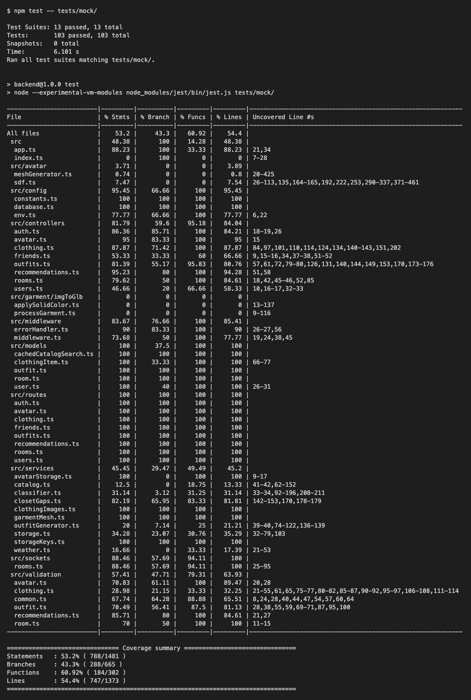
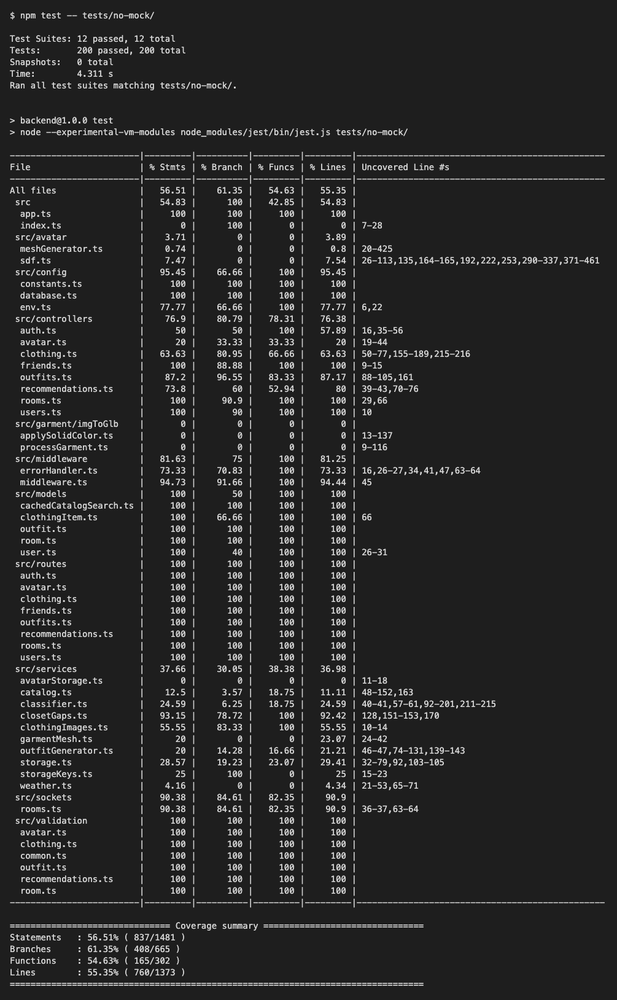
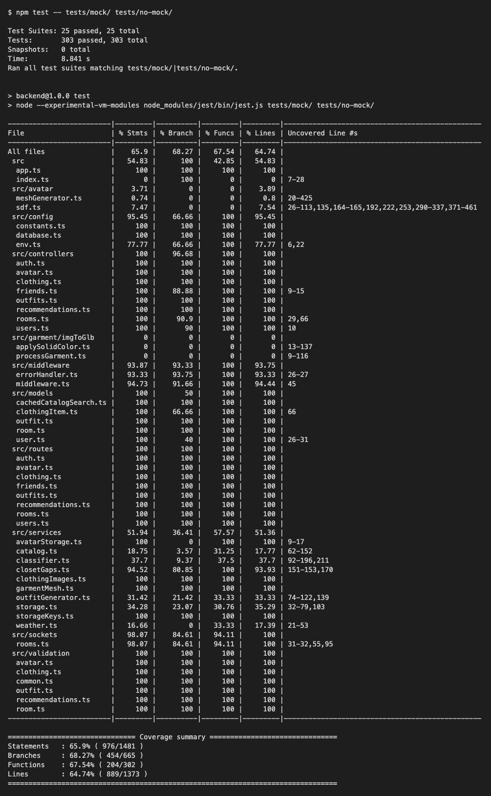
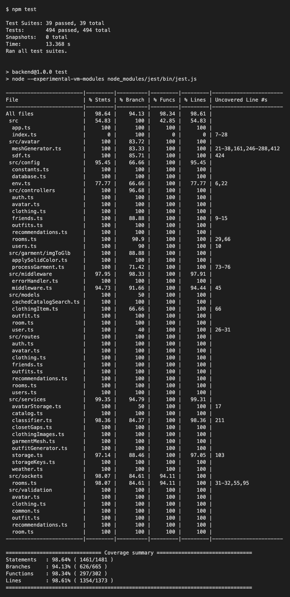

# Testing

## 1. Change History

| **Change Date** | **Modified Sections** | **Rationale** |
| --------------- | --------------------- | ------------- |
| 2026-10-18 | 2, 3, 4 | First version for CP1. Section 2 documents the back-end tests of all interfaces of the Clothing component (`/clothing`), how to run them, the GitHub Actions configuration and the coverage reports. Section 4 gives the end-to-end test design for the Upload Clothing Item use case. Section 3 is left for CP2, since the non-functional requirements are not finalized yet. |
| 2026-10-24 | 2.1.1, 2.5 | Added the mocked `describe` groups for the `/outfits` interfaces. `controllers/outfits.ts` is now fully covered: the mocked tests reach the update-after-concurrent-delete case, and an unreachable check was removed. |
| 2026-10-25 | 4 | Implemented the Upload Clothing Item end-to-end test (`UploadClothingTest.kt`) and added its logs. Each scenario is now a separate test so they don't depend on each other, and "the closet is unchanged" is checked against the back-end and the first card instead of by counting cards, since a large closet doesn't fit on screen. The test adds its photos to the photo library itself and removes them and any item it added afterwards. |
| 2026-10-29 | 2, 3 | Updated for CP2. Added `POST /avatar` and `POST /outfits/generate` to the back-end test table and the mocked components, and pointed every test link at the current line. Updated the commit hash, the run instructions and the coverage screenshots, added a report of every back-end test together with the reasons each file below 100% can't be fully covered, and covered the error handler's branches listed for CP2. Section 3 now names the two non-functional requirements that are tested automatically; their tests come with the features they measure. |
| 2026-11-03 | 2.1.1, 2.3, 2.5 | Updated the Clothing upload test documentation for required front and back photos. Added the front-photo upload failure case and documented cleanup attempts for both generated storage keys. |
| 2026-11-04 | 2, 4 | Final update for CP2. Added the friends, profile (`/users/me`), rooms, room Socket.IO and garment model interfaces to the back-end test table, completed the `POST /clothing` test cases for front and back photos, and pointed every test link at the submission commit. Updated the test counts, coverage screenshots and the reasons each file below 100% can't be fully covered. Section 4 now follows the two-photo Add Clothing Items use case and has a new log. |
| 2026-11-11 | 2.1.1 | Added the tests of the posts interfaces (`POST /posts`, `GET /posts` and `DELETE /posts/:id`). |

---

## 2. Back-end Test Specification: APIs

The back-end tests are documented in detail for all interfaces of the **Clothing** component: `POST /clothing`, `GET /clothing`, `GET /clothing/:id`, `PATCH /clothing/:id` and `DELETE /clothing/:id`. Every other interface that has tests (authentication, avatars, outfits, recommendations, friends, profiles, posts, rooms with their live Socket.IO events, and garment models) is listed in the same table with its `describe` groups and mocked components.

### 2.1. Locations of Back-end Tests and Instructions to Run Them

#### 2.1.1. Tests

| **Interface** | **Describe Group Location, No Mocks** | **Describe Group Location, With Mocks** | **Mocked Components** |
| ------------- | ------------------------------------- | --------------------------------------- | --------------------- |
| **POST /clothing** | [`backend/tests/no-mock/clothing.test.ts#L28`](https://github.com/evannawfal/fabricate/blob/1b9c140a06ce98a69e69005322cf631676a79495/backend/tests/no-mock/clothing.test.ts#L28) | [`backend/tests/mock/clothingUpload.test.ts#L96`](https://github.com/evannawfal/fabricate/blob/1b9c140a06ce98a69e69005322cf631676a79495/backend/tests/mock/clothingUpload.test.ts#L96) | Clothing classifier (Claude API), Azure Blob Storage, Clothing DB |
| **GET /clothing** | [`backend/tests/no-mock/clothing.test.ts#L216`](https://github.com/evannawfal/fabricate/blob/1b9c140a06ce98a69e69005322cf631676a79495/backend/tests/no-mock/clothing.test.ts#L216) | [`backend/tests/mock/clothing.test.ts#L38`](https://github.com/evannawfal/fabricate/blob/1b9c140a06ce98a69e69005322cf631676a79495/backend/tests/mock/clothing.test.ts#L38) | Azure Blob Storage (photo links), Clothing DB |
| **GET /clothing/:id** | [`backend/tests/no-mock/clothing.test.ts#L369`](https://github.com/evannawfal/fabricate/blob/1b9c140a06ce98a69e69005322cf631676a79495/backend/tests/no-mock/clothing.test.ts#L369) | [`backend/tests/mock/clothing.test.ts#L78`](https://github.com/evannawfal/fabricate/blob/1b9c140a06ce98a69e69005322cf631676a79495/backend/tests/mock/clothing.test.ts#L78) | Clothing DB |
| **PATCH /clothing/:id** | [`backend/tests/no-mock/clothing.test.ts#L463`](https://github.com/evannawfal/fabricate/blob/1b9c140a06ce98a69e69005322cf631676a79495/backend/tests/no-mock/clothing.test.ts#L463) | [`backend/tests/mock/clothing.test.ts#L99`](https://github.com/evannawfal/fabricate/blob/1b9c140a06ce98a69e69005322cf631676a79495/backend/tests/mock/clothing.test.ts#L99) | Clothing DB |
| **DELETE /clothing/:id** | [`backend/tests/no-mock/clothing.test.ts#L668`](https://github.com/evannawfal/fabricate/blob/1b9c140a06ce98a69e69005322cf631676a79495/backend/tests/no-mock/clothing.test.ts#L668) | [`backend/tests/mock/clothing.test.ts#L147`](https://github.com/evannawfal/fabricate/blob/1b9c140a06ce98a69e69005322cf631676a79495/backend/tests/mock/clothing.test.ts#L147) | Clothing DB |
| POST /clothing/:id/generate | [`backend/tests/no-mock/clothingModel.test.ts#L23`](https://github.com/evannawfal/fabricate/blob/1b9c140a06ce98a69e69005322cf631676a79495/backend/tests/no-mock/clothingModel.test.ts#L23) | [`backend/tests/mock/clothingModel.test.ts#L82`](https://github.com/evannawfal/fabricate/blob/1b9c140a06ce98a69e69005322cf631676a79495/backend/tests/mock/clothingModel.test.ts#L82) | Garment model generation, Azure Blob Storage, Clothing DB |
| GET /clothing/:id/model | [`backend/tests/no-mock/clothingModel.test.ts#L65`](https://github.com/evannawfal/fabricate/blob/1b9c140a06ce98a69e69005322cf631676a79495/backend/tests/no-mock/clothingModel.test.ts#L65) | [`backend/tests/mock/clothingModel.test.ts#L333`](https://github.com/evannawfal/fabricate/blob/1b9c140a06ce98a69e69005322cf631676a79495/backend/tests/mock/clothingModel.test.ts#L333) | Azure Blob Storage (model link), Clothing DB |
| POST /auth/google | [`backend/tests/no-mock/auth.test.ts#L20`](https://github.com/evannawfal/fabricate/blob/1b9c140a06ce98a69e69005322cf631676a79495/backend/tests/no-mock/auth.test.ts#L20) | [`backend/tests/mock/auth.test.ts#L47`](https://github.com/evannawfal/fabricate/blob/1b9c140a06ce98a69e69005322cf631676a79495/backend/tests/mock/auth.test.ts#L47) | Google Authentication API, User DB |
| POST /avatar | [`backend/tests/no-mock/avatar.test.ts#L24`](https://github.com/evannawfal/fabricate/blob/1b9c140a06ce98a69e69005322cf631676a79495/backend/tests/no-mock/avatar.test.ts#L24) | [`backend/tests/mock/avatar.test.ts#L60`](https://github.com/evannawfal/fabricate/blob/1b9c140a06ce98a69e69005322cf631676a79495/backend/tests/mock/avatar.test.ts#L60) | Avatar generation, Azure Blob Storage, User DB |
| POST /outfits | [`backend/tests/no-mock/outfits.test.ts#L29`](https://github.com/evannawfal/fabricate/blob/1b9c140a06ce98a69e69005322cf631676a79495/backend/tests/no-mock/outfits.test.ts#L29) | [`backend/tests/mock/outfits.test.ts#L52`](https://github.com/evannawfal/fabricate/blob/1b9c140a06ce98a69e69005322cf631676a79495/backend/tests/mock/outfits.test.ts#L52) | Outfit DB, Clothing DB |
| POST /outfits/generate | [`backend/tests/no-mock/outfitGeneration.test.ts#L26`](https://github.com/evannawfal/fabricate/blob/1b9c140a06ce98a69e69005322cf631676a79495/backend/tests/no-mock/outfitGeneration.test.ts#L26) | [`backend/tests/mock/outfitGeneration.test.ts#L73`](https://github.com/evannawfal/fabricate/blob/1b9c140a06ce98a69e69005322cf631676a79495/backend/tests/mock/outfitGeneration.test.ts#L73) | Outfit generator (Claude API), Weather service (OpenWeather), Clothing DB |
| GET /outfits | [`backend/tests/no-mock/outfits.test.ts#L172`](https://github.com/evannawfal/fabricate/blob/1b9c140a06ce98a69e69005322cf631676a79495/backend/tests/no-mock/outfits.test.ts#L172) | [`backend/tests/mock/outfits.test.ts#L101`](https://github.com/evannawfal/fabricate/blob/1b9c140a06ce98a69e69005322cf631676a79495/backend/tests/mock/outfits.test.ts#L101) | Outfit DB, Clothing DB, Azure Blob Storage (photo links) |
| GET /outfits/:id | [`backend/tests/no-mock/outfits.test.ts#L217`](https://github.com/evannawfal/fabricate/blob/1b9c140a06ce98a69e69005322cf631676a79495/backend/tests/no-mock/outfits.test.ts#L217) | [`backend/tests/mock/outfits.test.ts#L158`](https://github.com/evannawfal/fabricate/blob/1b9c140a06ce98a69e69005322cf631676a79495/backend/tests/mock/outfits.test.ts#L158) | Outfit DB |
| PATCH /outfits/:id | [`backend/tests/no-mock/outfits.test.ts#L279`](https://github.com/evannawfal/fabricate/blob/1b9c140a06ce98a69e69005322cf631676a79495/backend/tests/no-mock/outfits.test.ts#L279) | [`backend/tests/mock/outfits.test.ts#L178`](https://github.com/evannawfal/fabricate/blob/1b9c140a06ce98a69e69005322cf631676a79495/backend/tests/mock/outfits.test.ts#L178) | Outfit DB |
| DELETE /outfits/:id | [`backend/tests/no-mock/outfits.test.ts#L434`](https://github.com/evannawfal/fabricate/blob/1b9c140a06ce98a69e69005322cf631676a79495/backend/tests/no-mock/outfits.test.ts#L434) | [`backend/tests/mock/outfits.test.ts#L246`](https://github.com/evannawfal/fabricate/blob/1b9c140a06ce98a69e69005322cf631676a79495/backend/tests/mock/outfits.test.ts#L246) | Outfit DB |
| GET /recommendations | [`backend/tests/no-mock/recommendations.test.ts#L27`](https://github.com/evannawfal/fabricate/blob/1b9c140a06ce98a69e69005322cf631676a79495/backend/tests/no-mock/recommendations.test.ts#L27) | [`backend/tests/mock/recommendations.test.ts#L71`](https://github.com/evannawfal/fabricate/blob/1b9c140a06ce98a69e69005322cf631676a79495/backend/tests/mock/recommendations.test.ts#L71) | Online store catalog (Serper), Clothing DB |
| GET /friends | [`backend/tests/no-mock/friends.test.ts#L24`](https://github.com/evannawfal/fabricate/blob/1b9c140a06ce98a69e69005322cf631676a79495/backend/tests/no-mock/friends.test.ts#L24) | [`backend/tests/mock/friends.test.ts#L40`](https://github.com/evannawfal/fabricate/blob/1b9c140a06ce98a69e69005322cf631676a79495/backend/tests/mock/friends.test.ts#L40) | User DB |
| POST /friends | [`backend/tests/no-mock/friends.test.ts#L58`](https://github.com/evannawfal/fabricate/blob/1b9c140a06ce98a69e69005322cf631676a79495/backend/tests/no-mock/friends.test.ts#L58) | [`backend/tests/mock/friends.test.ts#L55`](https://github.com/evannawfal/fabricate/blob/1b9c140a06ce98a69e69005322cf631676a79495/backend/tests/mock/friends.test.ts#L55) | User DB |
| DELETE /friends/:id | [`backend/tests/no-mock/friends.test.ts#L117`](https://github.com/evannawfal/fabricate/blob/1b9c140a06ce98a69e69005322cf631676a79495/backend/tests/no-mock/friends.test.ts#L117) | [`backend/tests/mock/friends.test.ts#L77`](https://github.com/evannawfal/fabricate/blob/1b9c140a06ce98a69e69005322cf631676a79495/backend/tests/mock/friends.test.ts#L77) | User DB |
| GET /users/me | [`backend/tests/no-mock/users.test.ts#L20`](https://github.com/evannawfal/fabricate/blob/1b9c140a06ce98a69e69005322cf631676a79495/backend/tests/no-mock/users.test.ts#L20) | [`backend/tests/mock/users.test.ts#L28`](https://github.com/evannawfal/fabricate/blob/1b9c140a06ce98a69e69005322cf631676a79495/backend/tests/mock/users.test.ts#L28) | User DB |
| PATCH /users/me | [`backend/tests/no-mock/users.test.ts#L46`](https://github.com/evannawfal/fabricate/blob/1b9c140a06ce98a69e69005322cf631676a79495/backend/tests/no-mock/users.test.ts#L46) | [`backend/tests/mock/users.test.ts#L28`](https://github.com/evannawfal/fabricate/blob/1b9c140a06ce98a69e69005322cf631676a79495/backend/tests/mock/users.test.ts#L28) | User DB |
| POST /posts | [`backend/tests/no-mock/posts.test.ts#L48`](https://github.com/evannawfal/fabricate/blob/65ec812d5901820fc3ae0ed1391d652656bd7521/backend/tests/no-mock/posts.test.ts#L48) | [`backend/tests/mock/posts.test.ts#L51`](https://github.com/evannawfal/fabricate/blob/65ec812d5901820fc3ae0ed1391d652656bd7521/backend/tests/mock/posts.test.ts#L51) | Outfit DB, Post DB |
| GET /posts | [`backend/tests/no-mock/posts.test.ts#L127`](https://github.com/evannawfal/fabricate/blob/65ec812d5901820fc3ae0ed1391d652656bd7521/backend/tests/no-mock/posts.test.ts#L127) | [`backend/tests/mock/posts.test.ts#L75`](https://github.com/evannawfal/fabricate/blob/65ec812d5901820fc3ae0ed1391d652656bd7521/backend/tests/mock/posts.test.ts#L75) | User DB, Post DB, Clothing DB |
| DELETE /posts/:id | [`backend/tests/no-mock/posts.test.ts#L232`](https://github.com/evannawfal/fabricate/blob/65ec812d5901820fc3ae0ed1391d652656bd7521/backend/tests/no-mock/posts.test.ts#L232) | [`backend/tests/mock/posts.test.ts#L96`](https://github.com/evannawfal/fabricate/blob/65ec812d5901820fc3ae0ed1391d652656bd7521/backend/tests/mock/posts.test.ts#L96) | Post DB |
| POST /rooms | [`backend/tests/no-mock/rooms.test.ts#L28`](https://github.com/evannawfal/fabricate/blob/1b9c140a06ce98a69e69005322cf631676a79495/backend/tests/no-mock/rooms.test.ts#L28) | [`backend/tests/mock/rooms.test.ts#L49`](https://github.com/evannawfal/fabricate/blob/1b9c140a06ce98a69e69005322cf631676a79495/backend/tests/mock/rooms.test.ts#L49) | Room DB, User DB |
| GET /rooms | [`backend/tests/no-mock/rooms.test.ts#L99`](https://github.com/evannawfal/fabricate/blob/1b9c140a06ce98a69e69005322cf631676a79495/backend/tests/no-mock/rooms.test.ts#L99) | [`backend/tests/mock/rooms.test.ts#L88`](https://github.com/evannawfal/fabricate/blob/1b9c140a06ce98a69e69005322cf631676a79495/backend/tests/mock/rooms.test.ts#L88) | Room DB |
| GET /rooms/:id | [`backend/tests/no-mock/rooms.test.ts#L119`](https://github.com/evannawfal/fabricate/blob/1b9c140a06ce98a69e69005322cf631676a79495/backend/tests/no-mock/rooms.test.ts#L119) | [`backend/tests/mock/rooms.test.ts#L103`](https://github.com/evannawfal/fabricate/blob/1b9c140a06ce98a69e69005322cf631676a79495/backend/tests/mock/rooms.test.ts#L103) | Room DB |
| POST /rooms/:id/save | [`backend/tests/no-mock/rooms.test.ts#L162`](https://github.com/evannawfal/fabricate/blob/1b9c140a06ce98a69e69005322cf631676a79495/backend/tests/no-mock/rooms.test.ts#L162) | [`backend/tests/mock/rooms.test.ts#L103`](https://github.com/evannawfal/fabricate/blob/1b9c140a06ce98a69e69005322cf631676a79495/backend/tests/mock/rooms.test.ts#L103) | Room DB |
| Socket.IO: joining a room | [`backend/tests/no-mock/roomSockets.test.ts#L8`](https://github.com/evannawfal/fabricate/blob/1b9c140a06ce98a69e69005322cf631676a79495/backend/tests/no-mock/roomSockets.test.ts#L8) | [`backend/tests/mock/roomSockets.test.ts#L32`](https://github.com/evannawfal/fabricate/blob/1b9c140a06ce98a69e69005322cf631676a79495/backend/tests/mock/roomSockets.test.ts#L32) | Room DB |
| Socket.IO: `room:message` | [`backend/tests/no-mock/roomSockets.test.ts#L31`](https://github.com/evannawfal/fabricate/blob/1b9c140a06ce98a69e69005322cf631676a79495/backend/tests/no-mock/roomSockets.test.ts#L31) | [`backend/tests/mock/roomSockets.test.ts#L48`](https://github.com/evannawfal/fabricate/blob/1b9c140a06ce98a69e69005322cf631676a79495/backend/tests/mock/roomSockets.test.ts#L48) | Message DB |
| Socket.IO: `room:outfitUpdate` | [`backend/tests/no-mock/roomSockets.test.ts#L60`](https://github.com/evannawfal/fabricate/blob/1b9c140a06ce98a69e69005322cf631676a79495/backend/tests/no-mock/roomSockets.test.ts#L60) | [`backend/tests/mock/roomSockets.test.ts#L63`](https://github.com/evannawfal/fabricate/blob/1b9c140a06ce98a69e69005322cf631676a79495/backend/tests/mock/roomSockets.test.ts#L63) | Clothing DB |
| Socket.IO: `room:memberLeft` | [`backend/tests/no-mock/roomSockets.test.ts#L112`](https://github.com/evannawfal/fabricate/blob/1b9c140a06ce98a69e69005322cf631676a79495/backend/tests/no-mock/roomSockets.test.ts#L112) | None needed (no database call that can fail on its own) | None |
| GET /health | [`backend/tests/no-mock/health.test.ts#L6`](https://github.com/evannawfal/fabricate/blob/1b9c140a06ce98a69e69005322cf631676a79495/backend/tests/no-mock/health.test.ts#L6) | None needed (no external components) | None |

How the external components are mocked:

- **Clothing classifier (Claude API)**, **outfit generator (Claude API)**, **weather service (OpenWeather)** and **Azure Blob Storage**: the tests replace them with Jest stand-ins through `setClothingClassifier()`, `setOutfitGenerator()`, `setWeatherService()` and `setFileStorage()`. The stand-ins can return a result, throw an "unavailable" or "not clothing" error, report the weather as unavailable, or fail an upload. [`backend/tests/setupEnv.ts`](https://github.com/evannawfal/fabricate/blob/1b9c140a06ce98a69e69005322cf631676a79495/backend/tests/setupEnv.ts) clears the services' credentials, so the tests never call the real services.
- **Online store catalog (Serper)**: the unit tests give `createSerperProvider()` a stand-in for `fetch`, so no search is sent to Serper, and `setCatalogService()` replaces the whole service. The cache is tested against the real in-memory MongoDB server. `backend/tests/setupEnv.ts` blanks `SERPER_API_KEY`, so tests never spend search credits.
- **Avatar generation** and **garment model generation**: `jest.unstable_mockModule()` replaces `exportAvatar()` and `processAndApplyGarment()`, so the mocked `POST /avatar` and `POST /clothing/:id/generate` tests can return a model or fail without generating one.
- **Clothing DB / Outfit DB / User DB / Post DB / Room DB / Message DB** (MongoDB): the tests without mocks use a real in-memory MongoDB server ([`backend/tests/helpers/database.ts`](https://github.com/evannawfal/fabricate/blob/1b9c140a06ce98a69e69005322cf631676a79495/backend/tests/helpers/database.ts)). The mocked tests use `jest.spyOn()` on Mongoose model methods (for example `ClothingItem.create`, `find`, `findOne`, `findOneAndUpdate`, `exists`, and the same `Outfit`, `User`, `Post`, `Room` and `Message` methods) to make them throw a database error.
- **Socket.IO**: nothing is mocked. The room socket tests start the back-end's Socket.IO server and connect real Socket.IO clients over WebSocket, as the app does.
- **Google Authentication API**: `jest.spyOn(OAuth2Client.prototype, 'verifyIdToken')` returns a chosen Google profile.

[`backend/tests/mock/backImageUrl.test.ts`](https://github.com/evannawfal/fabricate/blob/1b9c140a06ce98a69e69005322cf631676a79495/backend/tests/mock/backImageUrl.test.ts) also checks the back photo link in every response that includes clothing items: the closet, outfits, generated outfits, rooms and the `room:outfitUpdate` event.

**Test cases of the Clothing component**

Each test in the code is annotated with its input, expected status code, expected behavior and expected output (and the mock's behavior for mocked tests). All requests use a valid signed-in user unless the input says otherwise. The table below summarizes them.

**POST /clothing** (multipart form with required `photo` (front) and `backPhoto` (back) files)

| **Group** | **Test** | **Input** | **Status** | **Expected behavior and output** |
| --------- | -------- | --------- | ---------- | -------------------------------- |
| Unmocked | Missing token | No Authorization header | 401 | Nothing is saved; `{ error: "Missing token" }` |
| Unmocked | Missing photo | No file | 400 | Nothing is saved; error explaining the `photo` field |
| Unmocked | Missing front photo | Only the back photo | 400 | Nothing is saved; error explaining the `photo` field |
| Unmocked | Missing back photo | Only the front photo | 400 | Nothing is saved; error explaining the `backPhoto` field |
| Unmocked | Wrong form field | Photo sent under another field name | 400 | Nothing is saved; error naming the field |
| Unmocked | More than one front photo | Two files under `photo` | 400 | Nothing is saved; error naming the field |
| Unmocked | Unsupported front image type | GIF as the front photo | 400 | Nothing is saved; error listing JPEG, PNG and WebP |
| Unmocked | Unsupported back image type | GIF as the back photo | 400 | Nothing is saved; error naming the back image and listing JPEG, PNG and WebP |
| Unmocked | Front photo too large | Front photo of 5 MB + 1 byte | 413 | Nothing is saved; `{ error: "The photo must be at most 5 MB" }` |
| Unmocked | Back photo too large | Back photo of 5 MB + 1 byte | 413 | Nothing is saved; `{ error: "The photo must be at most 5 MB" }` |
| Unmocked | Classification not configured | Valid front and back JPEGs, no API key | 503 | Nothing is saved; `{ error: "Photo classification is not available right now" }` |
| Mocked | Uploads, classifies and saves the item with both photos | Classifier returns a denim jacket, storage accepts | 201 | Both photos go to the classifier in one call and are stored under `clothing/<userId>/` with different keys; the item is saved with both keys; response has the item and links for both photos |
| Mocked | Uploaded item appears in the closet | PNG front and WebP back photo, then `GET /clothing` | 201, 200 | Each photo keeps its own type; the closet lists the new item with both links |
| Mocked | Size limit is per photo | Two 4 MB photos (over 5 MB together) | 201 | The item is saved: the limit applies to each photo, not the whole request |
| Mocked | Photo is not clothing | Classifier rejects the front photo | 422 | Neither photo is stored and nothing is saved; `{ error: "The photo does not show a clothing item" }` |
| Mocked | Classifier unavailable | Classifier is rate limited or down | 503 | Neither photo is stored and nothing is saved; `{ error: "Photo classification is not available right now" }` |
| Mocked | Storage not configured | No storage settings | 503 | The classifier is not called (no API cost) and nothing is saved; `{ error: "File storage is not available" }` |
| Mocked | Front photo upload fails | Storage rejects the front upload | 500 | Nothing is saved, and clean-up is attempted for both photo keys; `{ error: "Internal server error" }` |
| Mocked | Back photo upload fails and the front photo is removed | Front upload succeeds, back upload fails | 500 | The front photo is deleted again and nothing is saved; `{ error: "Internal server error" }` |
| Mocked | Database error removes both stored photos | `ClothingItem.create` throws after both uploads | 500 | Both stored photos are deleted again; `{ error: "Internal server error" }` |
| Mocked | Clean-up failure is logged, not reported | `ClothingItem.create` and `deleteFile` throw | 500 | Each clean-up failure is only logged; the original database error is reported as `{ error: "Internal server error" }` |
| Mocked | Failing to sign the links does not remove the saved item | Item is saved, but signing the photo links fails | 201 | The item and both photos are kept; the response has `imageUrl` and `backImageUrl` null |

**GET /clothing** (`?category=` and `?clean=` filters)

| **Group** | **Test** | **Input** | **Status** | **Expected behavior and output** |
| --------- | -------- | --------- | ---------- | -------------------------------- |
| Unmocked | Missing token | No Authorization header | 401 | `{ error: "Missing token" }` |
| Unmocked | Empty closet | User with no items | 200 | `{ items: [] }` |
| Unmocked | Returns only own items, newest first | Two own items, one from another user | 200 | Only the user's items, newest first, without internal fields |
| Unmocked | Item without a back photo | Item added before back photos existed | 200 | The item still loads, with `backImageUrl: null` |
| Unmocked | Leaves out archived items | One active, one archived item | 200 | Only the active item |
| Unmocked | Filters by category | `?category=top` | 200 | Only tops |
| Unmocked | Filters by clean status | `?clean=false` | 200 | Only items that are not clean |
| Unmocked | Invalid category filter | `?category=hats` | 400 | Error listing the valid categories |
| Unmocked | Invalid clean filter | `?clean=maybe` | 400 | `{ error: "clean must be true or false" }` |
| Mocked | Closet loads without photo links when storage fails | Storage can't sign a download link | 200 | The closet still loads; the item has `imageUrl: null` |
| Mocked | Database error | `ClothingItem.find` throws | 500 | The error is handled and logged; `{ error: "Internal server error" }` |

**GET /clothing/:id**

| **Group** | **Test** | **Input** | **Status** | **Expected behavior and output** |
| --------- | -------- | --------- | ---------- | -------------------------------- |
| Unmocked | Own item | Id of the user's item | 200 | The item's details |
| Unmocked | Archived item | Id of the user's archived item | 200 | The item, marked as archived |
| Unmocked | Another user's item | Id of another user's item | 404 | The item is not revealed; `{ error: "Clothing item not found" }` |
| Unmocked | Unknown item | Valid id that doesn't exist | 404 | `{ error: "Clothing item not found" }` |
| Unmocked | Invalid id | `not-an-id` | 400 | `{ error: "Invalid clothing item id" }` |
| Unmocked | Missing token | No Authorization header | 401 | `{ error: "Missing token" }` |
| Mocked | Database error | `ClothingItem.findOne` throws | 500 | The error is handled and logged; `{ error: "Internal server error" }` |

**PATCH /clothing/:id** (JSON body with any of `name`, `category`, `color`, `style`, `tags`, `isClean`)

| **Group** | **Test** | **Input** | **Status** | **Expected behavior and output** |
| --------- | -------- | --------- | ---------- | -------------------------------- |
| Unmocked | Valid update | New name, category, tags (with spaces and a duplicate), clean status | 200 | Item is updated; tags are trimmed and de-duplicated |
| Unmocked | Partial update of color and style | New color and style only | 200 | Only those fields change |
| Unmocked | Cannot change the photos | Body that sets a photo key | 400 | Item unchanged; `{ error: "Unknown field: backImageKey" }` |
| Unmocked | Empty body | `{}` | 400 | Item unchanged; error asking for at least one field |
| Unmocked | Unknown field | `{ owner: <other user> }` | 400 | Item unchanged; `{ error: "Unknown field: owner" }` |
| Unmocked | Invalid value (10 cases) | Invalid value for each field, or a non-object body | 400 | Item unchanged; error describing the field |
| Unmocked | Malformed JSON | `{"name": ` | 400 | JSON error |
| Unmocked | Archived item | Id of an archived item | 409 | Item unchanged; `{ error: "Clothing item is archived and can no longer be edited" }` |
| Unmocked | Another user's item | Id of another user's item | 404 | The other user's item is unchanged |
| Unmocked | Invalid id | `123` | 400 | `{ error: "Invalid clothing item id" }` |
| Unmocked | Missing token | No Authorization header | 401 | `{ error: "Missing token" }` |
| Mocked | Database error while saving | `ClothingItem.findOneAndUpdate` throws | 500 | Item unchanged; `{ error: "Internal server error" }` |
| Mocked | Database error while checking for an archived item | Archived item; `ClothingItem.exists` throws | 500 | Item unchanged; `{ error: "Internal server error" }` |

**DELETE /clothing/:id** (archives the item: it leaves the closet, but past outfits still show it)

| **Group** | **Test** | **Input** | **Status** | **Expected behavior and output** |
| --------- | -------- | --------- | ---------- | -------------------------------- |
| Unmocked | Own item used in an outfit | Id of the user's item that is in an outfit | 204 | Item is archived; it leaves the closet but the outfit still shows it; empty body |
| Unmocked | Archiving keeps both photos | Id of an item with a front and a back photo | 204 | Item is archived and keeps both photo keys, since past outfits still show it; empty body |
| Unmocked | Already archived item | Id of an archived item | 404 | Nothing changes; `{ error: "Clothing item not found" }` |
| Unmocked | Another user's item | Id of another user's item | 404 | The other user's item is not archived |
| Unmocked | Invalid id | `not-an-id` | 400 | `{ error: "Invalid clothing item id" }` |
| Unmocked | Missing token | No Authorization header | 401 | `{ error: "Missing token" }` |
| Mocked | Database error | `ClothingItem.findOneAndUpdate` throws | 500 | Item is not archived; `{ error: "Internal server error" }` |

#### 2.1.2. Commit Hash Where Tests Run

`1b9c140a06ce98a69e69005322cf631676a79495`

#### 2.1.3. Explanation on How to Run the Tests

The tests need **Node.js 22** and npm 10. They do not need a `.env` file, a MongoDB installation or any API keys: they start an in-memory MongoDB server and never call the Claude API, OpenWeather, Azure Blob Storage or Google. The first run downloads a MongoDB binary, so it needs an internet connection.

1. **Clone the repository**:

   ```
   git clone https://github.com/evannawfal/fabricate.git
   cd fabricate
   git checkout 1b9c140a06ce98a69e69005322cf631676a79495
   ```

2. **Install the back-end dependencies**:

   ```
   cd backend
   npm ci
   ```

3. **Run the interface tests** with the course script from the repository root (Linux, macOS or WSL). It runs the mocked tests, the tests without mocks, and both combined, each with a coverage report (saved in `backend/coverage/mock`, `backend/coverage/no-mock` and `backend/coverage/interface`):

   ```
   ./scripts/run-backend-interface-tests.sh
   ```

   Or run each set directly from `backend/` (this also works in Windows PowerShell):

   ```
   npm test -- tests/no-mock/      # without mocks
   npm test -- tests/mock/         # with mocks
   npm test -- tests/mock/ tests/no-mock/   # both combined
   npm test                        # every back-end test, including the unit tests in tests/unit
   ```

   Coverage is always collected for every file in `backend/src` (`collectCoverageFrom` in [`backend/jest.config.js`](https://github.com/evannawfal/fabricate/blob/1b9c140a06ce98a69e69005322cf631676a79495/backend/jest.config.js)) and printed as a per-file table.

### 2.2. GitHub Actions Configuration Location

`.github/workflows/backend.yml`

The **Backend tests** job runs on every pull request and every push to `main`. It installs the dependencies, type-checks and builds the back-end, then runs `npm test`, which runs every test in `backend/tests` (mock, no-mock, unit and NFR). The coverage report is uploaded as the `backend-coverage` artifact of each run. The job is a required check before a pull request can be merged into `main`.

### 2.3. Jest Coverage Report Screenshots With Mocks

`npm test -- tests/mock/` (103 tests, all passing):



The mocked tests focus on error handling (failing classifiers, the outfit generator, the store search, storage and database calls) and on the parts that depend on the external services, so their coverage is low on its own.

### 2.4. Jest Coverage Report Screenshots Without Mocks

`npm test -- tests/no-mock/` (200 tests, all passing):



Without mocks, the controllers miss the parts that only run once an external service is configured or has answered: `controllers/clothing.ts` (50-77) after the photos are classified and (155-189) when a garment model is generated, `controllers/outfits.ts` (88-105) after the outfit generator is reached, `controllers/recommendations.ts` (39-43, 70-76) after the store search returns items, `controllers/avatar.ts` (19-44) after the avatar is generated, and `controllers/auth.ts` (35-56) after Google accepts the sign-in. The mocked tests cover these, along with the database errors the controllers handle (for example `controllers/clothing.ts` 215-216 and `controllers/outfits.ts` 161).

### 2.5. Jest Coverage Report Screenshots With and Without Mocks Combined

`npm test -- tests/mock/ tests/no-mock/` (303 tests, all passing):



**Clothing component:** when both sets run, every file of the Clothing component has 100% statement, function and line coverage: `routes/clothing.ts`, `controllers/clothing.ts`, `validation/clothing.ts`, `models/clothingItem.ts`, `services/clothingImages.ts`, `services/garmentMesh.ts` and `services/storageKeys.ts`. All of them also have 100% branch coverage except `models/clothingItem.ts`, whose one untaken branch is explained in the table below. Every route and validation file, and the auth, avatar, outfits and recommendations controllers, are also at 100%.

The rest of the combined report is below 100% mostly because the interface tests replace three kinds of code with stand-ins. The adapters for external services (`services/classifier.ts`, `outfitGenerator.ts`, `weather.ts`, `catalog.ts` and `storage.ts`) would call paid or rate-limited APIs. The avatar mesh generator (`avatar/meshGenerator.ts` and `sdf.ts`) takes seconds per mesh. The garment model pipeline (`garment/imgToGlb/processGarment.ts` and `applySolidColor.ts`) runs a background-removal model. All three are tested directly in `backend/tests/unit`: the adapters with mocked SDK clients, the mesh generator with real meshes, and the garment pipeline with the real base meshes and a stand-in for the background-removal model. `inspectMeshes.ts`, `testApplySolidColor.ts` and `testProcessGarment.ts` in `garment/imgToGlb` are scripts run by hand to inspect the 3D models. The server never loads them, so they are left out of coverage in `jest.config.js`, like `avatar/exportAvatar.ts`. Running every back-end test (`npm test`, 494 tests, all passing) gives:



**Why some files are below 100% when every test runs:**

| **File (uncovered lines)** | **Reason** |
| -------------------------- | ---------- |
| `src/index.ts` (7-28) | The server entry point: it connects to the production MongoDB and starts listening. The tests build the same Express app with `createApp()` from `src/app.ts` and an in-memory database instead, so this file only runs when the server is started. |
| `config/env.ts` (6, 22) | Start-up checks that stop the server when a required environment variable is missing or `PORT` is invalid. They run once when the module loads, before any test can change the environment. |
| `services/classifier.ts` (211), `services/storage.ts` (103) | The lines that create the real Claude and Azure SDK clients from the production credentials. Running them in a test would need real credentials. |
| `services/avatarStorage.ts` (branch on 17) | The default value of the optional `storage` parameter. The tests always pass a stand-in so they never contact Azure. |
| `middleware/middleware.ts` (45) | `getUserId()` throws if a handler is mounted without `requireAuth`. Every route is mounted behind `requireAuth`, so a request can't reach it; it turns a routing mistake into a clear error instead of an undefined user id in a database query. |
| `controllers/friends.ts` (branches on 9 and 15), `controllers/users.ts` (branch on 10) | Fallbacks for a missing email and for a signed-in user whose account no longer exists. Every account is created from a Google sign-in, which always includes an email, and no endpoint deletes accounts, so neither case can happen. |
| `controllers/rooms.ts` (branches on 29 and 66), `models/user.ts` (branches on 26 and 31) | Fallbacks for a room member or a user whose account no longer exists, and for an account with neither a name nor an email ("Unknown user"). No endpoint deletes accounts, and every account has a Google email. Clothing items are archived, never deleted, so a room's board items always exist too. |
| `models/clothingItem.ts` (branch on 66) | The default `null` for the optional `backImageUrl` parameter. Every caller passes the back photo link, or `null` explicitly for items added before back photos existed. |
| `sockets/rooms.ts` (branches on 31, 32, 55 and 95) | Defensive handling of a malformed client message: an event sent without an acknowledgement callback or with a payload that isn't an object, a member whose account no longer exists, and a board item that disappears between two lines. The app always sends an object payload with an acknowledgement, no endpoint deletes accounts, and line 93 already rejects an update whose items aren't all found, so the fallback on line 95 is never needed. |
| `garment/imgToGlb/processGarment.ts` (branches on 73-76) | The `?? 0` and `?? 255` fallbacks for a missing colour channel. sharp's raw RGBA output always has all four channels for every pixel. |
| `avatar/meshGenerator.ts` (branches on 21-38, 161, 246-288, 412), `avatar/sdf.ts` (branch on 424) | Numerical guards in the mesh generator: a fallback for a zero-length gradient or a near-zero denominator, the alternative helper axis when a normal is almost parallel to the x-axis, and default parameter values. A real body shape never produces these values, and every line still runs. |

In the interface tests alone, `middleware/errorHandler.ts` (26-27) is also uncovered: it passes an error to Express when a response has already started, which no current endpoint does (none streams its response). `tests/unit/errorHandler.test.ts` covers it.

---

## 3. Tests of Non-Functional Requirements

Two of the three non-functional requirements in `Requirements_and_Design.md` will be tested automatically: [room update latency](Requirements_and_Design.md#nfr1) and [closet analysis time](Requirements_and_Design.md#nfr3). Their tests are in `backend/tests/nfr/`. Run them with `scripts/run-backend-nfr-tests.sh` (or `.ps1`); CI also runs them on every pull request as part of `npm test`.

### 3.1. Test Locations in Git

| **Non-Functional Requirement** | **Location in Git** |
| ------------------------------ | ------------------- |
| Room updates reach members within 1 second | [`backend/tests/nfr/roomUpdateLatency.test.ts`](https://github.com/evannawfal/fabricate/blob/main/backend/tests/nfr/roomUpdateLatency.test.ts) |
| Closet gap analysis finishes within 2 seconds for 500 items | [`backend/tests/nfr/closetAnalysisTime.test.ts`](https://github.com/evannawfal/fabricate/blob/main/backend/tests/nfr/closetAnalysisTime.test.ts) |

### 3.2. Test Verification and Logs

- **Room updates reach members within 1 second**
  - **Verification:** The test starts the back-end with its Socket.IO server and a test MongoDB database, and connects two room members as separate Socket.IO clients over WebSocket, as the app does. One member sends 50 chat messages, then 50 outfit board changes, one at a time. Each update is timed from when it's sent until the other member receives it, so the database write after the broadcast isn't counted. The test fails if fewer than 95% of the messages, or of the outfit updates, arrive within 1 second, and logs the 95th percentile, slowest and mean times for each. Both clients run on the same machine as the server, so this measures the back-end's share of the delay, not the mobile network.
  - **Log Output**
    ```
    Room update latency, 50 of each update:
    Chat messages: 50/50 within 1000 ms, p95 4.3 ms, max 8.0 ms, mean 2.4 ms
    Outfit updates: 50/50 within 1000 ms, p95 8.0 ms, max 10.3 ms, mean 3.9 ms
    ```

- **Closet gap analysis finishes within 2 seconds for 500 items**
  - **Verification:** The test seeds a 500-item closet in a test MongoDB database. The closet has every category above its minimum share and every colour and style, so the analysis also runs its slowest step, the search for a versatile item. Each run times what the Recommendation Engine does for a request: it loads the closet with one indexed query and finds the gaps in memory. The test does 10 runs, including the first one before Node has warmed up, and fails if any run takes 2 seconds or longer. It logs the slowest and mean times and every run.
  - **Log Output**
    ```
    Closet analysis of 500 items over 10 runs (limit 2000 ms): max 19.5 ms, mean 10.6 ms, runs [19.5, 13.7, 11.9, 9.2, 8.9, 9.4, 11.3, 7.9, 7.7, 6.8] ms, 0 gap(s) found
    ```

---

## 4. Front-end Test Specification

### 4.1. Location in Git of Front-end Test Suite:

`frontend/app/src/androidTest/java/com/example/cpen321application/e2e/`

The Add Clothing Items use case is tested by [`UploadClothingTest.kt`](https://github.com/evannawfal/fabricate/blob/1b9c140a06ce98a69e69005322cf631676a79495/frontend/app/src/androidTest/java/com/example/cpen321application/e2e/UploadClothingTest.kt) in this folder. Run it, with the rest of the end-to-end tests, with `scripts/run-frontend-e2e-tests.sh` (or `.ps1`), and sign in to the app on the emulator when the script asks.

The test opens the app's main screen, signed in as the tester, and talks to the real deployed back-end and its photo classifier; nothing is mocked. The system photo picker is a separate app, so it is driven with UI Automator. Each scenario is its own test, so they don't depend on each other or on what is already in the tester's closet:

- Before each test, it reads the tester's closet from the back-end (`GET /clothing`) and copies the photo it will pick from its test assets into the emulator's photo library: `shirt.jpg` (a black T-shirt) or `mug.jpg` (a coffee mug, not clothing). Being the newest photo, it is the first one in the photo picker. The same photo is picked for the front and the back: a plain T-shirt looks the same from behind.
- Newer versions of the photo picker only select a photo until "Done" is tapped, so the test taps "Done" when the picker shows it, then waits for the app to be back on screen.
- "The closet is unchanged" means the back-end has no new items and the first card on screen is the same item as before (or the screen still shows "Your closet is empty"). Counting cards on screen would only count the ones that fit on it.
- After each test, it deletes the photo from the photo library and any item it added from the tester's closet.

The test finds item cards, their photos and the loading indicator by the test tags `closet_item`, `closet_item_image` and `upload_progress`.

### 4.2. Tests

- **Use Case: Add Clothing Items**

  **Main success scenario**
  1. The user opens the Closet tab and taps "Add clothing".
  2. The app asks whether to take a photo of the front of the item with the camera or choose one from the gallery.
  3. The user takes or chooses a photo of the front of a clothing item.
  4. The app asks the same for the back of the item, and the user takes or chooses a photo of the back.
  5. The app uploads both photos and shows a loading indicator while the item is classified.
  6. The app shows the new item at the top of the closet with its photo and name; its details show its front and back photos and the category, colour and style the app detected.

  **Failure scenarios**
  - 3a. In step 3 or 4, the user closes the camera or gallery without choosing a photo.
    - 3a1. The app asks again where the photo should come from.
    - 3a2. The user closes that too. The app returns to the Closet screen and the closet is unchanged.
  - 5a. The photos do not show a clothing item.
    - 5a1. The app shows the message "This photo doesn't show a clothing item. Try another photo." and the closet is unchanged.
  - 5b. The photos can't be uploaded or classified (no network, or the server is unavailable).
    - 5b1. The app shows the message "Couldn't add the item. Please try again." with a "Try again" button.
    - 5b2. The user taps "Try again" and the app repeats step 5.

  - **Expected Behaviors:**

    | **Scenario Steps** | **Test Case Steps** |
    | ------------------ | ------------------- |
    | 1. The user opens the Closet tab and taps "Add clothing". | Click "Closet" in the bottom navigation bar.<br>Check that the text "My Closet" is present on screen.<br>Click the button labelled "Add clothing". |
    | 2. The app asks whether to take a photo of the front of the item with the camera or choose one from the gallery. | Check that the text "Step 1 of 2: the front" and the options "Take photo" and "Choose from gallery" are present on screen. |
    | 3a. In step 3 or 4, the user closes the camera or gallery without choosing a photo. | `closingThePhotoPicker_leavesTheClosetUnchanged`: add `shirt.jpg` to the photo library, then do steps 1 and 2.<br>Click "Choose from gallery".<br>With UI Automator, wait for the photo picker to show the photo, then press the Back button. |
    | 3a1. The app asks again where the photo should come from. | With UI Automator, check that the app is back on screen.<br>Wait for the text "Step 1 of 2: the front" to be present on screen. |
    | 3a2. The user closes that too. The app returns to the Closet screen and the closet is unchanged. | Press the Back button.<br>Check that the text "Step 1 of 2: the front" is no longer present.<br>Check that the loading indicator (tagged `upload_progress`) is not present.<br>Check that the text "My Closet" and the button labelled "Add clothing" are present on screen.<br>Check that the closet is unchanged. |
    | 5a. The photos do not show a clothing item. | `photoThatIsNotClothing_showsAMessageAndAddsNothing`: add `mug.jpg` to the photo library, then do steps 1 and 2.<br>Click "Choose from gallery" and, with UI Automator, select the first photo in the photo picker (`mug.jpg`), tapping "Done" if the picker shows it.<br>Wait for the text "Step 2 of 2: the back", click "Choose from gallery" and select `mug.jpg` again the same way. |
    | 5a1. The app shows the message "This photo doesn't show a clothing item. Try another photo." and the closet is unchanged. | Wait up to 30 seconds for the text "This photo doesn't show a clothing item. Try another photo." to be present on screen.<br>Check that there is no "Try again" button.<br>Click "OK".<br>Check that the closet is unchanged. |
    | 3. The user takes or chooses a photo of the front of a clothing item. | `choosingAClothingPhoto_addsTheItemFirstWithItsDetectedDetails`: add `shirt.jpg` to the photo library, then do steps 1 and 2.<br>Click "Choose from gallery".<br>With UI Automator, select the first photo in the photo picker (`shirt.jpg`), tapping "Done" if the picker shows it. |
    | 4. The app asks the same for the back of the item, and the user takes or chooses a photo of the back. | Wait for the text "Step 2 of 2: the back" to be present on screen.<br>Click "Choose from gallery" and select `shirt.jpg` again the same way. |
    | 5. The app uploads both photos and shows a loading indicator while the item is classified. | Wait up to 10 seconds for the loading indicator (tagged `upload_progress`), and check that it is displayed.<br>Wait up to 30 seconds for it to disappear. |
    | 6. The app shows the new item at the top of the closet with its photo and name; its details show its front and back photos and the category, colour and style the app detected. | Check that the back-end has exactly one new item, that its category is "top" and that it has a front and a back photo.<br>Check that the first card (tagged `closet_item`) shows the new item's name and contains its photo (tagged `closet_item_image`).<br>Click the first card.<br>Check that the text "Added to your closet" is present, and that the details show "Tops" and the colour and style the back-end detected.<br>Click "Back" and check that the text "My Closet" is present on screen. |
    | 5b. The photos can't be uploaded or classified. | Not automated: it needs the back-end to fail on purpose, and the front-end end-to-end tests use the real back-end with no mocking. The back-end side of this failure is covered by the mocked `POST /clothing` tests ("Classifier unavailable", "Front photo upload fails"), and the app's "Try again" flow by `AddClothingTest.kt` (`failedUpload_canBeTriedAgainWithTheSamePhoto`), which runs the Closet screen with a fake back-end. |

  - **Test Logs:**
    ```
    > Task :app:connectedDebugAndroidTest
    Starting 5 tests on Pixel_9(AVD) - 16
    Pixel_9(AVD) - 16 Tests 2/5 completed. (0 skipped) (0 failed)
    Pixel_9(AVD) - 16 Tests 3/5 completed. (0 skipped) (0 failed)
    Finished 5 tests on Pixel_9(AVD) - 16
    BUILD SUCCESSFUL in 40s

    com.example.cpen321application.e2e.UploadClothingTest (Pixel 9 emulator, API 36, deployed back-end):
      photoThatIsNotClothing_showsAMessageAndAddsNothing                PASSED (10.29 s)
      choosingAClothingPhoto_addsTheItemFirstWithItsDetectedDetails     PASSED (8.88 s)
      closingThePhotoPicker_leavesTheClosetUnchanged                    PASSED (5.88 s)
    ```
